# چاکسازیی Auth و باشترین ئەنجامەکان

دروستکردنی هەژمار بە دوو هەنگاوی کورت ڕێک خراوە: ناو و ژمارەی مۆبایل، پاشان وشەی نهێنی. گەڕانەوە زانیارییە نووسراوەکان دەپارێزێت. سەردێر، دەقی یارمەتیدەر، کۆدی پشتڕاستکردنەوە و گۆڕینی وشەی نهێنی بە فۆنتی Rabar Regular و ئایکۆنی SVG ڕێک خراون. گۆڕینی نێوان ئیمەیڵ و مۆبایل هەم نیشاندەرەکە و هەم فۆڕمەکە بە نەرمی دەگۆڕێت.

باشترین ئەنجامەکان لە بانەرێکی یەک ڕیزدا پیشان دەدرێن. سڵایدی خۆکار دوای دەست‌هەڵگرتن لە کارتی ئێستاوە بەردەوام دەبێتەوە. وردەکارییەکان، بودجە، ماوە و دوگمەی بینینی ڤیدیۆ لە شاشەی تایبەتی ئەنجامەکانن. دۆخی بەتاڵ دوگمەی نوێکردنەوەی هەیە.

ئەم وێنانە لە ویدجێتە ڕاستەقینەکانی ئەپ گیراون؛ مۆکاپ نین. زانیاریی ڕیکلامەکان تاقیکردنەوەییە و دۆخی نەبوونی وێنۆچکە پیشان دەدرێت. شاشەی OTP و وشەی نهێنیی نوێ بە پێکهاتەکانی بەرهەم و زانیاریی تاقیکردنەوە تۆمار کراون، بەبێ ناردنی کۆد یان گۆڕینی هەژمارێکی ڕاستەقینە.

| چوونەژوورەوە بە ئیمەیڵ | چوونەژوورەوە بە مۆبایل |
| --- | --- |
| 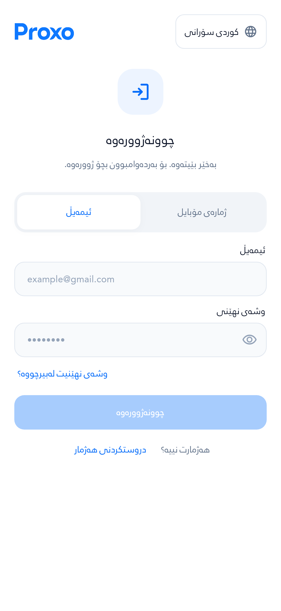 | 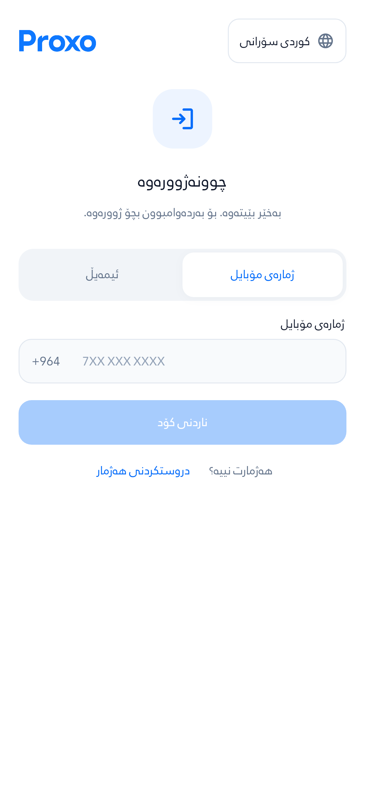 |

| دروستکردنی هەژمار: هەنگاوی یەکەم | پاراستنی هەژمار: هەنگاوی دووەم |
| --- | --- |
| 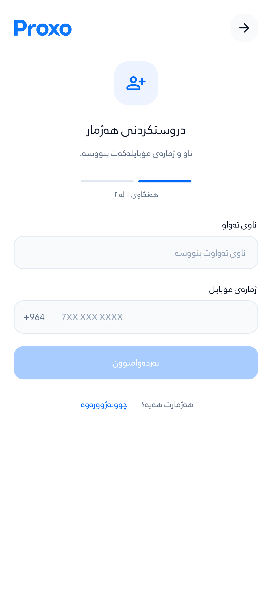 | 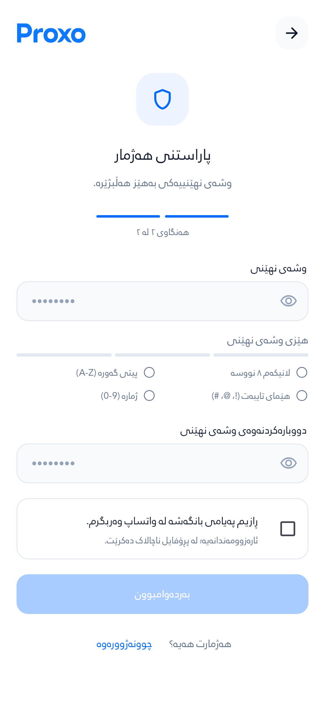 |

| گەڕاندنەوەی هەژمار | وشەی نهێنیی نوێ | کۆدی پشتڕاستکردنەوە |
| --- | --- | --- |
| 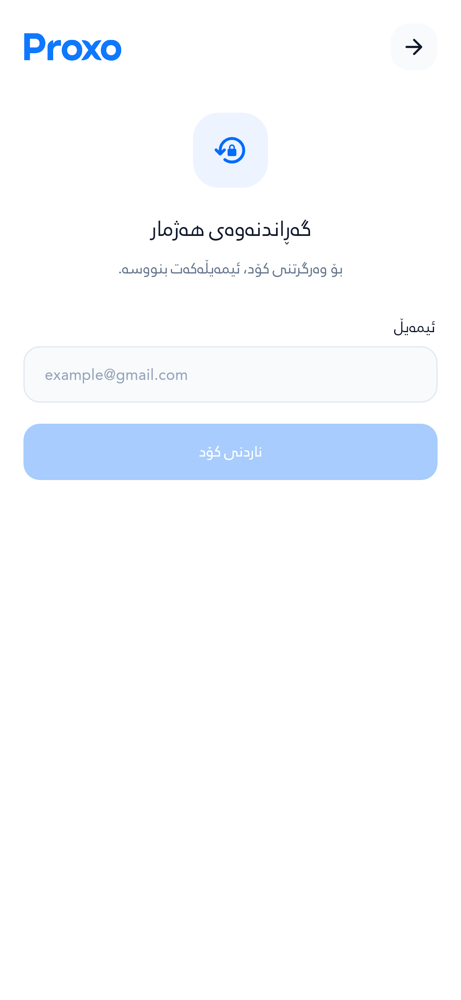 | 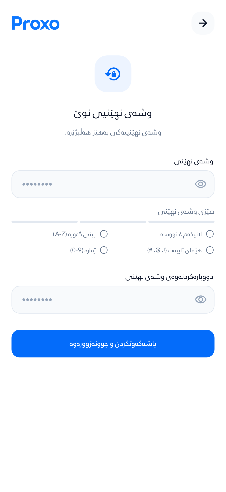 | 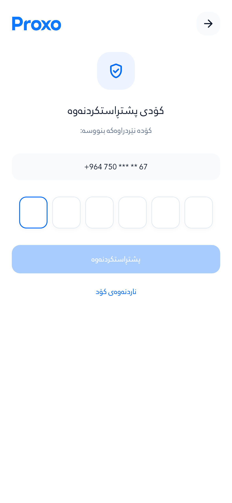 |

| بانەری یەک ڕیز | شاشەی ئەنجامەکان | دۆخی بەتاڵ |
| --- | --- | --- |
| 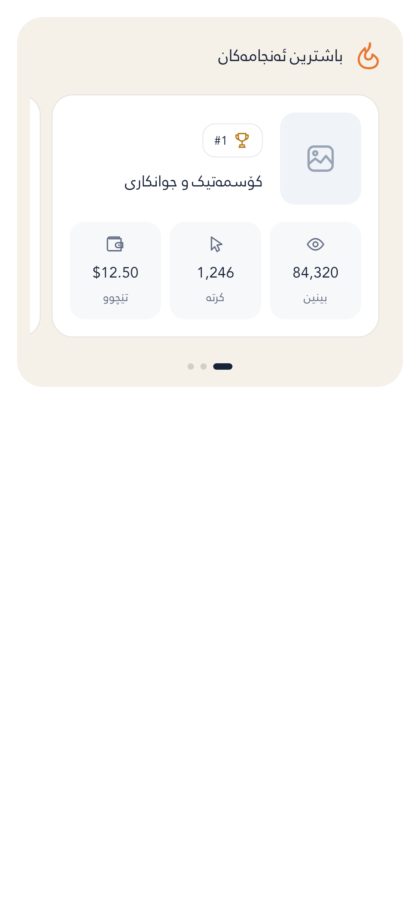 | 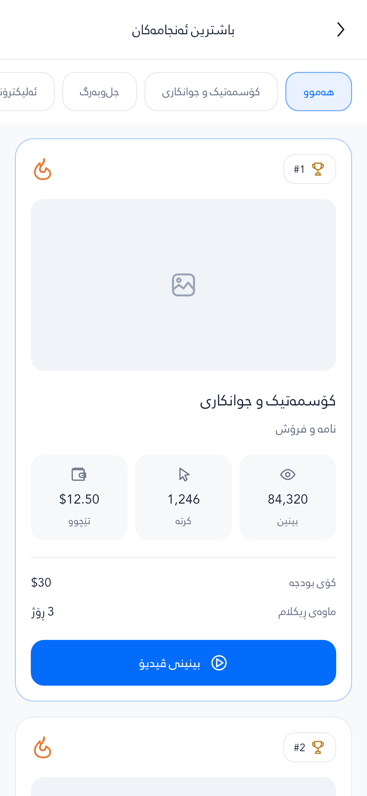 | 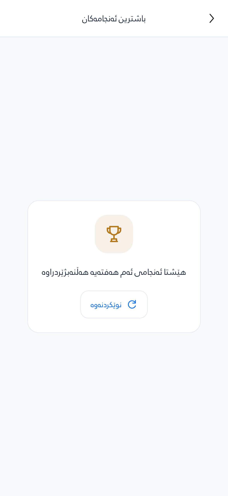 |

| ئامادەکردنی هەژمار | دووبارە هەوڵدانەوە |
| --- | --- |
| 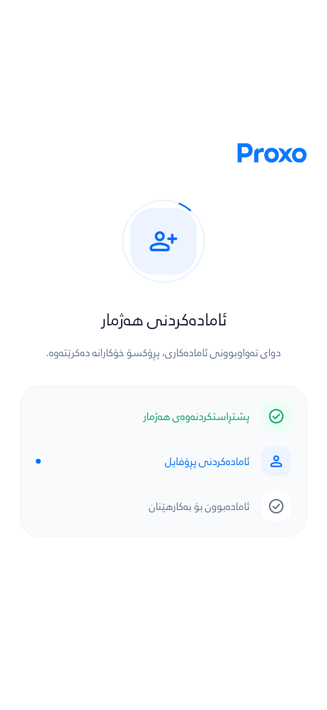 |  |

[هەنگاوی دووەمی هەژمار بە دەقی ٢٠٠٪](images/signup-security-large-text.png) · [خوارەوەی فۆڕمەکە](images/signup-security-large-text-bottom.png) · [OTP بە دەقی ٢٠٠٪](images/otp-large-text.png) · [بانەر بە دەقی ٢٠٠٪](images/results-banner-large-text.png) · [وردەکاری بە دەقی ٢٠٠٪](images/results-large-text.png)

## Engineering notes

- One immutable 10-minute in-memory data snapshot serves Home and Results. Simultaneous reads coalesce; refresh bypasses the TTL. Monday rollover uses Baghdad time, and late invalidated requests cannot overwrite newer snapshots. All selected records are paginated in stable rank order.
- Thumbnails share one decoded-image key across both screens (640 px decode width), plus a mobile file cache with at most 120 objects and a 14-day unused-file retention window. HTTP freshness rules still apply. Only the next thumbnail is prefetched. Flutter/OS memory pressure may evict decoded images; web file persistence differs from native platforms.
- The single carousel advances forward every five seconds with a 700 ms easing curve. Touch, dragging, background lifecycle, hidden routes and offscreen scrolling suspend autoplay. Reduced-motion/accessibility navigation disables autoplay. Timers and controllers are disposed with the section.
- Cards build lazily; they retain model/image caches rather than retaining every offscreen widget. Results use the shared app bar, native scroll physics, a lazy anchored list for the tapped rank and an external video action with a recoverable failure message.
- The Auth pill/form transition takes 260 ms; Auth steps take 180 ms. Reduced motion removes these transitions. Signup identity validation precedes security; optional WhatsApp consent remains off by default.

## Verification

Source: `ebb3cbca5ae285baf0834b63e1085675c45d9534`. [Isolated verification run](https://github.com/Zana-Sponsor/proxobalance/actions/runs/39083190517). **785/785 Flutter tests passed**; database replay, permissions, rollback, retry and concurrency checks passed. Dart analysis reported no errors and 367 nonfatal warnings/information across the application. The dependency lockfile was unchanged.

The reviewed captures cover **72 Auth/setup/Results scenarios** in Sorani, Arabic and Badini at 393 dp / 100% and 280 dp / 200% text. The 94 measured layouts (including scrolled views) contain **1293 nonempty text paragraphs**, all RabarAuthRegular weight 400, with no maximum-line overflow or captured layout exceptions. Home responsive tests additionally cover 240–1280 dp and text scales through 300%.

Behavior checks cover staged signup validation/back navigation, interpolated channel selection, rapid switching, touch pause/resume, forward carousel cycling, background/reduced-motion behavior, cache coalescing/TTL/refresh/week rollover/invalidation/pagination, tapped-rank anchoring and empty-state refresh. Original PNGs and their hashes are recorded in [evidence.json](evidence.json).

These are isolated source/fixture checks. The runner blocks instance metadata, has read-only repository permissions and no application secrets. No live OTP, external video-provider session, production migration or merge was performed. The final documentation commit adds only this evidence and gallery links. Earlier setup/telemetry/financial rollout requirements remain documented in [the setup review](../auth-setup-refresh-2026-10-17).

[Google Auth SVG provenance](../../proxo_app/assets/icons/auth/sources.json) · [original Results SVGs](../../proxo_app/assets/icons/results) · [Rabar font provenance](../../proxo_app/assets/fonts/Rabar_022.source.txt)

