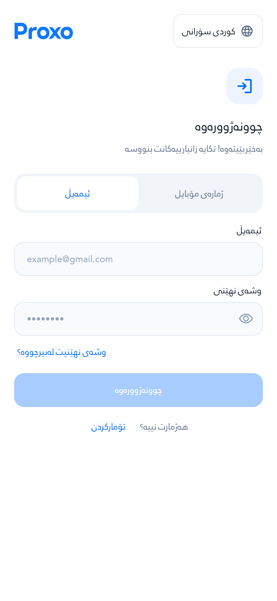
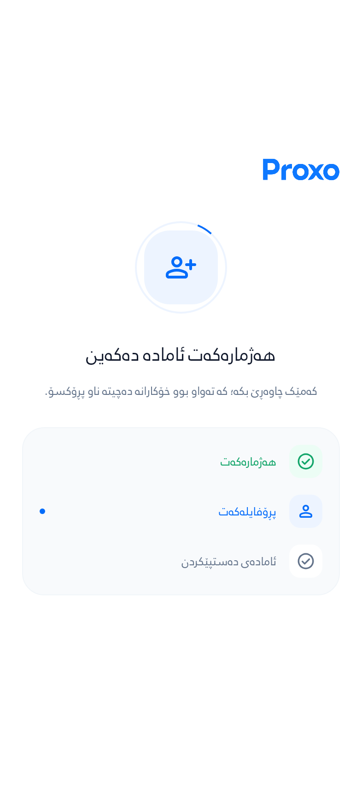
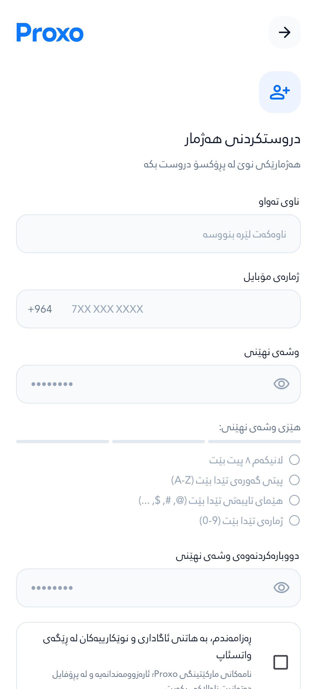

# Auth, account setup and private activity — 17 October 2026

**Latest Auth screenshots:** [Formal Sorani copy and responsive password guidance](../auth-sorani-polish/README.md). The captures and test counts below preserve the earlier verification checkpoint.

This work completes the source and verification work on `feat/secure-operations-telemetry-20261016`, stacked on the still-unmerged Proxo app branch in PR #7. It does not assert that the three migrations or this app version are deployed.

## Delivered behavior

- Auth uses the unmodified **Rabar_022 Regular** face (OS/2 weight 400). The previous Rabar_021 file has bold outlines even when registered at weight 400. Other app and receipt fonts are preserved.
- Login, signup, OTP and password recovery share spacing, lighter typography and locally bundled official Google Material Symbols SVGs. No runtime icon download is required. Source hashes and the Apache 2.0 icon license accompany the assets.
- Auth Back follows internal history, dismisses the keyboard, and returns each screen to its heading. Transitions take 180 ms; reduced motion replaces the view immediately. Outgoing views cannot receive taps or duplicate accessibility announcements.
- Account setup shows actual verification/profile/readiness phases. The app opens only after authenticated provisioning and successful reads of the user's profile, wallet, points and coins. Failure offers retry without creating another Auth account. Restarts revalidate the same account.
- Activity records stable section codes, event order within a run, bounded diagnostics, foreground presence and coarse device metadata. Back navigation and dialogs preserve the visible section. Late requests from an old account cannot enter the new account's log. Server validation rejects raw route paths.
- Per-user activity and aggregate reports are administrator-only RPCs. No diagnostic table is directly readable by ordinary clients. Existing financial idempotency, ledger, top-up, refund and outbox work remains covered by the isolated database suite.

## Verification

The isolated workflow blocks cloud instance metadata, uses no application secrets, and has read-only GitHub permissions. It applies the migrations twice to a synthetic PostgreSQL 17 fixture, checks permissions/rollback/retries and concurrent financial operations, analyzes Dart, and runs the full Flutter suite.

**Verified source:** `2a960fd78f8e230edb054af368a50c584c350192` — [run 39078941825](https://github.com/Zana-Sponsor/proxobalance/actions/runs/39078941825). Both database and Flutter jobs passed. **739/739 Flutter tests passed.** Analysis had no errors; 361 nonfatal warnings and information remain in the broader application. The dependency lockfile was unchanged.

The final screenshots cover **36 Auth/setup scenarios** with no captured layout exceptions. All **495 measured nonempty text paragraphs** use `RabarAuthRegular` at weight 400. The artifact ZIP SHA-256 is `2ec563cd69813a5b1d356b089d84d7c930805499bba954e0bed58a01d4c79a04`; selected original PNGs and their hashes are preserved in `evidence.json`.

Earlier failure history: first refresh run: [39078215552](https://github.com/Zana-Sponsor/proxobalance/actions/runs/39078215552). Database passed; 735 Flutter tests passed and two failed. Both failures were investigated: reduced-motion AnimatedSize invalidated layout, and the setup retry test tapped below the viewport. The code now removes animation controllers for reduced motion; the retry test scrolls to the real button. The second run additionally exposed lifecycle flush completion and a button cooldown timer surviving disposal. The final source drains queued lifecycle reports before resolving flush and cancels cooldown timers in dispose. All assertions remain enabled and pass in the final run.

Visual evidence uses actual widgets with a fictional HTTP backend: Sorani, Arabic and Badini; 393 dp normal text and 280 dp text at 200%. It includes login, signup, recovery, OTP, setup progress and retry states. No messages, OTP sends or payments are made by these tests.


## Actual screen captures

The images below are untouched captures from the verified source, using fictional test data.

| Login | Account setup |
| --- | --- |
|  |  |

| Signup | OTP |
| --- | --- |
|  |  |

[Signup after scrolling](images/signup-ckb-bottom.png) · [Setup retry](images/setup-retry-ckb.png) · [Arabic password recovery](images/recovery-ar.png)

## Reading activity after rollout

Use an authenticated administrator session with the normal client key:

```dart
final activity = await supabase.rpc('pa_admin_user_activity', params: {
  'p_user_id': selectedUserId,
  'p_limit': 50,
});
final report = await supabase.rpc('pa_admin_app_report', params: {'p_days': 30});
```

`devices` includes `active`, `last_seen_at` and `last_reported_section`. Events include `run_id`, `ordinal`, `section`, `kind`, `code` and server `received_at`. Limits are bounded and truncation is explicit. These are best-effort client diagnostics, not authoritative financial records or proof of exact offline activity. Presence expires after 90 seconds without a foreground report and also checks the Auth session. Raw events retain 30 days; daily aggregates and audit events retain 365 days. The migration schedules daily pruning when pg_cron is installed.

## Production rollout remains separate

A read-only preflight of the app project on 17 October found zero invalid wallet values, zero duplicate paid gateway keys, and pg_cron installed. It also found **31 wallet values requiring six-decimal conversion**. The finance schema, setup RPC and telemetry RPC were absent. No production migration or balance update was performed.

The pending migrations must be reviewed and rolled out in order (`20261016174350`, `20261016174352`, `20261016174355`) with the app and administrator clients. The first migration changes wallet precision and revokes legacy financial write paths; existing deployed clients must be accounted for. Keep the conversion snapshot and reconcile before/after totals. The outbox is a durable manual/integration queue; configuring an external ad provider worker is a separate integration and is not claimed here.

PR #7's unrelated release/native-renderer requirements are not satisfied by Auth widget captures. Do not present this branch as a released app or merge that larger branch solely on the strength of these checks.
