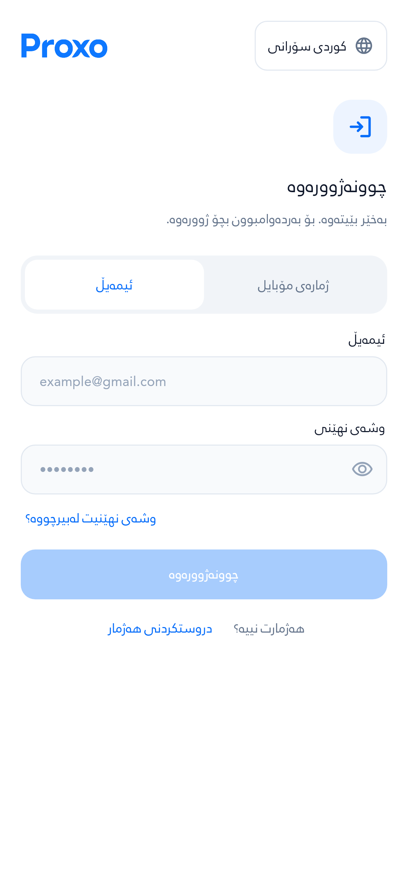
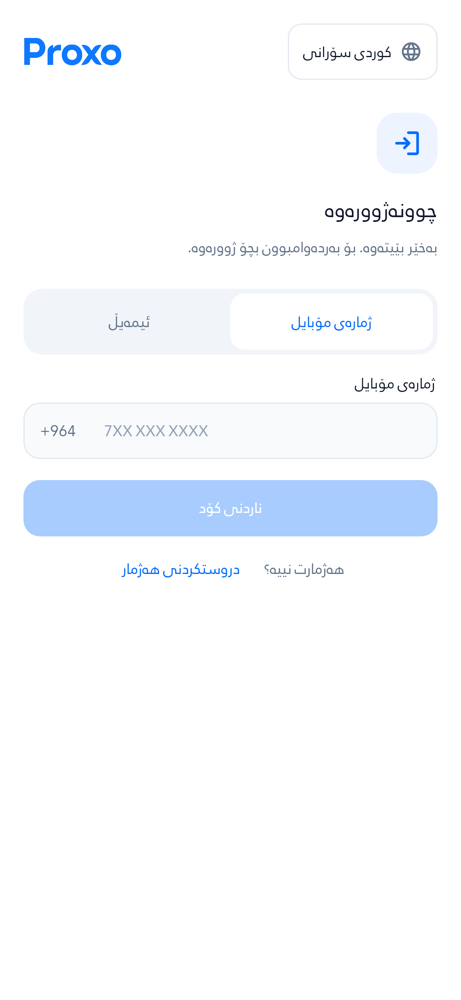
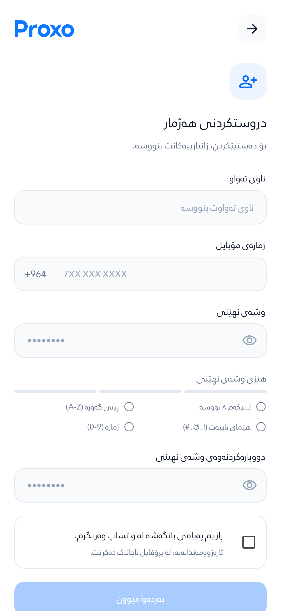
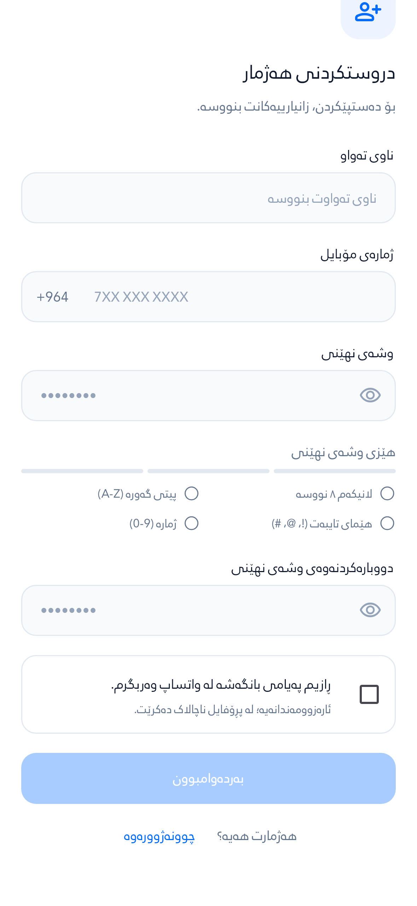
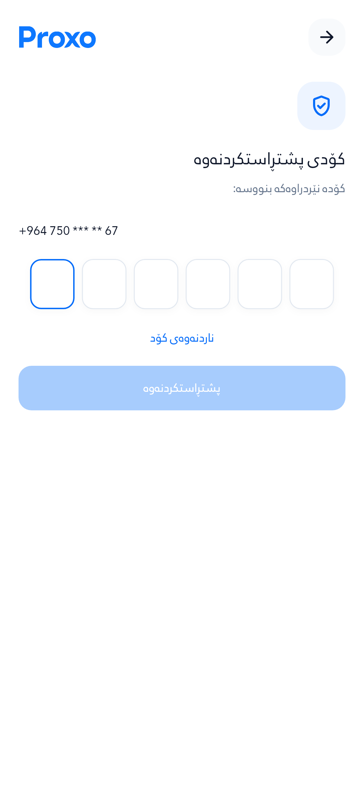
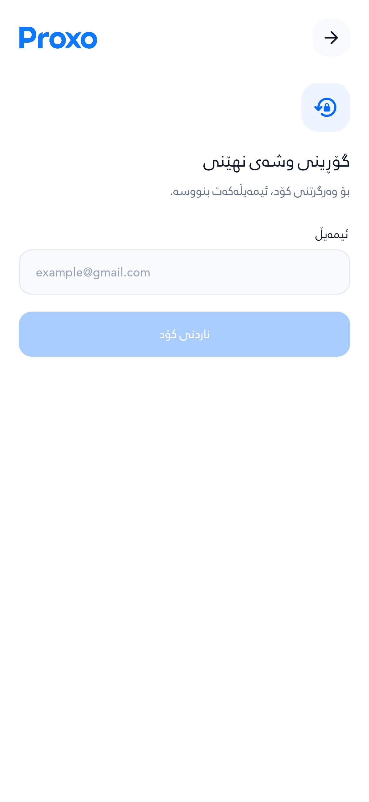
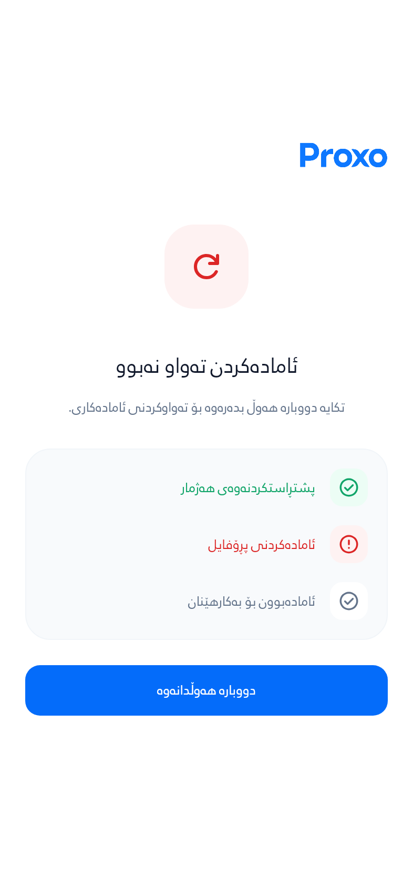

# شاشەکانی Auth — دەقی کوردیی فەرمی

[نوێترین دیزاین و سکرینشۆتەکان: Auth و باشترین ئەنجامەکان](../auth-results-redesign)

دەقی شاشەکانی چوونەژوورەوە، دروستکردنی هەژمار، پشتڕاستکردنەوە و ئامادەکردنی هەژمار پێداچوونەوەی بۆ کراوە. دەقەکان کورت و ڕوون کراونەتەوە و ناونانی دوگمەکان یەکسان کراوە.

فۆنتی **Rabar Regular** بە کێشی ٤٠٠ و ئایکۆنەکانی **Google Material Symbols Rounded** بە شێوەی SVG بەکار هاتوون. مەرجەکانی وشەی نهێنی لە شاشەی ئاساییدا بە دوو ستوون پیشان دەدرێن؛ لە شاشەی بچووک یان بە دەقی گەورە، دەبنە یەک ستوون. هەموو مەرجەکان بەردەوام دیارن. بۆشایی نێوان بەشەکان و قەبارەی دەقی یارمەتیدەر ڕێک خراون.

ئەم وێنانە لە ویدجێتە ڕاستەقینەکانی ئەپەکە و بە زانیاریی تاقیکردنەوە گیراون؛ مۆکاپ نین. وێنەکانی تۆمارکردن لە دوو شوێنی سکرۆڵەوە گیراون بۆ ئەوەی هەموو فۆڕمەکە ببینرێت.

| چوونەژوورەوە بە ئیمەیڵ | چوونەژوورەوە بە مۆبایل |
| --- | --- |
|  |  |

| دروستکردنی هەژمار | بەشی خوارەوەی فۆڕم |
| --- | --- |
|  |  |

| کۆدی پشتڕاستکردنەوە | گۆڕینی وشەی نهێنی |
| --- | --- |
|  |  |

| ئامادەکردنی هەژمار | دووبارە هەوڵدانەوە |
| --- | --- |
|  |  |

[تۆمارکردن لە شاشەی بچووک و بە دەقی ٢٠٠٪](images/signup-ckb-large-text.png) · [بەشی خوارەوە بە دەقی ٢٠٠٪](images/signup-ckb-large-text-bottom.png)

## Verification

Source: `c4666bd92a068ab2fc68ddae7166723f1f931f3d`. [Isolated verification run](https://github.com/Zana-Sponsor/proxobalance/actions/runs/39080312206). The runner blocks cloud instance metadata, has read-only repository permissions and uses fictional backend data without application secrets. Captures do not send OTPs or make payments.

**745/745 Flutter tests passed.** Database replay, permissions, rollback, retry and concurrency checks passed. Dart analysis had no errors; 361 existing nonfatal warnings/information remain in the broader application. The dependency lockfile was unchanged.

The captures cover **42 Auth/setup scenarios** across Sorani, Arabic and Badini, at 393 dp with normal text and 280 dp with 200% text. All **583 measured nonempty text paragraphs** use `RabarAuthRegular` at weight 400. No layout exceptions or text exceeding its maximum lines were captured. Visual review also checked the LTR order of `A-Z` and `0-9` inside the RTL password guidance.

The original PNG hashes, artifact provenance and measured layout summary are recorded in [evidence.json](evidence.json). Google SVG source URLs and the Apache 2.0 license are bundled in [the Auth icon directory](../../proxo_app/assets/icons/auth); the font provenance is in [Rabar_022.source.txt](../../proxo_app/assets/fonts/Rabar_022.source.txt).

These screenshots demonstrate the reviewed source UI. Production migration, deployment and real-device OTP verification remain separate; see [rollout notes](../auth-setup-refresh-2026-10-17/README.md#production-rollout-remains-separate).
