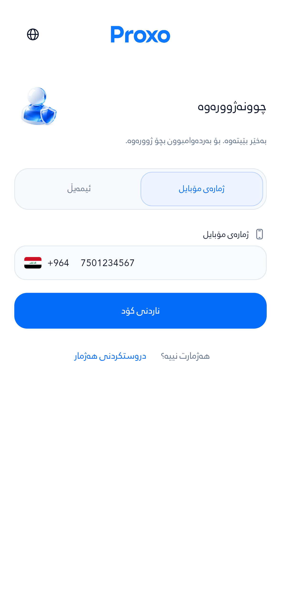
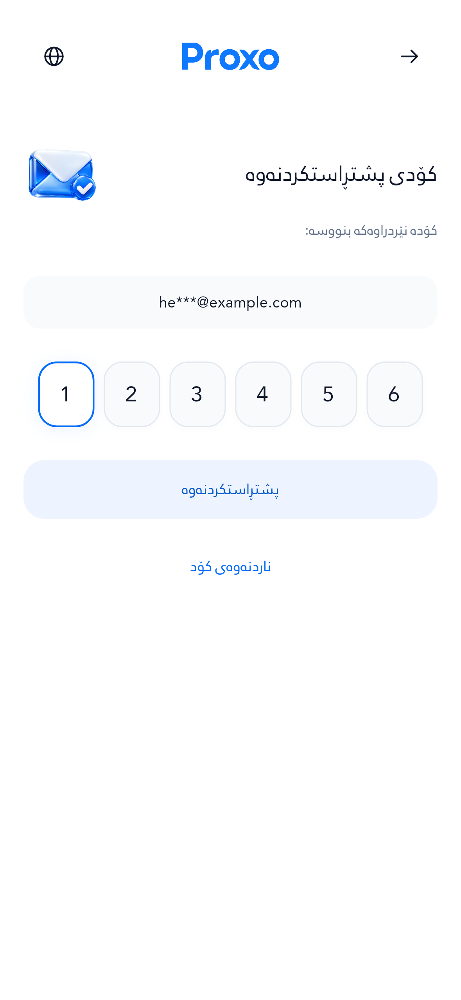
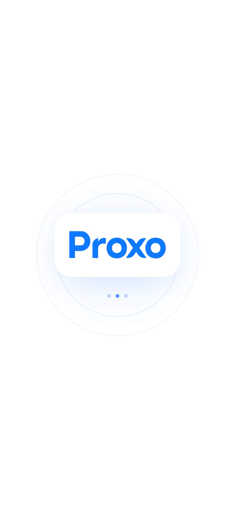
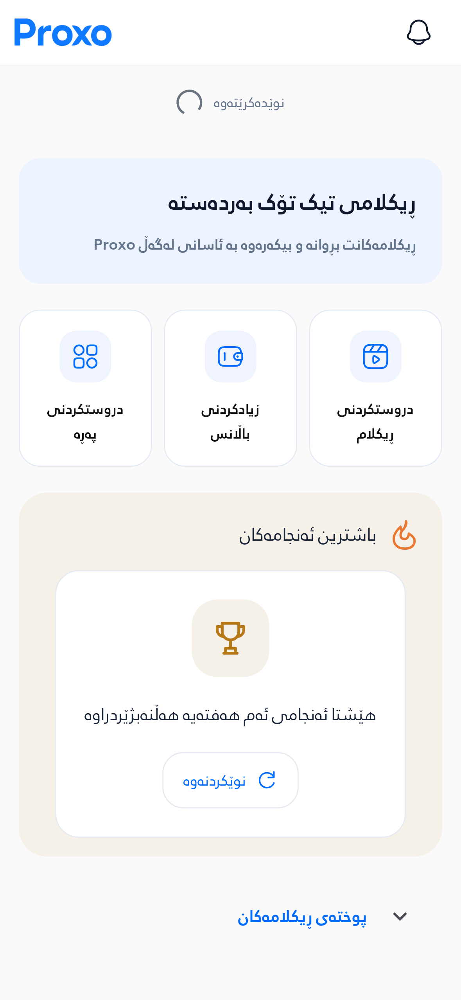

# Proxo — Auth and interface polish

**نوێکردنەوەی ٢٠٢٦-١٠-١٩:** وێنەی نمونە بووە سکرینشۆتی ڕاستەقینە، هەڵبژاردنی ستایل چاک کرا و فۆتەری هەموو ١٢ شێوە بە ٩٦ حاڵەت پشکنرا. [٧٢ وێنە، ئەنجامە نوێکان و APK](../evidence/proxolink-examples-2026-10-19/README.md). ژمارە و APK ـەکانی خوارەوە بەڵگەی وەشانی پێشوون.

فۆڕمی دروستکردنی هەژمار یەک بەشە و OTP لە شاشەی جیاوازە. ئایکۆنی 3D، AppBar ـی هاوسەنگ، دوگمەی نەرم، ئاڵای عێراق، سپڵاش و گواستنەوەی ئەنیمەیشن زیاد کراون. چوونەژوورەوەی هەژماری پێشوو پێویستی بە ئامادەکردنی پڕۆفایل نییە.

## Changes

- Returning email/phone logins, restored sessions and named routes use a session-only `AuthenticatedGate`. Only signup retains provisioning. Database access still uses the signed-in user's RLS policies.
- Locally bundled 3D glass/porcelain artwork replaces the Auth intro tiles. Toolbar and field glyphs stay compact. The AppBar has 40 dp breathing room below it.
- Name, email, password and confirmation stay together, without numbered steps; OTP is separate. Email/phone forms fade sequentially, so fields never overlap. The selected channel moves across a pale track and values persist when switching back.
- Shared Material button themes and custom CTA tokens use soft 18 dp corners, including Auth, profile, ad, results, ProxoLink, deposit, receipt and error actions. Auth fields and OTP cells use 16 dp corners. Reward and voucher claim controls now have at least 48 dp height; measured voucher controls grow to 67/59 dp with 2× text.
- OTP digits align horizontally and vertically without an invisible caret reserving width. Arabic-Indic and Eastern Arabic digits normalize to ASCII for typing and paste. The Iraq flag and +964 remain visible while typing.
- Routes animate for 320 ms; tabs have a 280 ms arrival while retaining scroll/form state and muting hidden tickers. Reduced-motion settings are respected.
- The shared refresh strip shows **نوێدەکرێتەوە** beside its spinner, with Arabic/Badini translations and space for large text.
- Native launch colors and the Flutter splash are aligned. The splash adds a blue halo and rounded brand surface.
- Background/terminated Android notification messages use the compact monochrome Proxo P mark and blue tint. Foreground and data-only messages also show the Proxo wordmark as their large icon. Removed the generic Firebase service declaration that competed with the Flutter messaging service.
- Fixed visible data-only pushes being dropped in the foreground and local-notification taps losing their destination after a terminated launch. Silent data updates remain silent.
- Auth text links now have a minimum 44 × 44 dp touch area. Rapid Auth swaps retain the latest form, and repeated submit taps share one pending operation.
- Ad video links and Create Page now have immediate local **بینینی نمونە** dialogs. Page examples match contact/order/download. **بینینی فێرکاری** resolves the admin's HTTPS video URL from Supabase only when tapped. [Configuration and screenshots](form-help.md).

## Actual screen captures

Production Flutter widgets with bundled fonts and fictional offline fixtures. The icon artwork was generated; these screenshots are rendered from the app implementation.

| Email login | Phone entry |
|---|---|
|  |  |

| Single signup form | Separate OTP |
|---|---|
|  |  |

| Splash | Refresh in progress |
|---|---|
|  |  |

[گۆڕانکاریەکان و وێنەی هەر بەش](changes-and-images.md) · [Full 150-case gallery with other app sections and scroll-bottom captures](screenshots.md) · [40 Android captures](native/native-runtime-gallery.md)

## Measurements

Flutter logical pixels. Text follows system accessibility scaling. At 280 dp / 2× text, long forms scroll and phone digits can scroll horizontally within the input.

| Component | Specification |
|---|---|
| Page gutters / maximum form width | 20 each side / 440 |
| AppBar / wordmark | 56 high / 84 × 24 |
| Back and language touch areas | 48 × 48 |
| AppBar → intro / intro → form | 40 / 28 |
| 3D intro artwork | 64 × 64; decoded at 256 px |
| Heading / labels / input and button text | 20 / 13 / 14 |
| Auth font | RabarAuthRegular, weight 400 |
| Input height / radius | Minimum 48 / 16 |
| Primary button height / radius | Minimum 50 / 18 |
| OTP cell / radius / gap | 48 × 56 / 16 / 8; 3 columns on narrow screens |
| Phone flag | 24 × 16, 8 dp from +964 |
| Refresh spinner / normal reveal | 22 / 60 |
| Android notification small icon | White-alpha P on a 24 dp canvas |

Actual Sorani signup at 393 × 852 dp (DPR 3):

| Element | Left | Top | Width | Height |
|---|---:|---:|---:|---:|
| AppBar | 20 | 20 | 353 | 56 |
| Wordmark | 154.5 | 36 | 84 | 24 |
| Title | 100 | 133 | 273 | 30 |
| 3D artwork | 20 | 116 | 64 | 64 |
| Name | 20 | 261 | 353 | 48 |
| Email | 20 | 351 | 353 | 48 |
| Password | 20 | 441 | 353 | 48 |
| Confirmation | 20 | 633 | 353 | 48 |
| Submit | 20 | 697 | 353 | 50 |

[CSV geometry](measurements.csv) · [Component bounds](component-bounds.json) · [Full measurements](measurements.json.gz) · [OTP ink centers](otp-ink-centers.json) · [Hashes and counts](evidence.json)

## Verification and remaining deployment work

- **78 focused behavior tests passed**, covering the configured custom email API, invalid OTP, confirmation failure, resend/retry, field retention, phone normalization, OTP lifecycle, returning-user entry, refresh coalescing, tab state, reduced-motion splash and signup provisioning. [Email route audit](email-signup.md).
- **880 tests passed in the complete Flutter suite**, including the existing behavior, security, lifecycle, validation and visual regressions. [Complete log](full-suite.log).
- **13 OTP lifecycle tests passed**, including five added localized-digit typing/paste/rebuild cases. [Log](otp-localized-digits.log).
- **150 app visual cases passed:** 25 views/states × 3 languages × 2 viewport/text settings. **200 screenshots**, **10,812 measured RenderObjects**, **zero rendering exceptions**. A further **24 example-dialog captures** cover video links and all three page types at both sizes in all three languages.
- No Auth text exceeds its maximum line count. Eighteen existing truncations remain in narrow notification summaries, an ad identifier and a task title; the report records them.
- Corrected email API/AuthShell/native-harness analyzer: zero errors, 3 pre-existing Auth warnings, 23 informational lints. [Current log](email-api-analyze.log).
- Added help, notification and Android profile-harness analyzer: zero errors, zero warnings; 11 informational lints. [Log](added-analyze.log).
- Latest OTP, reward/voucher and native-harness analyzer: zero errors, zero warnings, 34 informational lints. [Log](last-changes-analyze.log).
- The 224 images above are headless Flutter captures. Android captures are documented separately below. No live account, OTP, remote push message or payment was created.
- **Email uses the configured custom API:** signup and resend now call `email.proxopages.com/webhook/send_otp`; verification uses the existing user-bound RPCs before sign-in. Supabase still stores identities/sessions. Provider settings were preserved. The previous Supabase-email-template requirement was incorrect and has been removed. [Routes, tests and live-delivery limits](email-signup.md).
- **Push server branding deployed:** live `send-notification` is now version 5, with `icon: ic_notification` and `color: #046CFA`. Its JWT requirement and all other behavior were preserved; the retrieved deployment matches the repository source. `send-push-notification` is not deployed in this project and was only updated in the repository. No live notification was sent. Android heads-up and expanded shade appearance were verified with the actual Firebase builder on an emulator; FCM transport and other OEM renderers remain unverified.
- The workflow builds and retains `proxo-release-apk`. Without a configured release keystore it uses the repository's debug-signing fallback, so this is a test APK.
- `Proxo Android polish runtime` runs production screens in Android profile mode with fictional read-only fixtures, records frame timing and control dimensions, and captures the real Android background-notification surface using Firebase's automatic-notification builder. Its screenshots and timing are retained as `proxo-polish-android-runtime`. The fixture bypasses FCM network transport and does not certify physical-device performance. Profile hooks are excluded from release builds.

[Visual log](capture.log) · [Behavior log](behavior.log) · [Analyzer log](analyze.log) · [OTP recapture](otp-centering.log)

## Reproduce

Flutter 3.47.2 / Dart 3.13.2 with locked dependencies:

```sh
cd proxo_app
export FLUTTER_SUPPRESS_ANALYTICS=true DART_SUPPRESS_ANALYTICS=true
flutter --suppress-analytics pub get
flutter --suppress-analytics test --no-pub test/auth_refresh_test.dart test/auth_email_signup_test.dart test/auth_phone_flow_test.dart test/auth_otp_lifecycle_test.dart test/proxo_tab_stack_test.dart test/account_setup_test.dart test/whatsapp_marketing_test.dart test/proxo_polish_test.dart
flutter --suppress-analytics test --no-pub test/polish_capture_test.dart --reporter expanded
flutter --suppress-analytics test --no-pub --reporter expanded
```

Android notification reference: https://firebase.google.com/docs/cloud-messaging/android/receive-messages

[Artwork provenance](../../proxo_app/assets/icons/auth/SOURCES.md) · [ڕاپۆرتی ورد بە سۆرانی](review-ckb.md)

## Android runtime and corrected APK

[Android profile run 39183672140](https://github.com/Zana-Sponsor/proxobalance/actions/runs/39183672140) passed **36 screen/action cases**, retaining **40 Android captures** and **1,023 measured engine frames**, with zero captured layout exceptions. The real keyboard leaves the focused email field 25.364 dp above its visible boundary. Actual Android text entry retains the phone digits beside Iraq/+964. Both the background heads-up and expanded notification shade show the Proxo P logo.

Build mean/p90/p99: **1.329 / 3.017 / 10.026 ms**. Raster mean/p90/p99 on the software GPU: **36.255 / 66.605 / 119.139 ms**. These do not establish 60 fps or physical-device smoothness. The native splash capture has a blank wordmark; the completed splash is verified in the headless gallery, and the native capture limitation is retained rather than presented as a successful logo capture. [Full report, original images, exact percentile method and limits](native/README.md).

Together, the report publishes **264 screenshots**: 200 app, 24 help-dialog and 40 native Android captures.

The corrected APK was built from `65021db17ef8ea496ba21fa1971b583cb3c956f2` in [Verify run 39183672135](https://github.com/Zana-Sponsor/proxobalance/actions/runs/39183672135). All five jobs passed: **880 Flutter tests**, **179 backend tests**, **480 responsive browser cases**, **7 database API lifecycles**, and Edge Function checks. The PR merge tree exactly matches the source tree. [CI record](ci-verification.json).

- Package `com.proxo.proxoapp`, version `1.0.9+9`, Android API 24 minimum / 36 target; ARM64, ARMv7 and x86-64.
- 93,016,988 bytes; SHA-256 `cc8cb4eb0114240f11a30d4559f5defd9f4b61c1deca7109e24b6d9de0dab900`.
- APK v2 signature verified; Android Debug certificate. This is an installable **test build**, not a production-signing release. Its generated certificate differs from the earlier test artifact, so Android cannot apply it as an in-place update over an installation with that different certificate.
- All seven bundled image assets match repository bytes. Profile-only test hooks are absent from release DEX.
- Compiled notification vector: white 24 dp Proxo P; tint `#046CFA`; channel `proxo_high_importance`.
- Artifact ZIP digest, certificate digest and asset hashes: [apk-verification.json](apk-verification.json).
