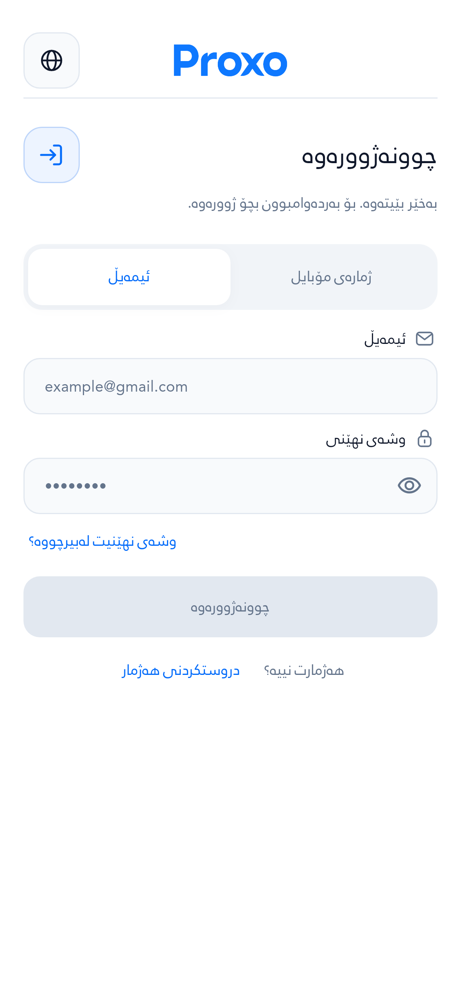
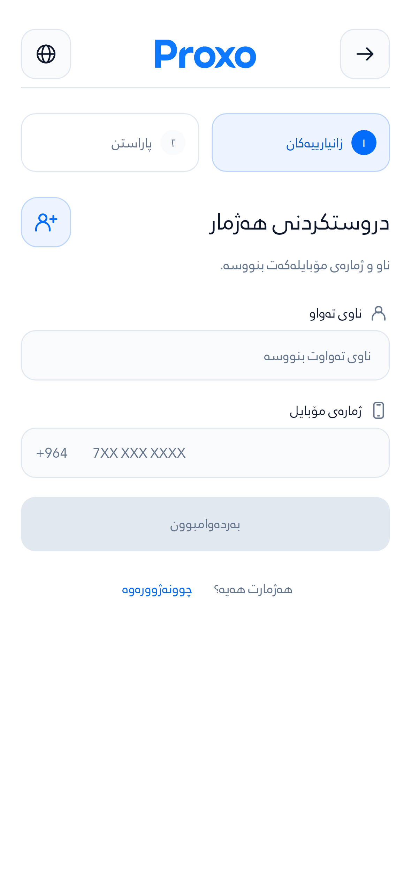
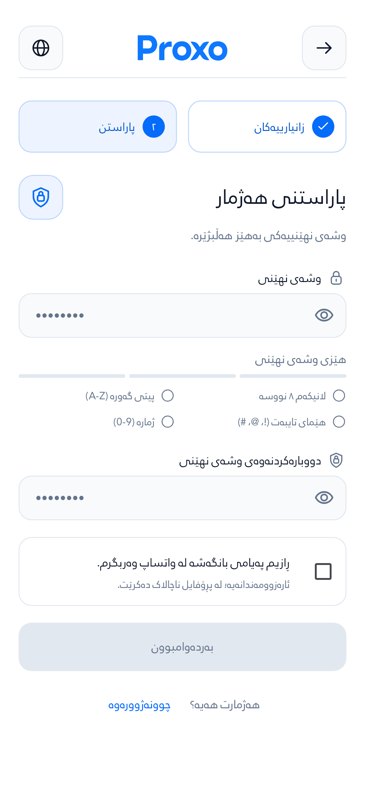
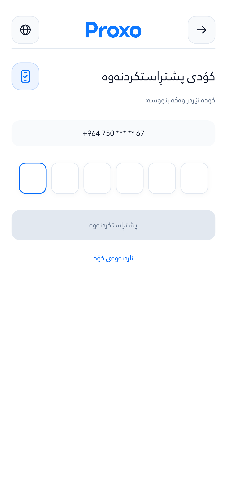
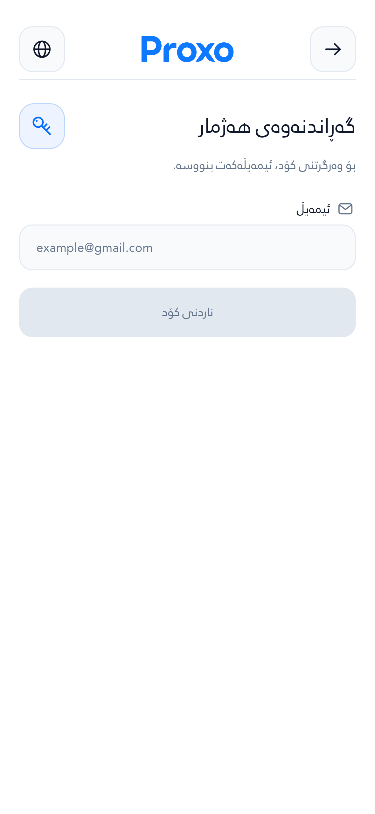
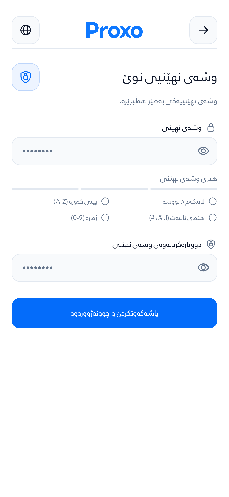

# دیزاینی نوێی Auth — Proxo

AppBar، سەردێڕ، ئایکۆن و نیشاندەری هەنگاوەکانی دروستکردنی هەژمار نوێ کرانەوە. لۆگۆ لە ناوەڕاستە، گەڕانەوە و گۆڕینی زمان دوگمەی جیاوازیان هەیە، و دوو هەنگاوی تۆمارکردن بە ناو و ژمارە دیارن.

The redesign builds on the active Auth work in `feat/secure-operations-telemetry-20261016` at `b86c93466fa993d93934fb72c5999761782fdbb1`. It keeps the existing identity → security → verification flow, validation, OTP destinations and marketing-consent behavior.

## دیزاینە نوێیەکان / Screenshots

These are captures of the production Flutter widgets, with the bundled fonts and an offline fixture backend. They are not image mockups or Android-device captures. Fixture data is fictional; capture does not submit authentication, OTP or payment requests.

| چوونەژوورەوە | دروستکردنی هەژمار |
|---|---|
|  |  |

| پاراستنی هەژمار | کۆدی پشتڕاستکردنەوە |
|---|---|
|  |  |

| گەڕاندنەوەی هەژمار | وشەی نهێنیی نوێ |
|---|---|
|  |  |

[هەموو سکرینشۆتەکان / All 42 capture cases and scroll-bottom views](screenshots.md)

## پێوانەکان / Design specifications

Dimensions are Flutter logical pixels (dp); text sizes below are the unscaled sizes. Controls and text grow with accessibility settings. The fixed toolbar, logo, icon artwork and numbered progress markers retain their visual size.

| Component | Specification |
|---|---|
| Page gutter | 20 dp per side |
| Form maximum width | 440 dp, centered on wider screens |
| AppBar | 64 dp, 1 dp lower divider |
| Logo | 98 × 28 dp, centered between equal action slots |
| Back / language target | 48 × 48 dp minimum, radius 14 dp |
| Intro icon tile | 48 × 48 dp, radius 16 dp |
| Intro / toolbar / label glyph | 24 / 22 / 18 dp |
| Outline icon grid | 24 × 24, stroke 1.7, rounded caps and joins |
| Page heading | RabarAuthRegular, 24 dp, weight 400, line height 1.5 |
| Supporting text | RabarAuthRegular, 14 dp, weight 400, line height 1.6 |
| Field text and labels | 14 dp, weight 400, line height 1.5 |
| Form field radius | 14 dp |
| Primary button | 52 dp minimum height, radius 14 dp |
| Progress item | 56 dp minimum height, 12 dp padding, radius 14 dp |
| Progress marker | 24 dp circle; number 12 dp; completed check 16 dp |
| Horizontal progress gap | 12 dp; stacked gap 8 dp |
| AppBar → content / intro → form | 24 / 24 dp |
| Title → subtitle / label → field | 6 / 6 dp |
| Between fields | 18 dp |

The intro stacks its icon when available content width is below 260 dp or 14 dp text scales above 18 dp. The progress items stack below 270 dp or the same text-scale threshold. Labels remain visible; the progress indicator is read-only and cannot bypass validation. Longer headings wrap; the existing whole-word fitting rule only reduces a heading if its longest word cannot fit.

| Token | Color |
|---|---|
| Page | `#FFFFFF` |
| Main text | `#0F172A` |
| Supporting text / placeholder | `#64748B` |
| Primary action | `#046CFA` |
| Active progress text | `#0759CE` |
| Active progress / icon surface | `#EDF4FF` |
| Active border | `#BDD5FA` |
| Field surface | `#F8FAFC` |
| Divider / neutral border | `#E2E8F0` |

## Implementation

- `AuthHeader`: one aligned toolbar with localized Back and language controls on every Auth step.
- `AuthIntro`: directional headline and a compact outlined icon beside it; the explanatory text gets the complete content width.
- `AuthSignupProgress`: descriptive identity/security steps with an explicit completed state and screen-reader announcements.
- `AuthTextField`: consistent outline icons beside labels, preserving the editable width and phone prefix.
- `AuthPrimaryButton`: a larger minimum target and readable inactive colors.
- New outline SVGs are original project artwork. Existing Google Material SVGs and their source/license records are unchanged.
- New progress labels are registered in the Sorani/Arabic/Badini catalog.

## Reproduce the visual capture

From `proxo_app`, with the repository's Flutter 3.47.2 SDK:

```bash
export FLUTTER_SUPPRESS_ANALYTICS=true
export DART_SUPPRESS_ANALYTICS=true
flutter --suppress-analytics pub get
flutter --suppress-analytics analyze --no-fatal-infos --no-fatal-warnings lib/widgets/auth lib/screens/auth test/auth_refresh_test.dart
flutter --suppress-analytics test test/auth_phone_flow_test.dart test/auth_otp_lifecycle_test.dart test/auth_refresh_test.dart --reporter expanded
flutter --suppress-analytics test test/polish_capture_test.dart --name '^(login|login-phone|signup|signup-security|forgot|new-password|otp) ' --reporter expanded
```

The existing `polish_capture_test.dart` harness writes actual RenderObject geometry beside each PNG in `build/polish-evidence`. The capture covers Sorani, Arabic and Badini at 393 dp / 1× text and 280 dp / 2× text, including the bottom of scrollable forms.

## پێوانەی ڕاستەقینە و ئەنجامی پشکنین / Measured results

- **42 visual cases passed:** 7 Auth views × 3 languages × 2 viewport/text-scale settings.
- **30 behavior tests passed:** phone normalization/readiness, OTP lifecycle/paste, Back navigation, validated signup stages, preserved fields after language switching, and setup states.
- **57 PNGs** include the lower part of scrollable forms.
- **2,298 RenderObjects** recorded with position, size, text style and image/decoration metadata.
- **0 rendering exceptions; 0 paragraphs exceeding their maximum line count.**
- Analyzer: **0 errors**, 3 existing warnings and 23 informational lints. The warnings are in unchanged AuthShell logic (one unnecessary cast; two visible-for-testing calls).

The standard Sorani signup screen was rendered at **393 × 852 dp**, **3× DPR** (1179 × 2556 physical pixels):

| Element | Left | Top | Width | Height |
|---|---:|---:|---:|---:|
| AppBar | 20 | 20 | 353 | 64 |
| Logo | 147.5 | 37.5 | 98 | 28 |
| Identity progress | 202.5 | 108 | 170.5 | 56 |
| Security progress | 20 | 108 | 170.5 | 56 |
| Page title | 84 | 194 | 289 | 36 |
| Intro icon tile | 20 | 188 | 48 | 48 |
| Name input | 20 | 315 | 353 | 48 |
| Phone input | 20 | 408 | 353 | 48 |

Both toolbar action targets were verified at **48 × 48 dp** after removing compact visual density; the 3 focused Back/language tests passed again ([log](toolbar-regression.log)).

Exact measurements for every captured state:

- [Measurements table — CSV](measurements.csv)
- [Main component bounds — JSON](component-bounds.json)
- [Complete RenderObject geometry — compressed JSON](measurements.json.gz)
- [Evidence, source hashes and screenshot hashes](evidence.json)
- [Visual-capture log](capture.log), [behavior log](behavior.log), [analyzer log](analyze.log)

This change is delivered on a separate review branch. It does not itself merge into `main`, publish a release or produce an Android APK/AAB.
