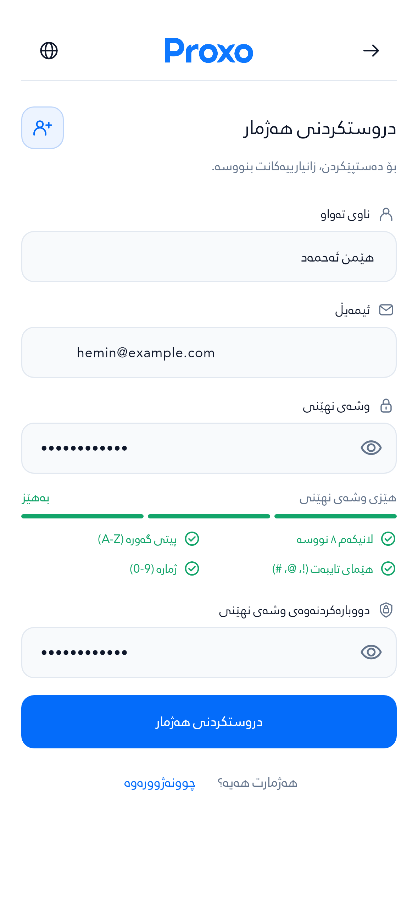

# دیزاینی نوێی Auth — Proxo

وەشانی دووەم: سەردێر و AppBar بچووکتر و هاوسەنگتر کراون. ناو، ئیمەیڵ، وشەی نهێنی و دووبارەکردنەوەی لە یەک فۆڕمدان؛ OTP شاشەیەکی جیاوازە. نیشاندەری هەنگاو و کارتەکانی دوو بەشی پێشوو لابراون.

**Email signup requires the Supabase email settings and code template described in [email signup rollout](email-signup.md) before release.** Live provider settings and email delivery were not changed or verified by this PR. The template and integration are included for review.

## پلان → پێوانە → گۆڕانکاری

1. Flatten registration into one continuous form, followed by its own verification screen. Preserve the input values when returning from OTP or changing language.
2. Reduce the toolbar, wordmark, heading and icons; use a consistent 20 dp page gutter and shared type/spacing tokens. Retain usable touch areas and natural text scaling.
3. Implement the form and native email signup boundary, then render the actual Flutter widgets in Sorani, Arabic and Badini at ordinary and enlarged text sizes.

## سکرینشۆتەکان / Screenshots

These are captures of production Flutter widgets with the bundled fonts, not generated mockups. Fictional fixture data is used. The filled signup is the same screen after typing, **not an additional form stage**.

| فۆڕمی دروستکردنی هەژمار | هەمان فۆڕم، پڕکراوە |
|---|---|
|  |  |

| چوونەژوورەوە | OTP ـی جیاواز |
|---|---|
|  |  |

| گەڕاندنەوەی هەژمار | وشەی نهێنیی نوێ |
|---|---|
|  |  |

[All capture cases, languages and scroll-bottom views](screenshots.md)

## پێوانەکان / Design specifications

All dimensions are Flutter logical pixels (dp). Type sizes follow the user's text scaling. The 280 dp, 2× text captures intentionally scroll; text is not clamped to fit the whole form into one viewport.

| Component | Previous revision | Current revision |
|---|---:|---:|
| AppBar height | 64 | 56 |
| Centered logo | 98 × 28 | 84 × 24 |
| Page heading | 24 | 20 |
| Supporting copy / field labels | 14 | 13 |
| Input / button text | 14 | 14 |
| Intro icon tile | 48 × 48, radius 16 | 40 × 40, radius 12 |
| Intro / toolbar / label glyphs | 24 / 22 / 18 | 20 / 20 / 16 |
| Field radius | 14 | 12 |
| Primary button | Minimum 52, radius 14 | Minimum 50, radius 12 |
| Between fields | 18 | 16 |
| Progress cards | Two, minimum 56 high | Removed |

| Shared rule | Measurement |
|---|---|
| Page gutter | 20 per side |
| Form maximum width | 440, centered on wider screens |
| Back / language hit area | 48 × 48, transparent surface |
| Input height | Minimum 48; expands with text |
| AppBar → intro / intro → form | 24 / 24 |
| Title → subtitle / label → field | 6 / 6 |
| Input padding | Horizontal 14, vertical 13 |
| Font | Bundled RabarAuthRegular, weight 400 |
| Heading / field line height | 1.5 |
| Supporting copy line height | 1.6 |
| Outline assets | 24 × 24 grid, 1.7 stroke, rounded caps and joins |

| Color role | Value |
|---|---|
| Background | `#FFFFFF` |
| Main text | `#0F172A` |
| Supporting text / placeholder | `#64748B` |
| Primary action | `#046CFA` |
| Accent ink / icon surface | `#0759CE` / `#EDF4FF` |
| Accent border | `#BDD5FA` |
| Field surface | `#F8FAFC` |
| Divider / field border | `#E2E8F0` |

## پێوانەی ڕاستەقینە / Measured layout

The Sorani signup screen at **393 × 852 dp**, **3× DPR** produces a **1179 × 2556** PNG. It fits all four fields, the requirements, submit action and login prompt in the viewport at the default text size.

| Element | Left | Top | Width | Height |
|---|---:|---:|---:|---:|
| AppBar | 20 | 20 | 353 | 56 |
| Logo | 154.5 | 35.5 | 84 | 24 |
| Page title | 76 | 105 | 297 | 30 |
| Intro icon tile | 20 | 100 | 40 | 40 |
| Name input | 20 | 217 | 353 | 48 |
| Email input | 20 | 307 | 353 | 48 |
| Password input | 20 | 397 | 353 | 48 |
| Confirm password input | 20 | 589 | 353 | 48 |
| Submit action | 20 | 653 | 353 | 50 |

- [Every measured component — CSV](measurements.csv)
- [Main component bounds — JSON](component-bounds.json)
- [Full geometry, typography and decoration metadata — compressed JSON](measurements.json.gz)
- [Source and screenshot hashes, counts and validation results](evidence.json)

## Validation

- **42 visual cases passed; 44 behavior tests passed (35 core + 9 marketing regressions).**
- **57 PNGs** including scroll-bottom views; **2,523 measured RenderObjects**.
- **0 rendering exceptions; 0 paragraphs exceeding their maximum line count.**
- Analyzer: **0 errors**, 3 existing warnings (one unnecessary cast and two visible-for-testing calls) and 25 informational lints.

The behavior coverage includes email signup request/verification/resend contracts, rejection of invalid OTP and unexpected auto-confirmed sessions, one form → OTP → Back with field retention, language switching, phone login normalization, OTP paste/lifecycle, navigation and setup states. All backend calls in these tests use offline fixtures; no live account or message was created.

The visual matrix contains seven views/states × three languages × two viewport/text-scale settings: 393 × 852 at 1× text and DPR 3; 280 × 852 at 2× text and DPR 2. It checks rendering exceptions and scroll resets and records the real RenderObject geometry. These are headless widget captures, not Android-device screenshots.

[Capture log](capture.log) · [Behavior log](behavior.log) · [Analyzer log](analyze.log) · [Marketing regression log](marketing-regression.log)

## Reproduce

Use Flutter 3.47.2 / Dart 3.13.2 with the locked dependencies and bundled fonts:

```sh
cd proxo_app
export FLUTTER_SUPPRESS_ANALYTICS=true DART_SUPPRESS_ANALYTICS=true
flutter --suppress-analytics pub get
flutter --suppress-analytics test --no-pub test/auth_email_signup_test.dart test/auth_phone_flow_test.dart test/auth_otp_lifecycle_test.dart test/auth_refresh_test.dart --reporter expanded
flutter --suppress-analytics test --no-pub test/whatsapp_marketing_test.dart --reporter expanded
flutter --suppress-analytics test --no-pub test/polish_capture_test.dart --name '^(login|login-phone|signup|signup-filled|forgot|new-password|otp) ' --reporter expanded
flutter --suppress-analytics analyze --no-pub --no-fatal-infos --no-fatal-warnings lib/widgets/auth lib/screens/auth test/auth_refresh_test.dart test/auth_email_signup_test.dart
```

This review branch targets `feat/secure-operations-telemetry-20261016`. It does not merge into `main`, change live Supabase settings or publish an APK/AAB.
