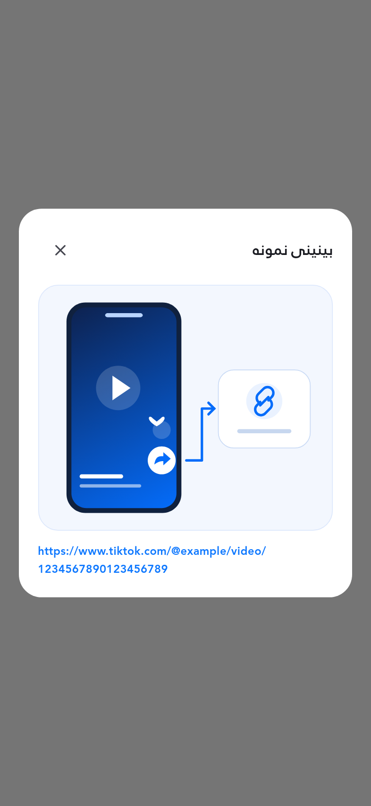
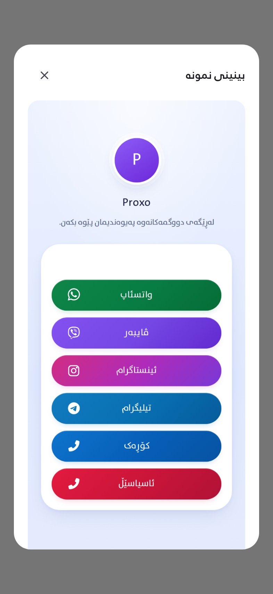

# گۆڕانکاریەکان و وێنەی هەر بەش

وێنەکان لە ڕووکاری جێبەجێکراوی ئەپەکە و داتای نمونە گیراون. بۆ بینینی قەبارەی تەواو کلیک لە لینکەکان بکە. پێوانەکانی پیکسڵی لۆژیکی، زمان، قەبارەی دەق و SHA-256 لە [بەڵگەکان](evidence.json) و [پێوانەکان](measurements.csv) تۆمار کراون.

| داواکاری | ئەوەی جێبەجێ کراوە | وێنە / بەڵگە |
|---|---|---|
| AppBar و سەردێر | AppBar ٥٦dp، ناونیشان ٢٠، بۆشایی ژێر AppBar ٤٠dp | [چوونەژوورەوە](images/login-ckb-393.png) · [هەژمار](images/signup-ckb-393.png) |
| ئایکۆنی 3D | وێنەی 3D ـی ٦٤×٦٤dp بۆ Auth | [Auth](images/login-ckb-393.png) · [OTP](images/otp-ckb-393.png) |
| فۆڕمی هەژمار | ناو، ئیمێڵ، وشەی نهێنی و دووبارەکردنەوە لە یەک فۆڕم | [بەتاڵ](images/signup-ckb-393.png) · [پڕکراوە](images/signup-filled-ckb-393.png) |
| OTP جیاواز | شاشەی جیاواز، خانەی نەرم، ژمارەی ناوەڕاست | [پڕکراوە](images/otp-filled-ckb-393.png) · [شاشەی تەسک](images/otp-filled-ckb-280-2x.png) · [پێوانەی ناوەڕاست](otp-ink-centers.json) |
| ژمارەی مۆبایل | ئاڵای عێراق لەتەنیشت +964 لە کاتی نووسین | [فۆڕمی پڕکراوە](images/login-phone-filled-ckb-393.png) |
| گۆڕینی ئیمێڵ/مۆبایل | ئەنیمەیشن، پاراستنی دەق و ڕێگری لە تێکەڵبوونی فۆڕمەکان | [ئیمێڵ](images/login-ckb-393.png) · [مۆبایل](images/login-phone-ckb-393.png) · [تێستی ڕەفتار](behavior.log) |
| دوگمەکان | گۆشەی هاوبەش ١٨dp، گەورەبوون لەگەڵ دەق | [ڕیکلام](images/create-ckb-393.png) · [پارەدان](images/deposit-ckb-393.png) · [پڕۆفایل](images/profile-ckb-393.png) |
| خەڵات و فاوچەر | کەمترین بەرزی ٤٨dp بۆ دوگمە دیاریکراوەکان | [فاوچەر](images/vouchers-ckb-393.png) · [دەقی دوو هێندە](images/vouchers-ckb-280-2x.png) · [ئەرکەکان](images/tasks-ckb-393.png) |
| ڕیفرێش | «نوێدەکرێتەوە» لەتەنیشت سووڕێنەر | [دۆخی نوێکردنەوە](images/refresh-ckb-393.png) |
| سپڵاش | لۆگۆی هاوسەنگ، تیشکی شین و جووڵەی دەستپێک | [سپڵاش](images/splash-ckb-393.png) |
| چوونەژوورەوەی پێشوو | دووبارە ئامادەکردنی پڕۆفایل داوا ناکات | [تێستەکان](behavior.log) |
| ئاگاداریی باکگراووند | نیشانی P و ڕەنگی شین لە ئاگاداریی سیستەمی Android | [وێنە و تێستی Android](native/README.md) |
| نمونەی لینکی ڤیدیۆ | پیشاندانی دەستبەجێی وێنەی ناوخۆیی | [بینینی نمونە](help-images/video-link-ckb-393.png) |
| نمونەی دروستکردنی پەڕە | نموونە بۆ پەیوەندی، داواکردن و داگرتن | [پەیوەندی](help-images/contact-ckb-393.png) · [داواکردن](help-images/order-ckb-393.png) · [داگرتن](help-images/download-ckb-393.png) |
| لینکی فێرکاری | لینکی HTTPS ـی دانراوی ئەدمین لە Supabase | [ناوی خانەکان و ڕێکخستن](form-help.md) |
| API ـی ئیمێڵ | ناردن و دووبارە ناردنی کۆد لە API ـەکەتەوە | [ڕێڕەوەکان](email-signup.md) · [تێستەکان](email-api-tests.log) |
| زمان و دەقی گەورە | سۆرانی، عەرەبی، بادینی؛ ٣٩٣dp/١× و ٢٨٠dp/٢× | [گشت ٢٠٠ سکرینشۆتی ئەپ](screenshots.md) · [٢٤ وێنەی نمونەکان](form-help.md) |

## نمونەی دیزاینی جێبەجێکراو

| دروستکردنی هەژمار | OTP |
|---|---|
|  |  |

| مۆبایل | سپڵاش |
|---|---|
|  |  |

| نموونەی لینک | نموونەی پەڕە |
|---|---|
|  |  |

[ڕاپۆرتی سۆرانی](review-ckb.md) · [ڕاپۆرتی تەکنیکی](README.md) · [گشت تێستەکان](full-suite.log)
