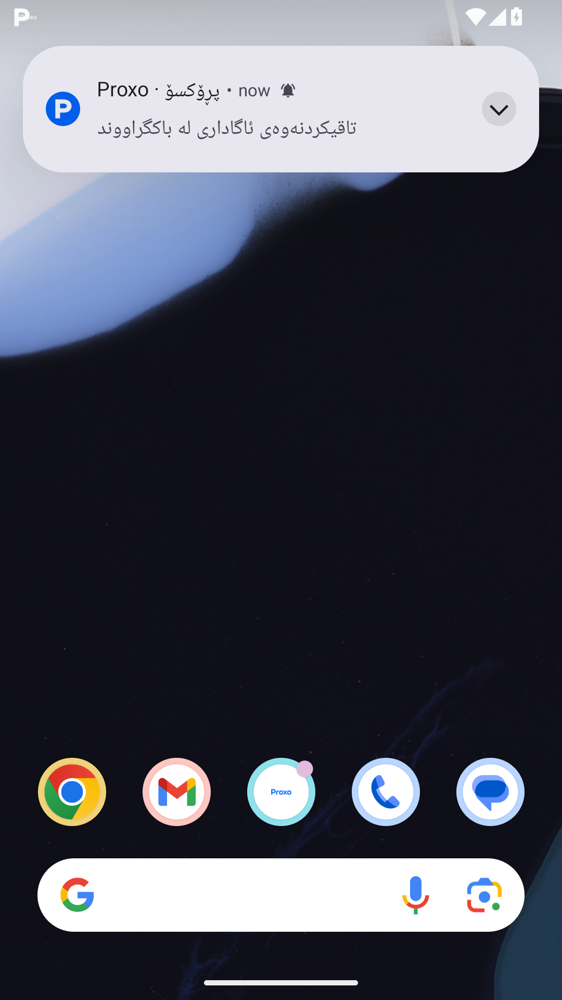

# Android profile verification

Run [39183672140](https://github.com/Zana-Sponsor/proxobalance/actions/runs/39183672140) passed on source `65021db17ef8ea496ba21fa1971b583cb3c956f2`. The profile fixture completed 36 screen/action cases, retained 37 FlutterSurface captures plus 3 Android OS captures, and reported no captured layout exception. All 40 original PNGs are listed in the [sorted gallery](native-runtime-gallery.md). The [machine-readable measurements and image hashes](native-runtime-metrics.json) accompany the original `runtime.json`, `device.json`, `performance-summary.json` and logs.

Artifact 12157089016 was downloaded and safely extracted after its ZIP SHA-256 matched GitHub: `a6911f4876b750974265013cb19a51f778eae680973afe00689245b498f68392`. The tested source includes the email API correction; this native fixture does not send real email or authenticate a real account.

## Verified behavior

- The [keyboard capture](auth-keyboard-android.png) shows a real Android software keyboard with the focused email field fully visible above it. After the inset stabilized at 946 px, the field bottom measured 328.818 dp and the available viewport bottom measured 354.182 dp, leaving 25.364 dp clearance. The assertion ran before any test-only manual scrolling. This resolves the earlier fixture's premature keyboard capture.
- Real Android text injection entered 7501234567, retained it after unfocus and enabled the send button. The [phone screenshot](screens/auth-phone.png) shows the number beside the Iraq flag and +964.
- The production video-link and page example dialogs opened using bundled assets. Their [ad](screens/ad-video-example.png) and [page](screens/page-example.png) captures show the example images over the production forms.
- The [pending refresh](screens/home-refresh-pending.png) displays نوێدەکرێتەوە beside its spinner. The controlled response and closing animation completed; the [completed refresh](screens/home-refresh.png) and corresponding assertion passed.
- Eight email/phone channel cycles completed without a captured exception. Layout/control observations cover 36 mounted cases. The 413 recorded control nodes include nested duplicates and disabled controls; they are not 413 unique business actions that were clicked.
- A real Android heads-up notification displayed the blue P logo and Proxo title while the app was backgrounded on the launcher. The [expanded notification shade](background-notification-shade-android.png) also displays the Proxo blue P icon. Native metadata confirms notification 4321, channel `proxo_high_importance` and color `#046CFA`. This used Firebase's actual Android notification builder with a local fixture; no FCM network request was sent.

## Measured performance

Android 15 x86_64 emulator, profile AOT, software GPU; 1080×1920 pixels, DPR 2.75. The native test completed in approximately 3 min 25 s. Frame metrics combine mounts, scrolling and selected UI actions; they do not measure network latency or production cold startup.

| Engine work | Frames | Mean | Aggregate p90 | Aggregate p99 | Maximum | Above 16.000 ms (Flutter budget) | Above 16.667 ms |
|---|---:|---:|---:|---:|---:|---:|---:|
| Build | 1,023 | 1.329 ms | 3.017 ms | 10.026 ms | 62.645 ms | 5 | 5 |
| Raster | 1,023 | 36.255 ms | 66.605 ms | 119.139 ms | 463.362 ms | 760 | 746 |

Means are arithmetic means of all concatenated raw frame times, so cases are weighted by their frame counts. Aggregate percentiles use Flutter's exact rounded index `floor((N-1)*p+0.5)` on sorted, concatenated raw frame times. All per-case percentiles and budget counts were recalculated from their raw arrays and matched Flutter's summaries. The strictly-above-16.000 ms count matches Flutter's budget constant; strictly-above-16.667 ms is a separate comparison. Auth channel cycles measured 212 frames: build p90/p99 = 1.616/5.347 ms; raster p90/p99 = 29.254/56.035 ms. Software-GPU raster times exceed a 60 Hz budget frequently, so this run does not certify physical-device smoothness or 60 fps.

## Capture limitations

The [splash capture](screens/splash.png) has a blank central wordmark pill, so it does not verify the completed splash logo. The fixture mounts the artwork directly and the same asset renders in later auth captures; first-image decoding/capture timing is a possible explanation, not an established cause. The separate [verified headless splash render](../images/splash-ckb-393.png) shows the completed artwork; it is not a native screenshot. The [OTP capture](screens/otp.png) shows six rounded, evenly spaced empty boxes; it alone does not establish digit centering. The [ad-confirmation capture](screens/ad-confirmation.png) catches the live countdown's digit crossfade, so it is not evidence of settled digit alignment.

No real account signup/login, email or phone OTP delivery, payment or remote mutation was submitted. The fictional backend intentionally blocks unsupported operations, so trusted-device lookup and thumbnail generation can log expected network-boundary fallbacks. Local example images were exercised; live administrator tutorial configuration and external video playback were not exercised by this native fixture.

Background notification appearance was verified while the app was backgrounded. FCM network transport and terminated/force-stopped receipt remain untested. Screen appearance and selected interactions passed; this does not establish that every business path or every physical device is bug-free.

The native OTP capture contains empty cells; [filled headless OTP captures](../images/otp-filled-ckb-393.png) and [ink-center measurements](../otp-ink-centers.json) supply the digit-centering evidence.
