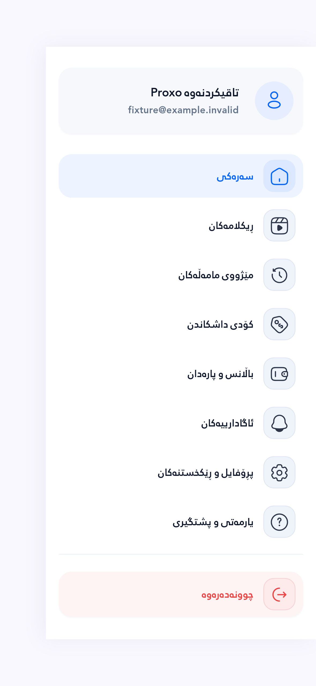
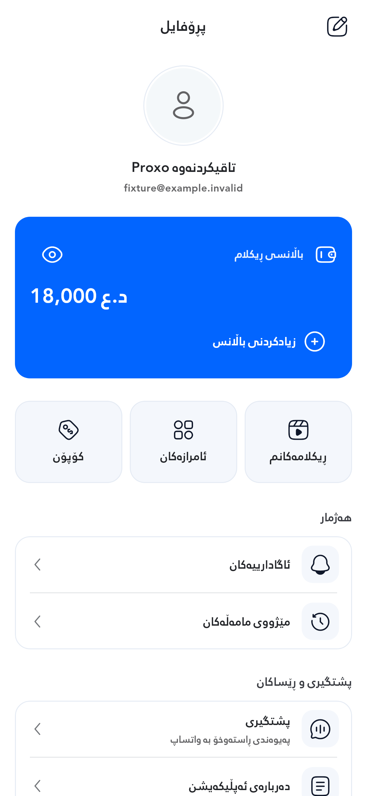
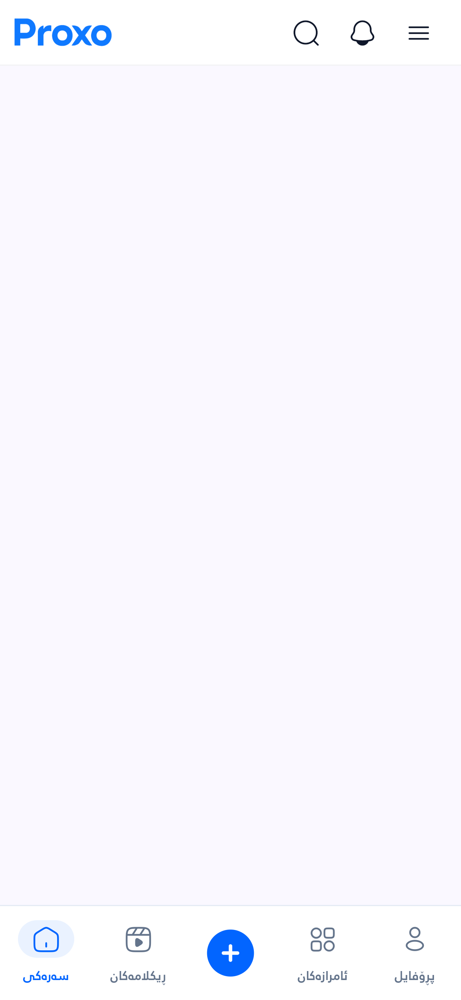

# وێنەکانی پێش و دوای گۆڕان

Actual Flutter screen captures using fictional account data. Original PNG bytes are preserved. These are **review screenshots**, not approved goldens.

Source: `22db3425ec15e218053c2fa5844e1fb1c08fa885`; before: `e61144904f5f9986b8d3a2f486ca7756a3ba267a`.

[Implementation, licenses and verification](../CHROME_REDESIGN_2026-10-15.md) · [Capture run and all 70 PNGs](https://github.com/Zana-Sponsor/proxobalance/actions/runs/38644003380) · [Hashes and checks](verification.json)

| بەش / Surface | پێش / Before | دوای / After |
|---|---|---|
| Sidebar | [PNG](before/sidebar-393-s1.0-d3.0.png) | [PNG](after/sidebar-393-s1.0-d3.0.png) |
| Profile | [PNG](before/profile-393-s1.0-d3.0.png) | [PNG](after/profile-393-s1.0-d3.0.png) |
| Profile lower section | [PNG](before/profile-393-s1.0-d3.0-bottom.png) | [PNG](after/profile-393-s1.0-d3.0-bottom.png) |
| App bar + bottom navigation | [PNG](before/chrome-393-s1.0-d3.0.png) | [PNG](after/chrome-393-s1.0-d3.0.png) |
| Edit profile | [PNG](before/edit-393-s1.0-d3.0.png) | [PNG](after/edit-393-s1.0-d3.0.png) |
| Sidebar · 280dp / text 2× | [PNG](before/sidebar-280-s2.0-d2.0.png) | [PNG](after/sidebar-280-s2.0-d2.0.png) |
| Profile · 280dp / text 2× | [PNG](before/profile-280-s2.0-d2.0.png) | [PNG](after/profile-280-s2.0-d2.0.png) |
| Navigation · 280dp / text 2× | [PNG](before/chrome-280-s2.0-d2.0.png) | [PNG](after/chrome-280-s2.0-d2.0.png) |

Large text keeps its chosen size. On narrow screens, the bottom navigation scrolls horizontally and the selected destination is brought into view; labels are never shrunk to make all five fit. Profile and sidebar content scroll vertically. The near-empty chrome canvas deliberately isolates the real app bar and navigation widgets.

## Sidebar

## Profile

## App bar and bottom navigation

