# Proxo: actual screen evidence

155 production-widget screenshots with bundled app fonts. Each image has measured widget geometry. These are rendered app screens, not design mockups.

The separate [passing Android runtime report](native/README.md) includes 42 scenarios, 50 native PNGs, background-notification logo evidence and measured engine frame timings. Its software-GPU measurements do not certify physical-device smoothness.

[Final CI results](ci-results.json) · [APK 1.0.11 verification and signing limitation](apk/README.md) · [Download the CI APK artifact](https://github.com/Zana-Sponsor/proxobalance/actions/runs/39391606925/artifacts/12250317662)

Both viewports use RTL Kurdish, a 24dp top/16dp bottom safe area, device pixel ratio 2 and 2× PNG capture. The standard phone is **393 × 852dp at 100% text**; the accessibility case is **320 × 740dp at 200% text**. Larger text intentionally scrolls instead of shrinking. The legacy Advertisements filter strip still caps its own text scale; the new empty/error panels honor 200%.

Customer, campaign, balance and receipt fixtures are fictional. Payment recipient numbers shown by Add Balance are the existing app configuration; no transfer or payment was performed. The successful thumbnail is the real bundled Proxo JPEG used as a fictional creative; no live advertiser image is claimed. Failed-image captures exercise the production `Image.errorBuilder`; the exact failed provider alone is excluded from asset precaching. Other mounted images must decode. Best Results exposes public categories, not private ad titles; the long-label case therefore tests the available long Kurdish category.

Page creation screenshots use an in-memory repository. Email-change screenshots use a strict mocked custom API client. Neither demonstrates live publication or sends an email. Destructive confirmations are opened and cancelled. See [page readiness](page-readiness.md), [Vercel readiness](vercel-readiness.md), and [isolated rollout plan](isolated-rollout-plan.md) for the outstanding production boundary.

Capture source: [`9fdd08d`](https://github.com/Zana-Sponsor/proxobalance/commit/9fdd08d14f982e40221455cc4ab5dac0f3c368e3). All 42 capture scenarios passed; [run log](capture-test.log). Exact source file hashes: [source manifest](capture-source-manifest.json). Image hashes and capture dimensions: [capture manifest](capture-manifest.json). Measured font families/sizes/scales: [geometry summary](geometry-summary.json). [Visual review and corrected findings](visual-review.md). Recheck every capture hash and PDF pixel with [verify_artifacts.py](verify_artifacts.py). Historical recovery provenance from successful source-5a6167e CI: [immutable artifact inventory](recovered-evidence-manifest.json); those old captures have been superseded by the current gallery.

Final build source: [`ade200a`](https://github.com/Zana-Sponsor/proxobalance/commit/ade200a23732cb5029087e1a6ccac0036f1161b9). Its production code, assets and platform configuration are identical to capture source `9fdd08d`; the four changed files repair test evidence output and strict fixture request classification. The published build source and its tested PR merge have the same Git tree. See [source and CI proof](ci-source-proof.json) and the [Sorani completion report](review-ckb.md).

## Existing authentication reference

[Historical native auth screenshot](reference/auth-login-5a6167e.png) · [provenance and run limitation](reference/provenance.json). Viewport 392.73 × 698.18dp, DPR 2.75 (1080 × 1920px); Android 15 emulator. This is the existing design reference, not a new authentication change. The native run captured the screen but failed a later transport-classification assertion; it is not presented as a passing runtime test.

## Shared dimensions

| Property | Value |
| --- | --- |
| Screen gutter / content maximum | 20dp / 600dp |
| Card padding / section spacing | 16dp / 24dp |
| Card radius / button minimum | 18dp / 48dp |
| Profile and new shared-state typography | RabarAuthRegular, regular weight |
| Title / section / body / secondary / amount | 18 / 16 / 14 / 13 / 22dp |
| App bar controls | Shared 48dp targets, measured per image |

Open any geometry link for actual text bounds, icon bounds, font sizes and active text scale. Logical dimensions are not pixel dimensions; PNGs are twice the viewport width/height. Offscreen nodes are recorded with `intersects_viewport: false`.

## Home and Best Results

| Screen and state | 393 × 852dp · 100% text | 320 × 740dp · 200% text |
| --- | --- | --- |
| Home and app bar; Best Results collapsed, no image — collapsed card, scrolled into view |  [Geometry](geometry/home-393-s1-collapsed-card.json) | <a href="widgets/home-320-s2-collapsed-card.png">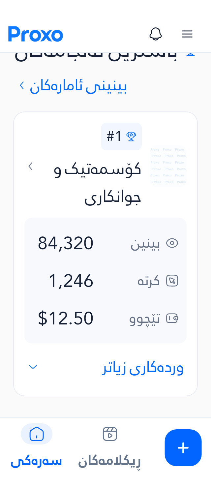</a> [Geometry](geometry/home-320-s2-collapsed-card.json) |
| Best Results expanded, lower content |  [Geometry](geometry/home-393-s1-expanded-bottom.json) |  [Geometry](geometry/home-320-s2-expanded-bottom.json) |
| Best Results details expanded, no image |  [Geometry](geometry/home-393-s1-expanded.json) |  [Geometry](geometry/home-320-s2-expanded.json) |
| Home and app bar; Best Results collapsed, no image |  [Geometry](geometry/home-393-s1.json) | <a href="widgets/home-320-s2.png">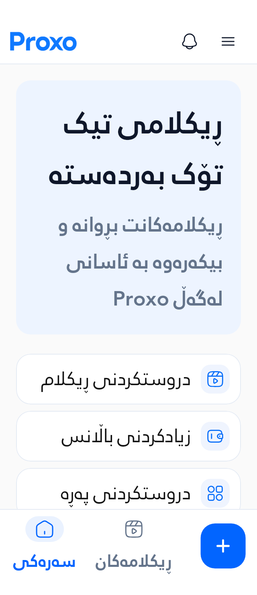</a> [Geometry](geometry/home-320-s2.json) |
| Home with the longest available Kurdish category label — collapsed card, scrolled into view |  [Geometry](geometry/home-long-label-393-s1-collapsed-card.json) | <a href="widgets/home-long-label-320-s2-collapsed-card.png">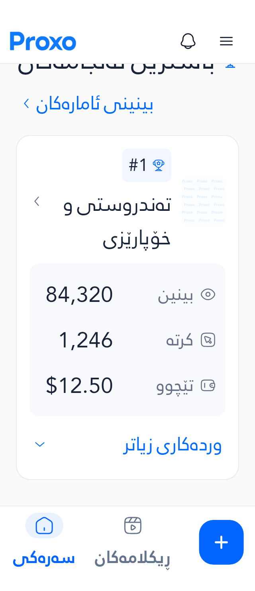</a> [Geometry](geometry/home-long-label-320-s2-collapsed-card.json) |
| Home with the longest available Kurdish category label — details expanded, bottom |  [Geometry](geometry/home-long-label-393-s1-expanded-bottom.json) |  [Geometry](geometry/home-long-label-320-s2-expanded-bottom.json) |
| Home with the longest available Kurdish category label — details expanded | <a href="widgets/home-long-label-393-s1-expanded.png">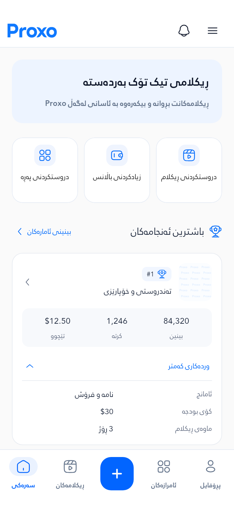</a> [Geometry](geometry/home-long-label-393-s1-expanded.json) | <a href="widgets/home-long-label-320-s2-expanded.png">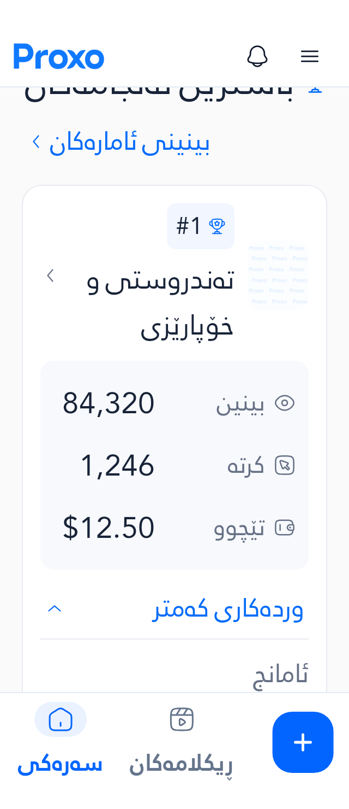</a> [Geometry](geometry/home-long-label-320-s2-expanded.json) |
| Home with the longest available Kurdish category label | <a href="widgets/home-long-label-393-s1.png">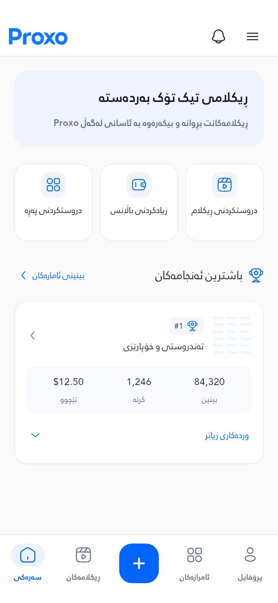</a> [Geometry](geometry/home-long-label-393-s1.json) |  [Geometry](geometry/home-long-label-320-s2.json) |
| Home after deliberate image-load failure — collapsed card, scrolled into view |  [Geometry](geometry/home-thumbnail-failed-393-s1-collapsed-card.json) |  [Geometry](geometry/home-thumbnail-failed-320-s2-collapsed-card.json) |
| Home after deliberate image-load failure — details expanded, bottom | <a href="widgets/home-thumbnail-failed-393-s1-expanded-bottom.png">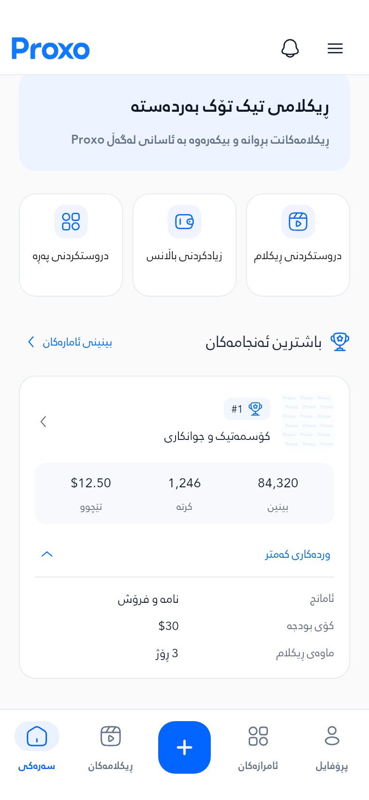</a> [Geometry](geometry/home-thumbnail-failed-393-s1-expanded-bottom.json) |  [Geometry](geometry/home-thumbnail-failed-320-s2-expanded-bottom.json) |
| Home after deliberate image-load failure — details expanded |  [Geometry](geometry/home-thumbnail-failed-393-s1-expanded.json) |  [Geometry](geometry/home-thumbnail-failed-320-s2-expanded.json) |
| Home after deliberate image-load failure |  [Geometry](geometry/home-thumbnail-failed-393-s1.json) |  [Geometry](geometry/home-thumbnail-failed-320-s2.json) |
| Home with decoded fictional bundled Proxo creative — collapsed card, scrolled into view |  [Geometry](geometry/home-thumbnail-image-393-s1-collapsed-card.json) | <a href="widgets/home-thumbnail-image-320-s2-collapsed-card.png">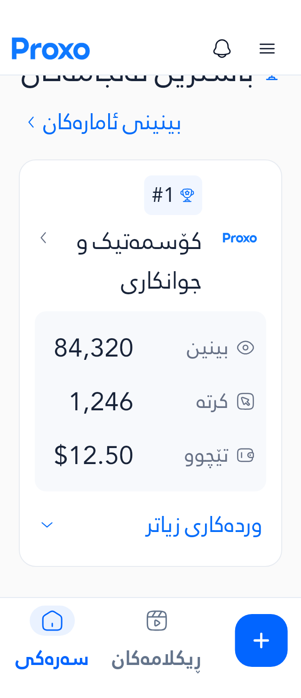</a> [Geometry](geometry/home-thumbnail-image-320-s2-collapsed-card.json) |
| Home with decoded fictional bundled Proxo creative — details expanded, bottom |  [Geometry](geometry/home-thumbnail-image-393-s1-expanded-bottom.json) | <a href="widgets/home-thumbnail-image-320-s2-expanded-bottom.png">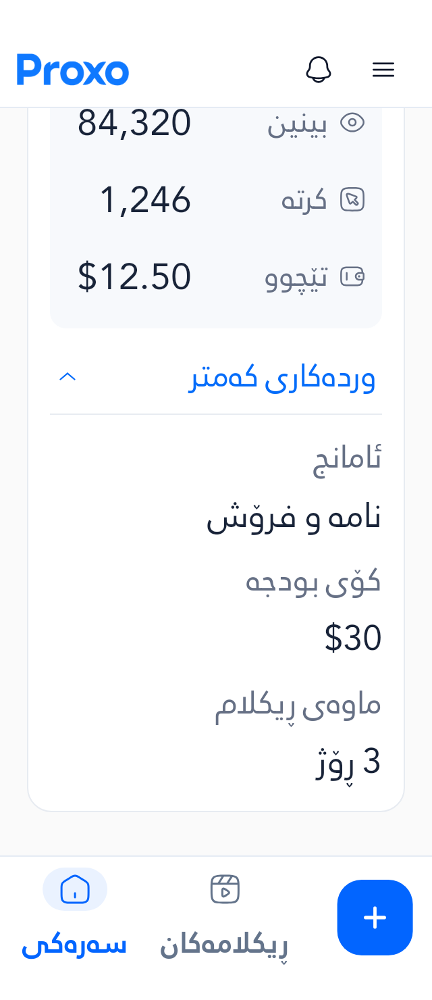</a> [Geometry](geometry/home-thumbnail-image-320-s2-expanded-bottom.json) |
| Home with decoded fictional bundled Proxo creative — details expanded |  [Geometry](geometry/home-thumbnail-image-393-s1-expanded.json) | <a href="widgets/home-thumbnail-image-320-s2-expanded.png">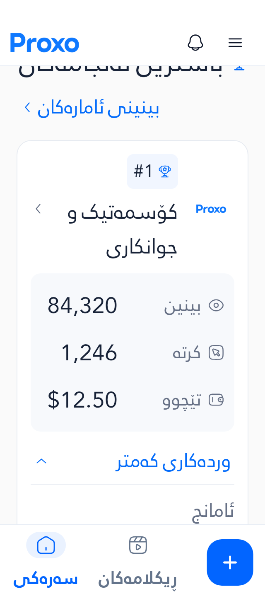</a> [Geometry](geometry/home-thumbnail-image-320-s2-expanded.json) |
| Home with decoded fictional bundled Proxo creative | <a href="widgets/home-thumbnail-image-393-s1.png">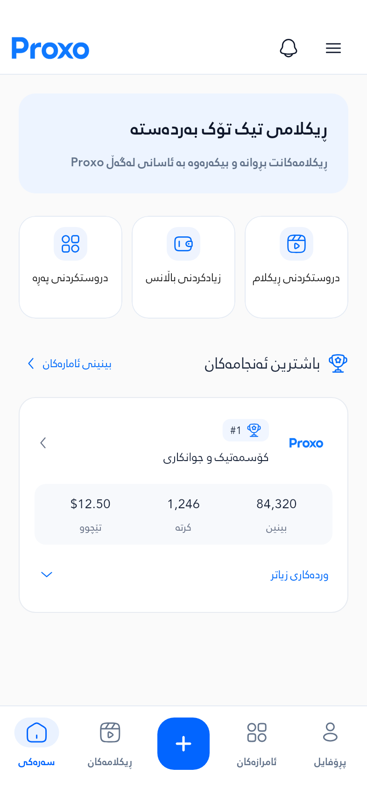</a> [Geometry](geometry/home-thumbnail-image-393-s1.json) |  [Geometry](geometry/home-thumbnail-image-320-s2.json) |

## Add Balance and payment details

| Screen and state | 393 × 852dp · 100% text | 320 × 740dp · 200% text |
| --- | --- | --- |
| Unavailable methods remain disabled | <a href="widgets/deposit-393-s1-unconfigured-methods.png">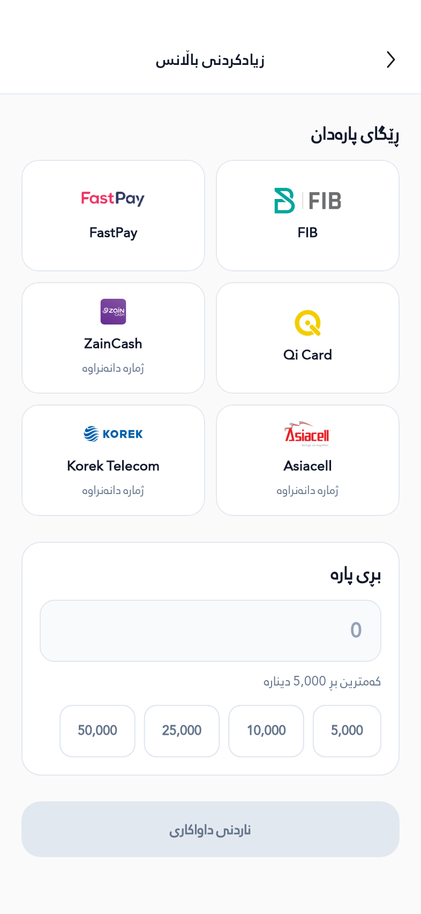</a> [Geometry](geometry/deposit-393-s1-unconfigured-methods.json) | <a href="widgets/deposit-320-s2-unconfigured-methods.png">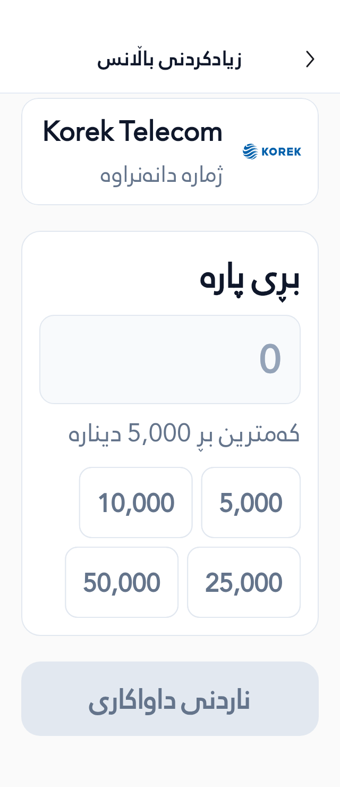</a> [Geometry](geometry/deposit-320-s2-unconfigured-methods.json) |
| Add Balance; methods and initial amount |  [Geometry](geometry/deposit-393-s1.json) | <a href="widgets/deposit-320-s2.png">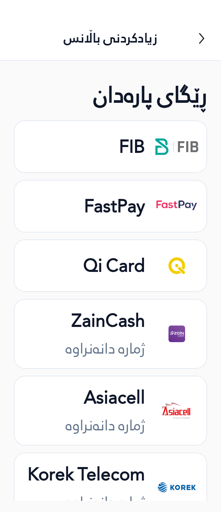</a> [Geometry](geometry/deposit-320-s2.json) |
| Deposit Fastpay — Amount selected | <a href="widgets/deposit-fastpay-393-s1-amount.png">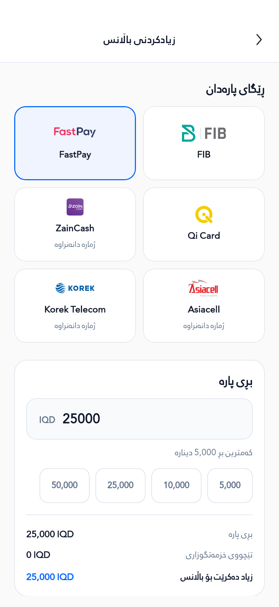</a> [Geometry](geometry/deposit-fastpay-393-s1-amount.json) | <a href="widgets/deposit-fastpay-320-s2-amount.png">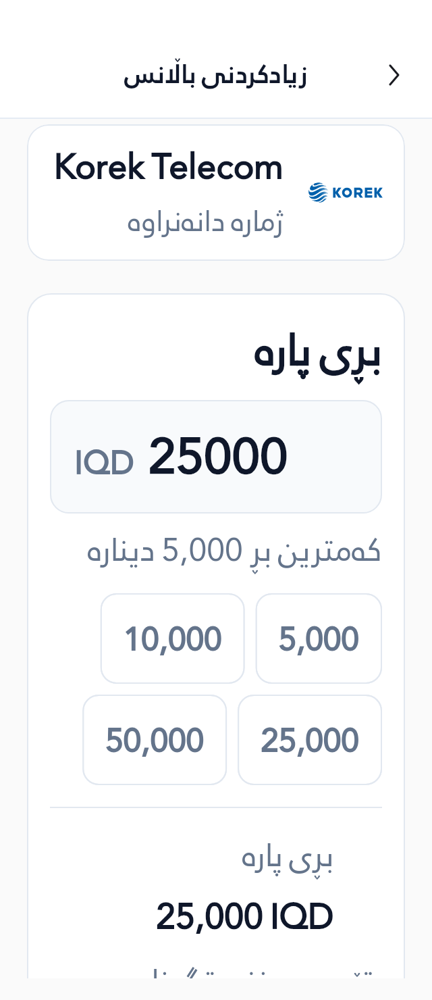</a> [Geometry](geometry/deposit-fastpay-320-s2-amount.json) |
| Deposit Fastpay — Checkout entry; no payment attempted | <a href="widgets/deposit-fastpay-393-s1-checkout-entry.png">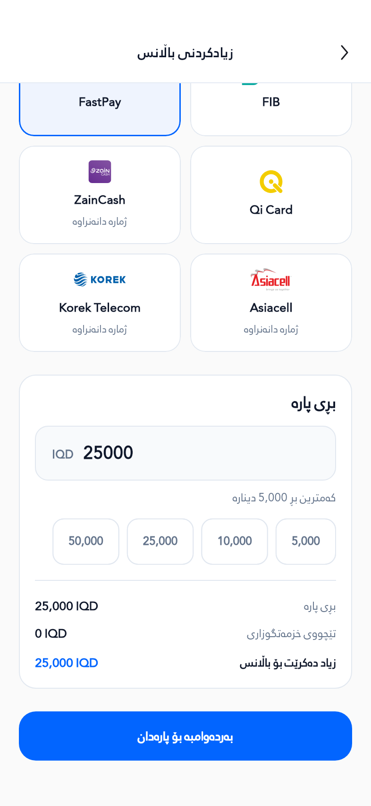</a> [Geometry](geometry/deposit-fastpay-393-s1-checkout-entry.json) | <a href="widgets/deposit-fastpay-320-s2-checkout-entry.png">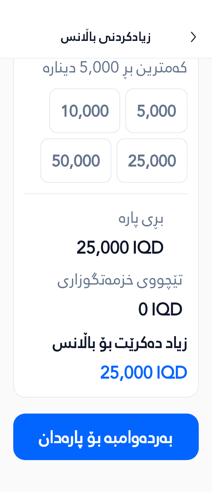</a> [Geometry](geometry/deposit-fastpay-320-s2-checkout-entry.json) |
| Deposit Fib — Amount selected | <a href="widgets/deposit-fib-393-s1-amount.png">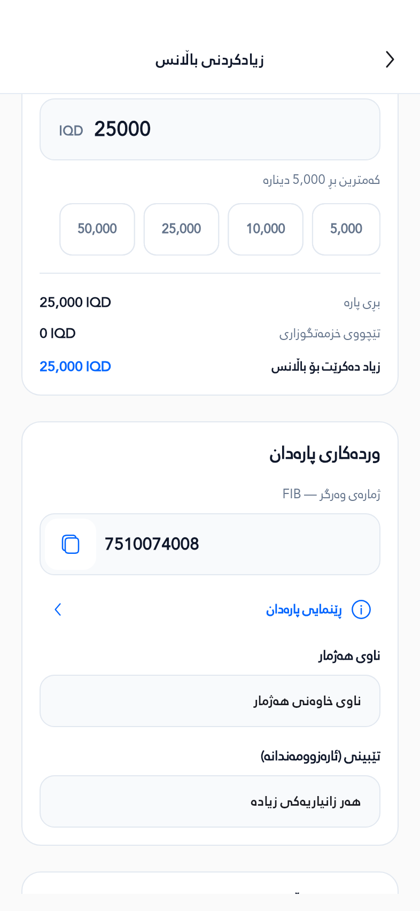</a> [Geometry](geometry/deposit-fib-393-s1-amount.json) | <a href="widgets/deposit-fib-320-s2-amount.png">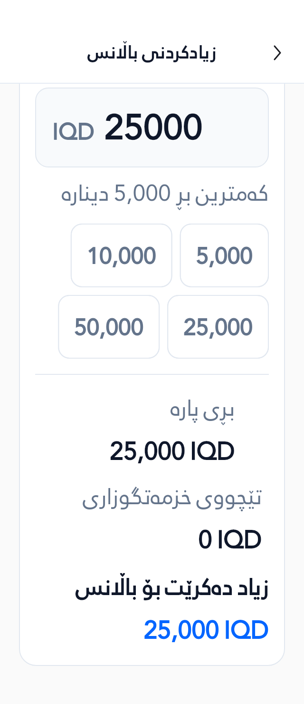</a> [Geometry](geometry/deposit-fib-320-s2-amount.json) |
| Deposit Fib — Recipient details |  [Geometry](geometry/deposit-fib-393-s1-details.json) | <a href="widgets/deposit-fib-320-s2-details.png">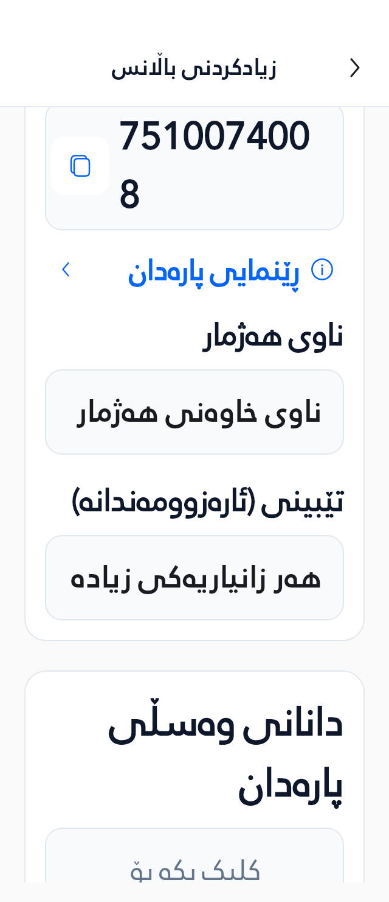</a> [Geometry](geometry/deposit-fib-320-s2-details.json) |
| Deposit Fib — Instructions expanded | <a href="widgets/deposit-fib-393-s1-instructions.png">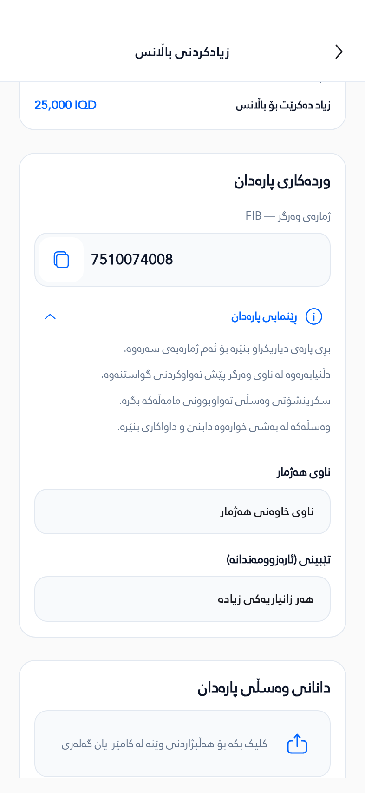</a> [Geometry](geometry/deposit-fib-393-s1-instructions.json) | <a href="widgets/deposit-fib-320-s2-instructions.png">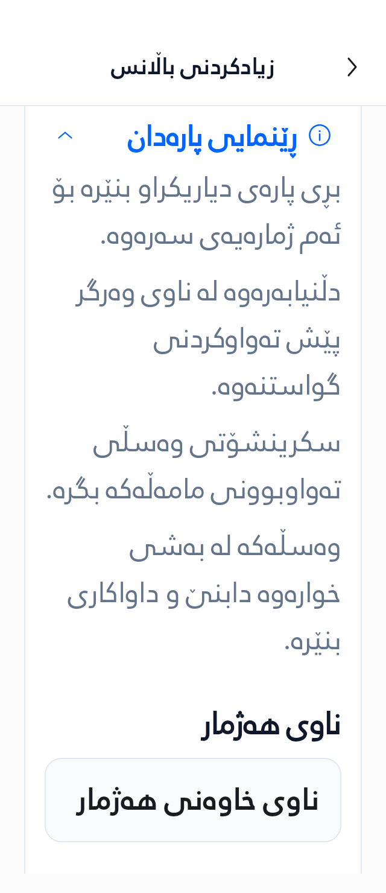</a> [Geometry](geometry/deposit-fib-320-s2-instructions.json) |
| Deposit Fib — Fictional receipt attached | <a href="widgets/deposit-fib-393-s1-receipt-attached.png">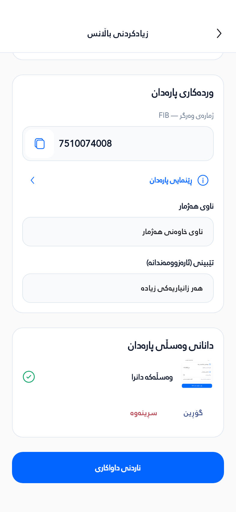</a> [Geometry](geometry/deposit-fib-393-s1-receipt-attached.json) | <a href="widgets/deposit-fib-320-s2-receipt-attached.png">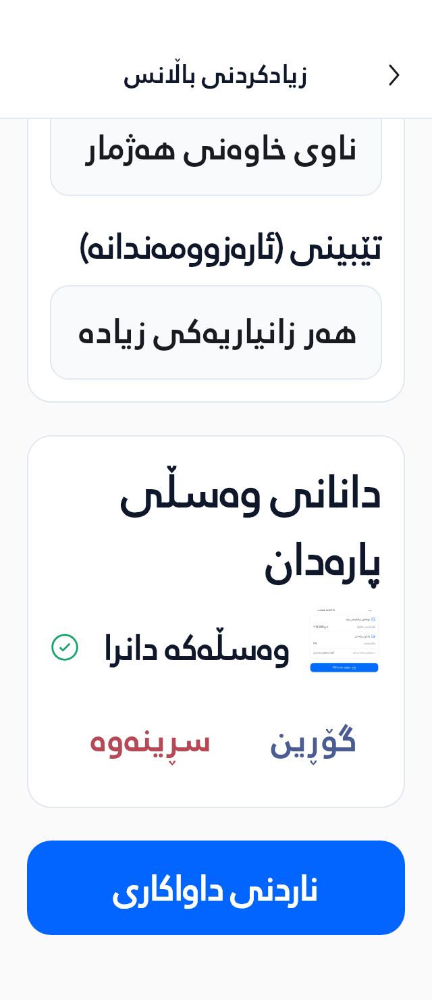</a> [Geometry](geometry/deposit-fib-320-s2-receipt-attached.json) |
| Deposit Fib — Receipt source chooser | <a href="widgets/deposit-fib-393-s1-receipt-picker.png">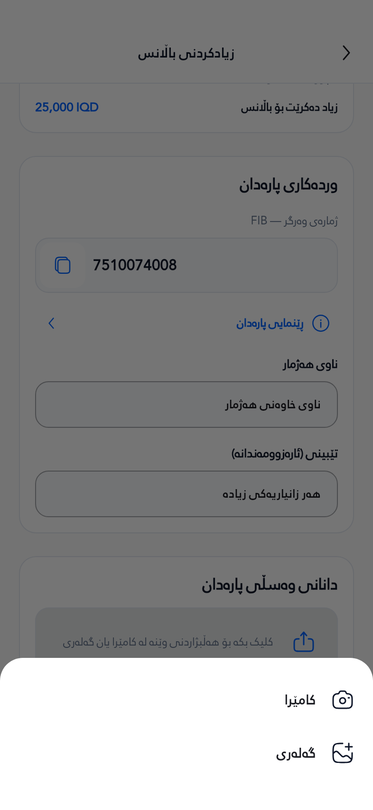</a> [Geometry](geometry/deposit-fib-393-s1-receipt-picker.json) | <a href="widgets/deposit-fib-320-s2-receipt-picker.png">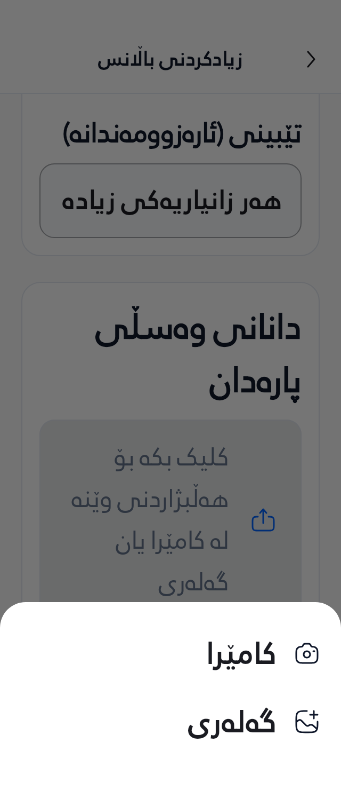</a> [Geometry](geometry/deposit-fib-320-s2-receipt-picker.json) |
| Deposit Fib — Receipt upload controls |  [Geometry](geometry/deposit-fib-393-s1-receipt.json) |  [Geometry](geometry/deposit-fib-320-s2-receipt.json) |
| Deposit Kcard — Amount selected |  [Geometry](geometry/deposit-kcard-393-s1-amount.json) |  [Geometry](geometry/deposit-kcard-320-s2-amount.json) |
| Deposit Kcard — Recipient details |  [Geometry](geometry/deposit-kcard-393-s1-details.json) | <a href="widgets/deposit-kcard-320-s2-details.png">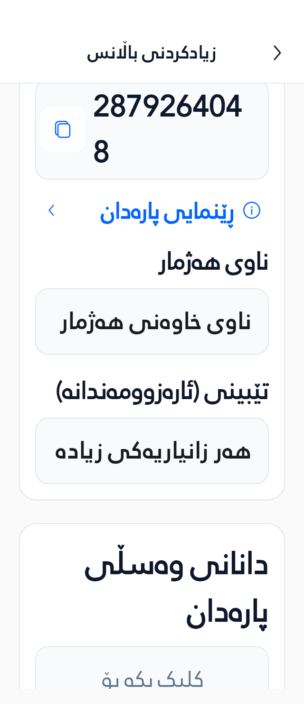</a> [Geometry](geometry/deposit-kcard-320-s2-details.json) |
| Deposit Kcard — Instructions expanded | <a href="widgets/deposit-kcard-393-s1-instructions.png">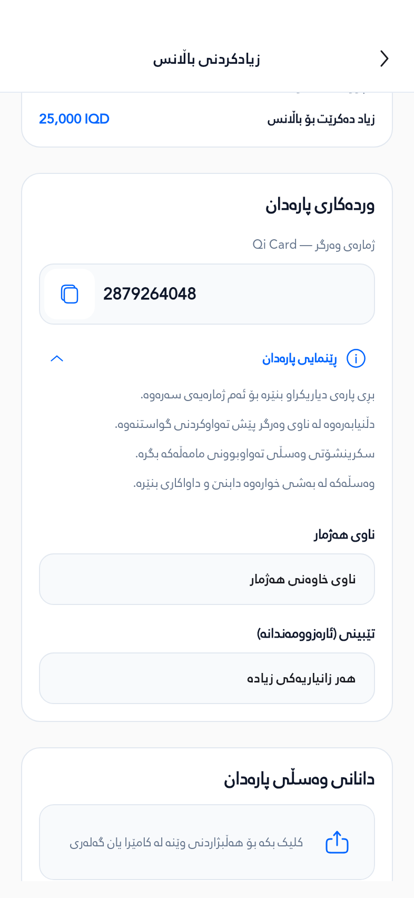</a> [Geometry](geometry/deposit-kcard-393-s1-instructions.json) |  [Geometry](geometry/deposit-kcard-320-s2-instructions.json) |
| Deposit Kcard — Receipt upload controls | <a href="widgets/deposit-kcard-393-s1-receipt.png">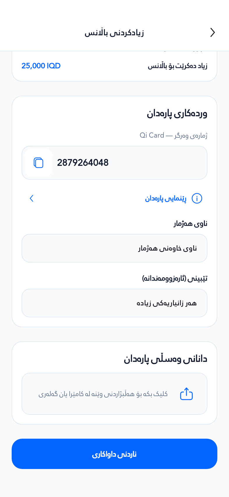</a> [Geometry](geometry/deposit-kcard-393-s1-receipt.json) | <a href="widgets/deposit-kcard-320-s2-receipt.png">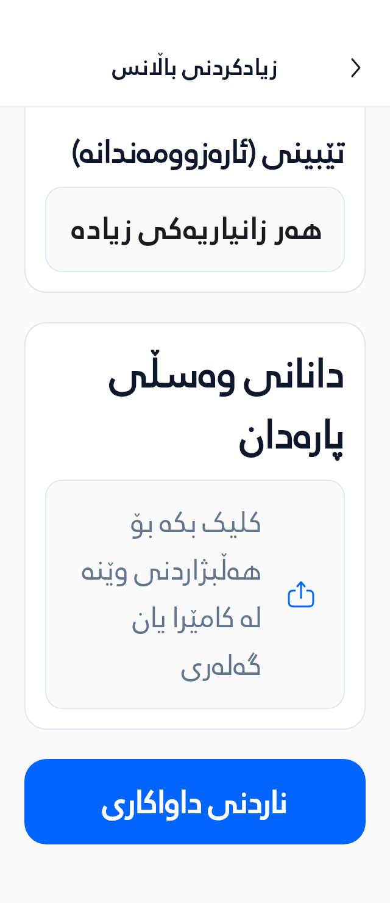</a> [Geometry](geometry/deposit-kcard-320-s2-receipt.json) |

## Pages overview and creation flow

| Screen and state | 393 × 852dp · 100% text | 320 × 740dp · 200% text |
| --- | --- | --- |
| Pages empty overview; no automatic creation navigation — action revealed by scrolling | — | <a href="widgets/tools-320-s2-action.png">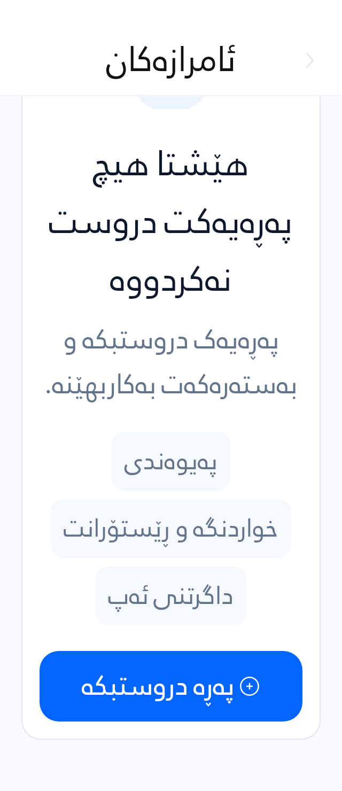</a> [Geometry](geometry/tools-320-s2-action.json) |
| Creation prerequisites unavailable; retry UI | <a href="widgets/tools-393-s1-create-unavailable.png">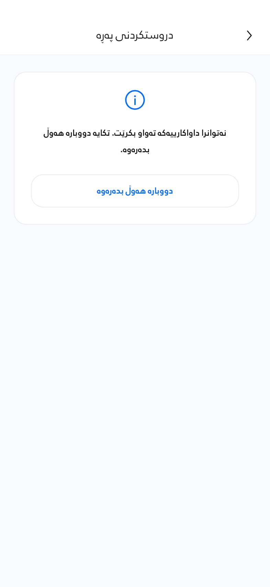</a> [Geometry](geometry/tools-393-s1-create-unavailable.json) | <a href="widgets/tools-320-s2-create-unavailable.png">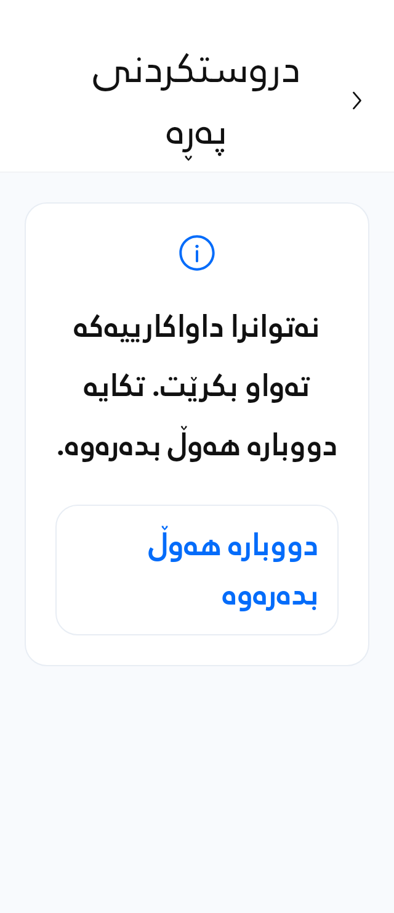</a> [Geometry](geometry/tools-320-s2-create-unavailable.json) |
| Pages empty overview; no automatic creation navigation | <a href="widgets/tools-393-s1.png">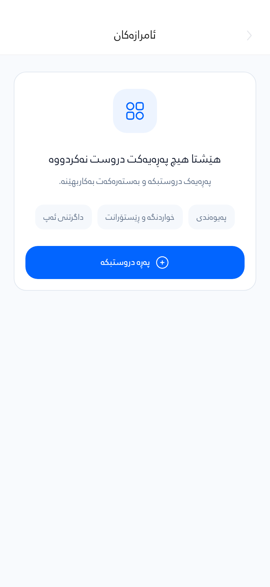</a> [Geometry](geometry/tools-393-s1.json) | <a href="widgets/tools-320-s2.png">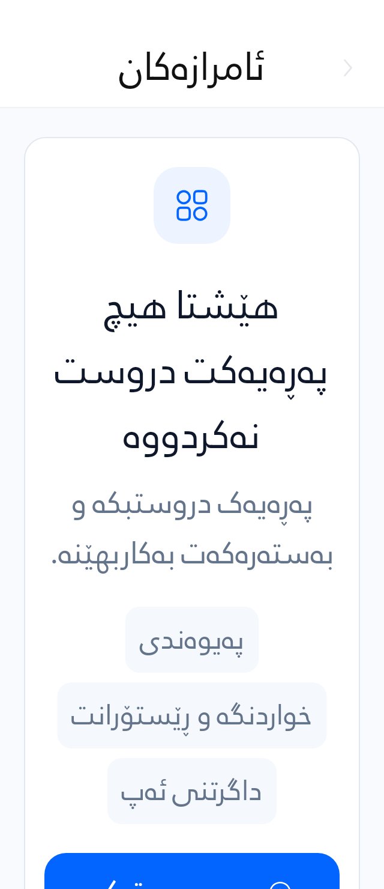</a> [Geometry](geometry/tools-320-s2.json) |
| Pages empty overview for the in-memory creation journey — Contact form, fictional values entered | <a href="widgets/tools-create-flow-393-s1-contact-filled.png">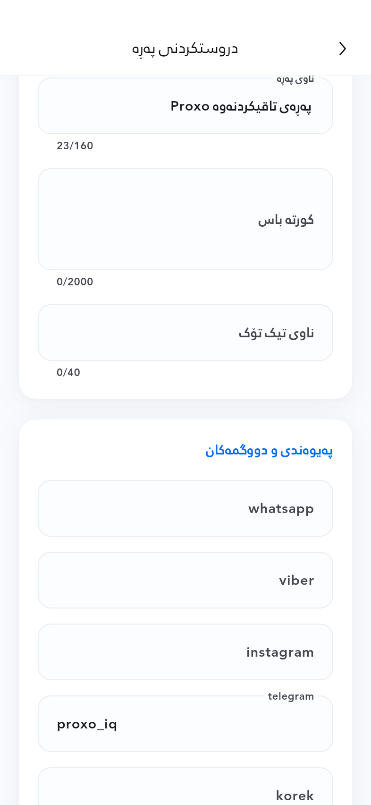</a> [Geometry](geometry/tools-create-flow-393-s1-contact-filled.json) | <a href="widgets/tools-create-flow-320-s2-contact-filled.png">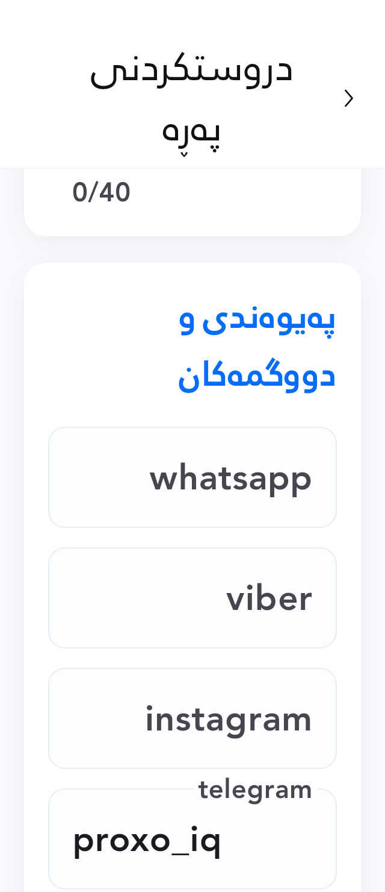</a> [Geometry](geometry/tools-create-flow-320-s2-contact-filled.json) |
| Pages empty overview for the in-memory creation journey — Contact creation form | <a href="widgets/tools-create-flow-393-s1-contact-form.png">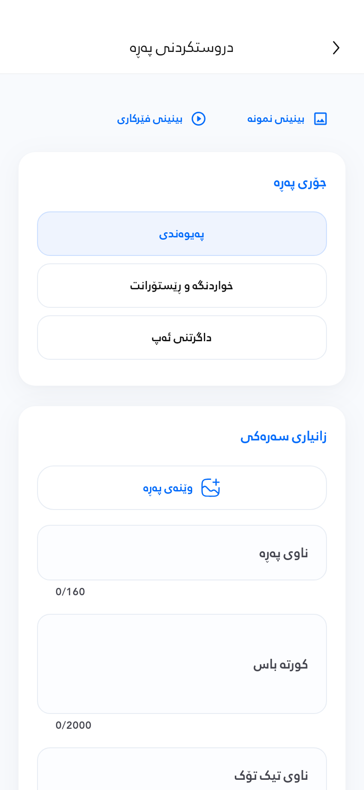</a> [Geometry](geometry/tools-create-flow-393-s1-contact-form.json) | <a href="widgets/tools-create-flow-320-s2-contact-form.png">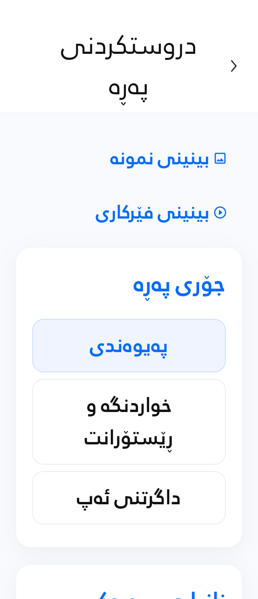</a> [Geometry](geometry/tools-create-flow-320-s2-contact-form.json) |
| Created page visible after in-memory save; not proof of production persistence | <a href="widgets/tools-create-flow-393-s1-created-in-memory.png">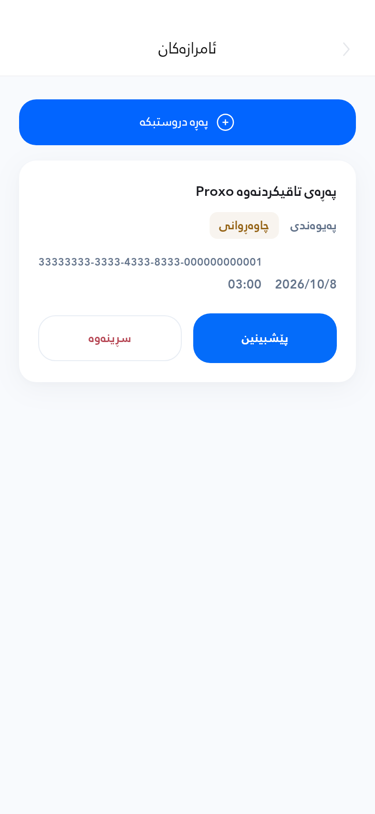</a> [Geometry](geometry/tools-create-flow-393-s1-created-in-memory.json) | <a href="widgets/tools-create-flow-320-s2-created-in-memory.png">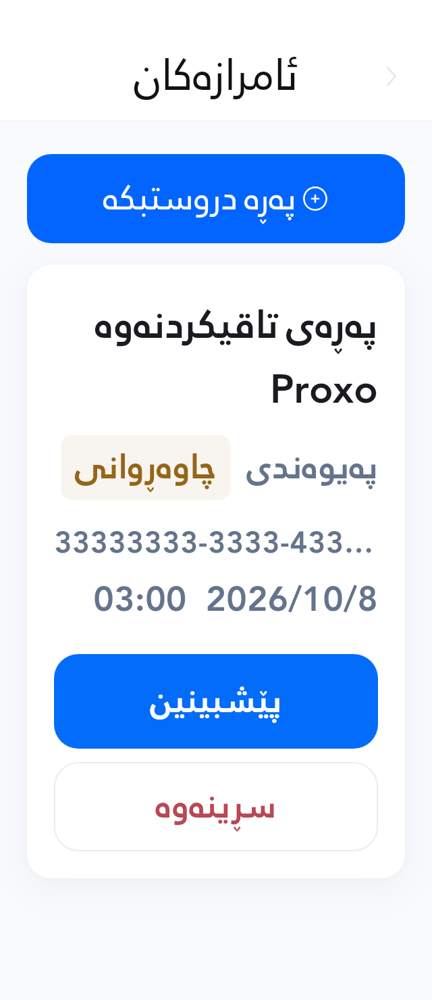</a> [Geometry](geometry/tools-create-flow-320-s2-created-in-memory.json) |
| Pages empty overview for the in-memory creation journey — Style chooser and submit control | <a href="widgets/tools-create-flow-393-s1-designs-submit.png">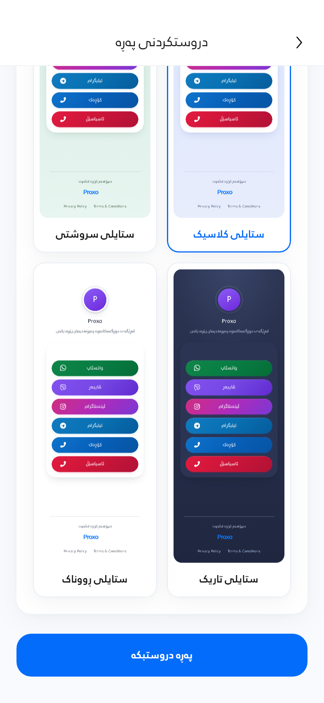</a> [Geometry](geometry/tools-create-flow-393-s1-designs-submit.json) | <a href="widgets/tools-create-flow-320-s2-designs-submit.png">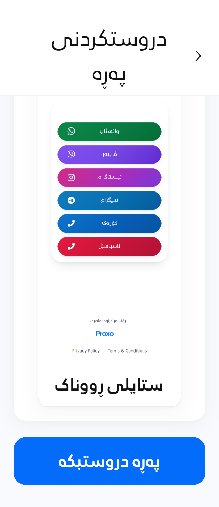</a> [Geometry](geometry/tools-create-flow-320-s2-designs-submit.json) |
| Pages empty overview for the in-memory creation journey — Download creation form | <a href="widgets/tools-create-flow-393-s1-download-form.png">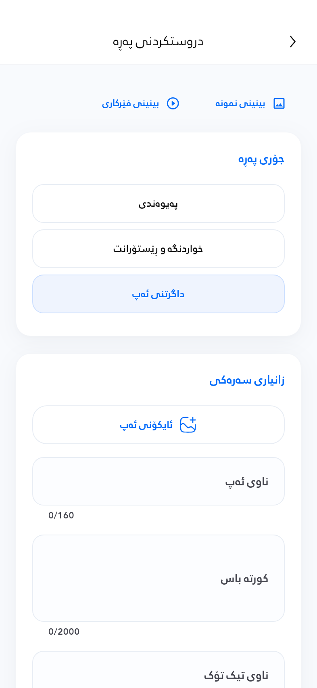</a> [Geometry](geometry/tools-create-flow-393-s1-download-form.json) | <a href="widgets/tools-create-flow-320-s2-download-form.png">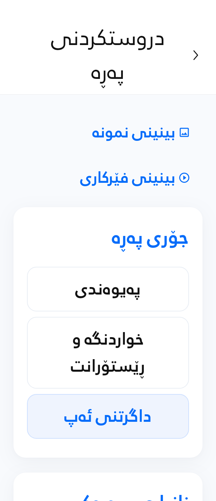</a> [Geometry](geometry/tools-create-flow-320-s2-download-form.json) |
| Pages empty overview for the in-memory creation journey — Order creation form | <a href="widgets/tools-create-flow-393-s1-order-form.png">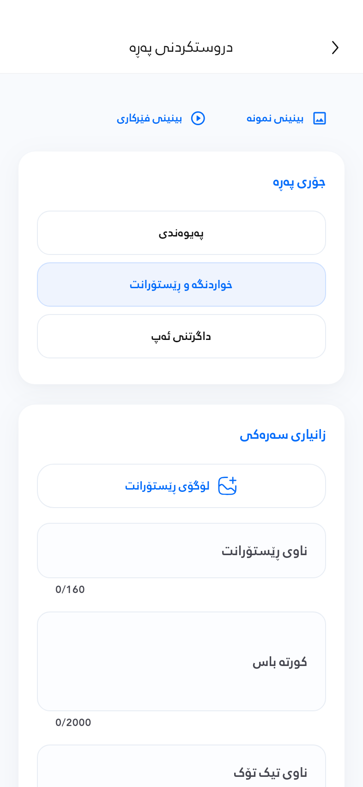</a> [Geometry](geometry/tools-create-flow-393-s1-order-form.json) | <a href="widgets/tools-create-flow-320-s2-order-form.png">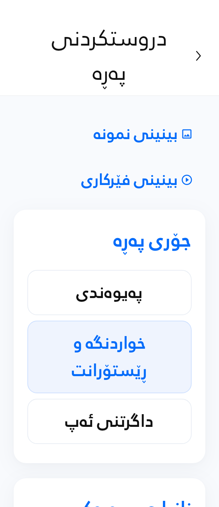</a> [Geometry](geometry/tools-create-flow-320-s2-order-form.json) |
| Pages empty overview for the in-memory creation journey |  [Geometry](geometry/tools-create-flow-393-s1.json) |  [Geometry](geometry/tools-create-flow-320-s2.json) |

## Profile and account dialogs

| Screen and state | 393 × 852dp · 100% text | 320 × 740dp · 200% text |
| --- | --- | --- |
| Profile, normal fictional identity — about and privacy sheet, bottom | <a href="widgets/profile-393-s1-about-bottom.png">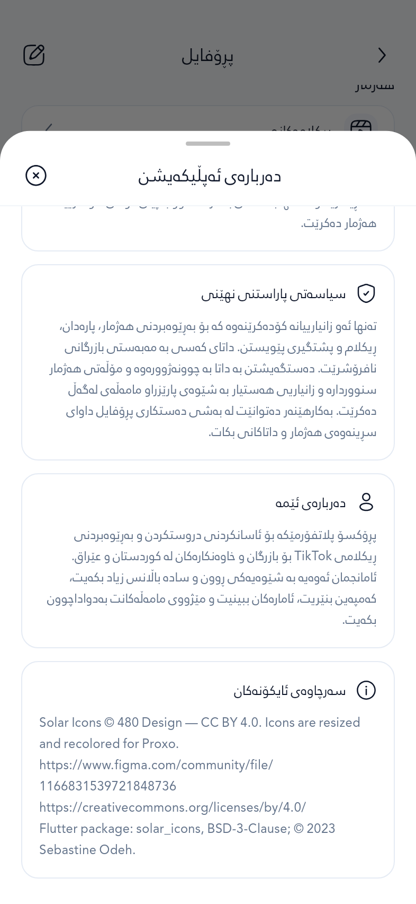</a> [Geometry](geometry/profile-393-s1-about-bottom.json) | <a href="widgets/profile-320-s2-about-bottom.png">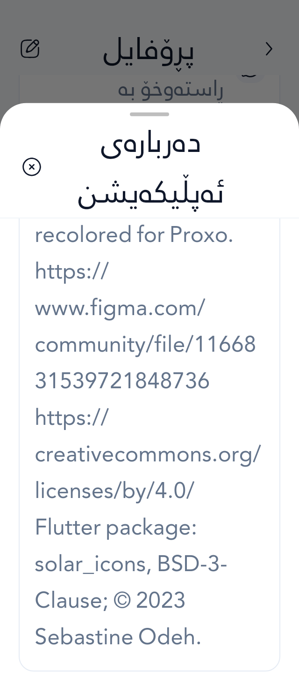</a> [Geometry](geometry/profile-320-s2-about-bottom.json) |
| Profile, normal fictional identity — about and privacy sheet |  [Geometry](geometry/profile-393-s1-about.json) |  [Geometry](geometry/profile-320-s2-about.json) |
| Profile, normal fictional identity — balance concealed |  [Geometry](geometry/profile-393-s1-balance-hidden.json) |  [Geometry](geometry/profile-320-s2-balance-hidden.json) |
| Profile, normal fictional identity — bottom content |  [Geometry](geometry/profile-393-s1-bottom.json) |  [Geometry](geometry/profile-320-s2-bottom.json) |
| Profile, normal fictional identity — account deletion confirmation, cancelled |  [Geometry](geometry/profile-393-s1-delete-confirm.json) |  [Geometry](geometry/profile-320-s2-delete-confirm.json) |
| Profile, normal fictional identity — edit screen, bottom |  [Geometry](geometry/profile-393-s1-edit-bottom.json) |  [Geometry](geometry/profile-320-s2-edit-bottom.json) |
| Profile, normal fictional identity — edit screen |  [Geometry](geometry/profile-393-s1-edit.json) |  [Geometry](geometry/profile-320-s2-edit.json) |
| Profile, normal fictional identity — FAQ, bottom |  [Geometry](geometry/profile-393-s1-faq-bottom.json) |  [Geometry](geometry/profile-320-s2-faq-bottom.json) |
| Profile, normal fictional identity — FAQ |  [Geometry](geometry/profile-393-s1-faq.json) |  [Geometry](geometry/profile-320-s2-faq.json) |
| Profile, normal fictional identity — logout confirmation, cancelled |  [Geometry](geometry/profile-393-s1-sign-out-confirm.json) |  [Geometry](geometry/profile-320-s2-sign-out-confirm.json) |
| Profile, normal fictional identity — support sheet, bottom |  [Geometry](geometry/profile-393-s1-support-bottom.json) |  [Geometry](geometry/profile-320-s2-support-bottom.json) |
| Profile, normal fictional identity — support sheet |  [Geometry](geometry/profile-393-s1-support.json) |  [Geometry](geometry/profile-320-s2-support.json) |
| Profile, normal fictional identity |  [Geometry](geometry/profile-393-s1.json) |  [Geometry](geometry/profile-320-s2.json) |
| Email-change OTP dialog; mocked request, no email sent |  [Geometry](geometry/profile-email-otp-393-s1-dialog.json) |  [Geometry](geometry/profile-email-otp-320-s2-dialog.json) |
| Email-change OTP, centered fictional digits |  [Geometry](geometry/profile-email-otp-393-s1-filled.json) |  [Geometry](geometry/profile-email-otp-320-s2-filled.json) |
| OTP layout with simulated 300dp keyboard inset (no platform keyboard bitmap) |  [Geometry](geometry/profile-email-otp-393-s1-keyboard-inset.json) |  [Geometry](geometry/profile-email-otp-320-s2-keyboard-inset.json) |
| Edit profile with fictional email client |  [Geometry](geometry/profile-email-otp-393-s1.json) |  [Geometry](geometry/profile-email-otp-320-s2.json) |
| Profile, long Kurdish name and mixed-direction email — balance concealed |  [Geometry](geometry/profile-long-393-s1-balance-hidden.json) |  [Geometry](geometry/profile-long-320-s2-balance-hidden.json) |
| Profile, long Kurdish name and mixed-direction email — bottom content |  [Geometry](geometry/profile-long-393-s1-bottom.json) |  [Geometry](geometry/profile-long-320-s2-bottom.json) |
| Profile, long Kurdish name and mixed-direction email |  [Geometry](geometry/profile-long-393-s1.json) |  [Geometry](geometry/profile-long-320-s2.json) |
| Profile, optional information missing — balance concealed |  [Geometry](geometry/profile-missing-393-s1-balance-hidden.json) |  [Geometry](geometry/profile-missing-320-s2-balance-hidden.json) |
| Profile, optional information missing — bottom content |  [Geometry](geometry/profile-missing-393-s1-bottom.json) |  [Geometry](geometry/profile-missing-320-s2-bottom.json) |
| Profile, optional information missing |  [Geometry](geometry/profile-missing-393-s1.json) |  [Geometry](geometry/profile-missing-320-s2.json) |

## Advertisements states

| Screen and state | 393 × 852dp · 100% text | 320 × 740dp · 200% text |
| --- | --- | --- |
| Advertisements, empty account — action revealed by scrolling |  [Geometry](geometry/ads-empty-393-s1-action.json) |  [Geometry](geometry/ads-empty-320-s2-action.json) |
| Advertisements, empty account |  [Geometry](geometry/ads-empty-393-s1.json) |  [Geometry](geometry/ads-empty-320-s2.json) |
| Advertisements, retrieval failed (no cached list) — action revealed by scrolling |  [Geometry](geometry/ads-error-393-s1-action.json) |  [Geometry](geometry/ads-error-320-s2-action.json) |
| Advertisements, retrieval failed (no cached list) |  [Geometry](geometry/ads-error-393-s1.json) |  [Geometry](geometry/ads-error-320-s2.json) |
| Advertisements, no matches in pending filter — action revealed by scrolling |  [Geometry](geometry/ads-filter-empty-393-s1-action.json) |  [Geometry](geometry/ads-filter-empty-320-s2-action.json) |
| Advertisements, no matches in pending filter |  [Geometry](geometry/ads-filter-empty-393-s1.json) |  [Geometry](geometry/ads-filter-empty-320-s2.json) |
| Advertisements, pending request and skeleton |  [Geometry](geometry/ads-loading-393-s1.json) |  [Geometry](geometry/ads-loading-320-s2.json) |

## Menu and logout failure

| Screen and state | 393 × 852dp · 100% text | 320 × 740dp · 200% text |
| --- | --- | --- |
| Menu scrolled to bottom |  [Geometry](geometry/menu-393-s1-bottom.json) |  [Geometry](geometry/menu-320-s2-bottom.json) |
| Injected logout failure; session retained |  [Geometry](geometry/menu-393-s1-logout-error.json) |  [Geometry](geometry/menu-320-s2-logout-error.json) |
| Open menu, upper section |  [Geometry](geometry/menu-393-s1.json) |  [Geometry](geometry/menu-320-s2.json) |

## Advertisement receipt

| Screen and state | 393 × 852dp · 100% text | 320 × 740dp · 200% text |
| --- | --- | --- |
| Advertisement receipt, lower content |  [Geometry](geometry/ad-receipt-393-s1-bottom.json) |  [Geometry](geometry/ad-receipt-320-s2-bottom.json) |
| Advertisement receipt, second middle segment | — |  [Geometry](geometry/ad-receipt-320-s2-middle-2.json) |
| Advertisement receipt, middle content | — |  [Geometry](geometry/ad-receipt-320-s2-middle.json) |
| Advertisement receipt, upper content |  [Geometry](geometry/ad-receipt-393-s1.json) |  [Geometry](geometry/ad-receipt-320-s2.json) |

## Payment receipt

| Screen and state | 393 × 852dp · 100% text | 320 × 740dp · 200% text |
| --- | --- | --- |
| Payment receipt, lower content |  [Geometry](geometry/transaction-receipt-393-s1-bottom.json) |  [Geometry](geometry/transaction-receipt-320-s2-bottom.json) |
| Payment receipt, upper content |  [Geometry](geometry/transaction-receipt-393-s1.json) |  [Geometry](geometry/transaction-receipt-320-s2.json) |

## Receipt export proof

[Receipt PDF review and exact pixel parity](receipt-export-review.md) covers all four production PDF exports, their rendered pages, source screenshots and 108 responsive layout cases. Sharing uses the actual export code with the platform share channel intercepted by the test. It does not send a receipt to another person.

## Verification limits

Widget screenshots establish layout and state handling in the Flutter test renderer. They do not measure real-device frame pacing, network latency, Android background delivery, payment processing, or production page persistence. Native emulator evidence and CI results must be reported separately with their exact source revision and result. A screenshot alone is not a performance test.
