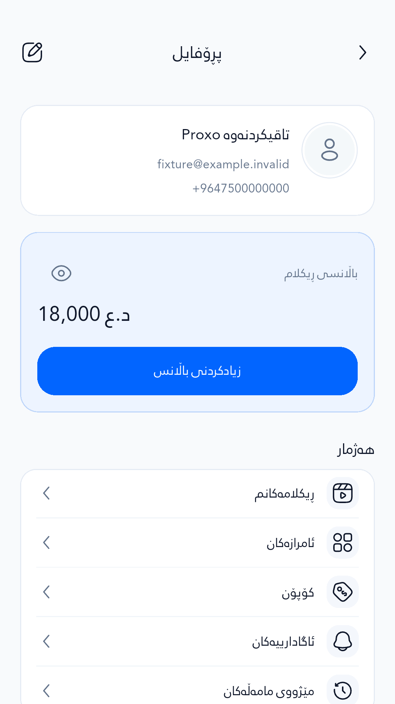
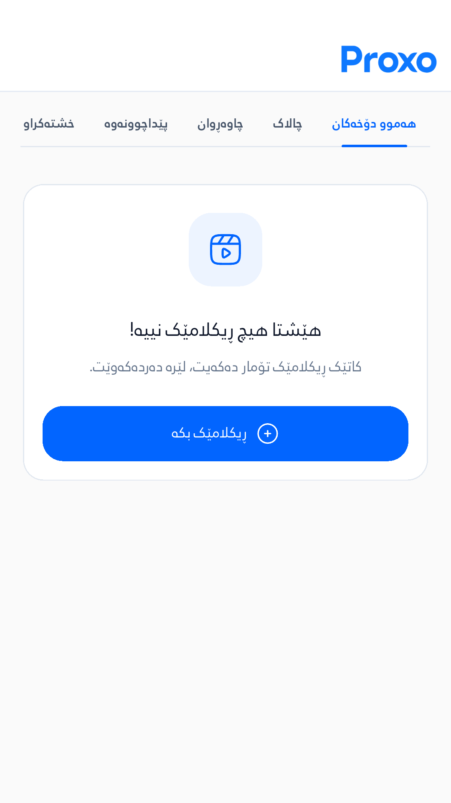
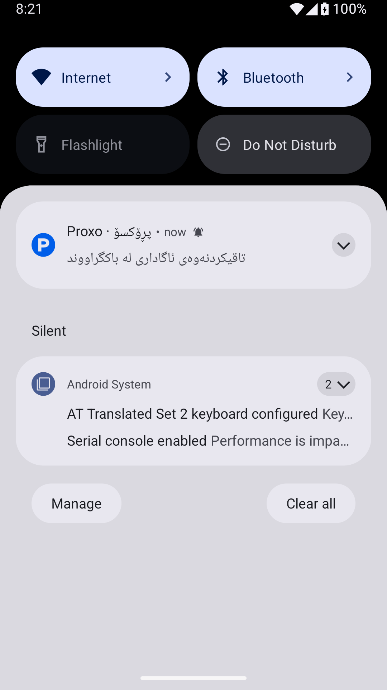

Passed: 42 Android native scenarios

Source `ade200a23732cb5029087e1a6ccac0036f1161b9` (tree `35ed6cc439c5e431a474085e04395e014bc94b13`), [workflow 39391606860](https://github.com/Zana-Sponsor/proxobalance/actions/runs/39391606860).

CI tested merge `d92868011776e0a5ae655fc340ae5db5e1f15e50`, whose tree is identical to the source tree. The artifact SHA-256 matches GitHub's recorded digest. The workflow completed successfully.

42 scenarios, 42 engine frame measurements and 50 actual Android PNG captures are retained.

The native fixture captures current Profile, Ads empty state, auth keyboard, refresh, selected routes and the background notification logo. No customer account, payment or page is modified.

Unexpected backend attempts: 0. Expected blocked trusted-device lookups: 6; expected blocked fictional thumbnail repairs: 1; expected blocked unread-count HEADs: 4.

Observed 1,562 frames on Android 15, x86_64 emulator, profile AOT, software GPU; actual capture size 1080 × 1920, DPR 2.75.

| Engine phase | Median | p90 | p99 | Worst |
|---|---:|---:|---:|---:|
| Build | 0.574 ms | 2.497 ms | 9.381 ms | 31.779 ms |
| Raster | 20.677 ms | 56.039 ms | 105.038 ms | 414.545 ms |

Five build frames and 1,038 raster frames exceeded the fixture's frame budget.

Software GPU rendering may exceed the frame budget. These measurements do not establish that the app is smooth or fast on physical phones.

Limits:

- Android emulator profile AOT with software GPU; frame timings are not physical-phone speed certification.
- Scenario mounting, selected interactions and scrolling were tested; not every button or production backend flow was executed.
- Fictional local backend data; every non-GET Supabase fixture request was rejected before network access.
- Background notification uses the actual local Android/Firebase notification builder; remote FCM delivery was not tested.
- Production page creation, payment, account mutations and network latency were not exercised.

Machine-readable evidence: [verification.json](verification.json), [runtime.json](runtime.json), [frame-summary.csv](frame-summary.csv).

Representative captures:

