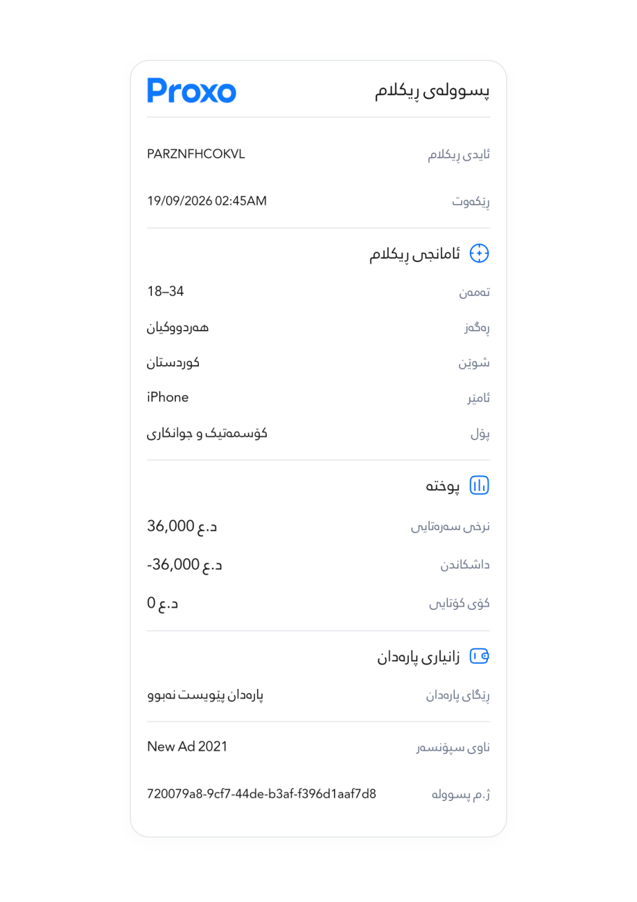
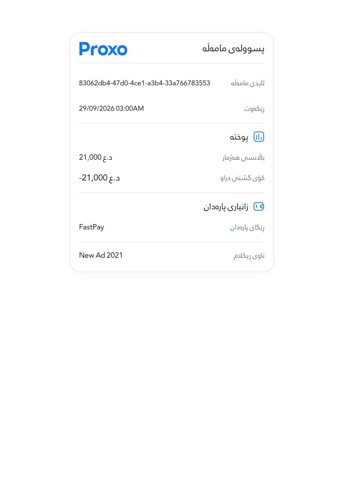
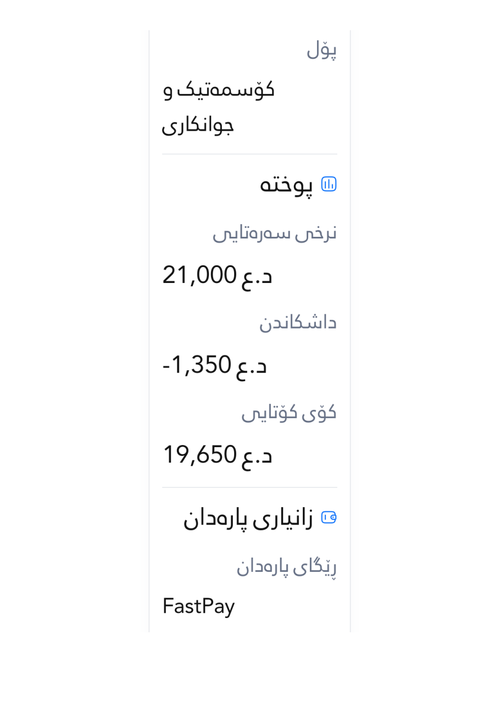
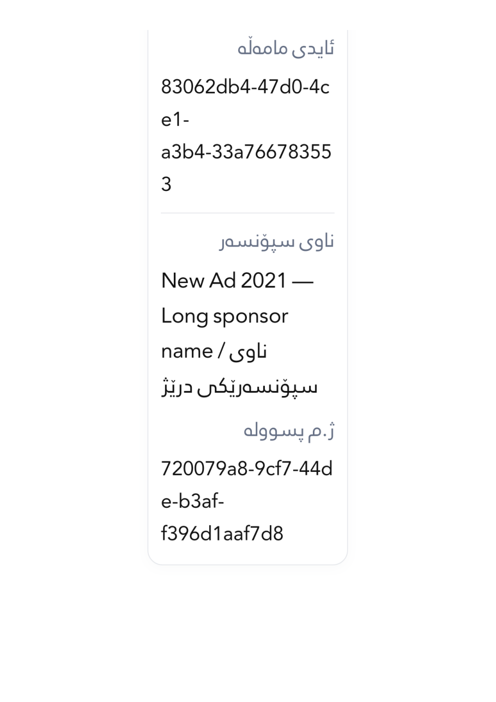
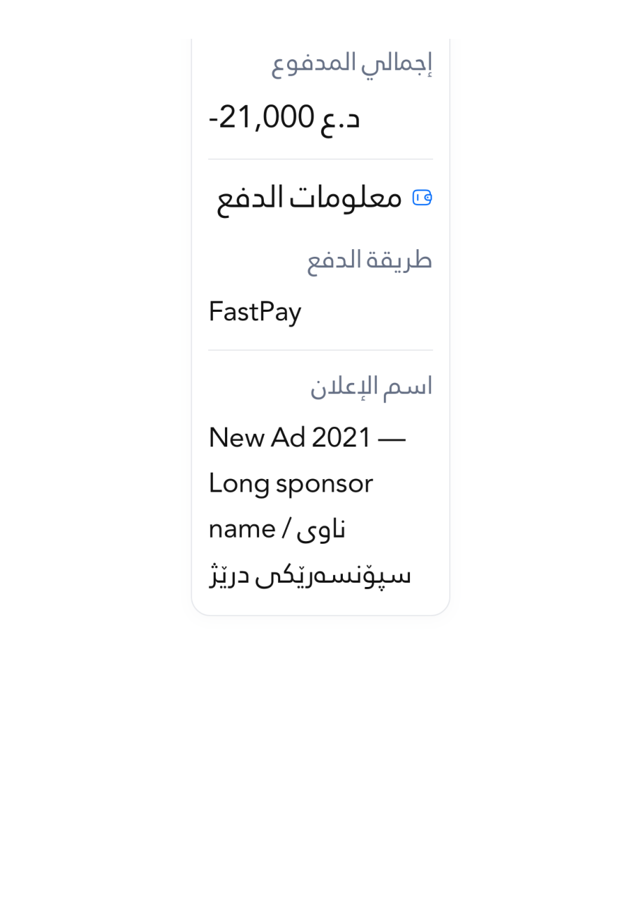

# Receipt export verification — 20 October 2026

The four files below came from the production `exportReceiptPdf` implementation and actual receipt widgets, with the app’s bundled receipt font. The test intercepts the platform sharing channel; it does not send a receipt or perform a payment. All values are fictional.

All **seven A4 pages** were rendered and visually inspected. Titles, labels, amounts, reference values and mixed Kurdish/Latin text remain visible. Standard receipts fit one page. Large text on the narrow viewport uses additional pages; the export breaks between complete rows and keeps a section heading with its first row.

| Actual export | Widget width / text scale | A4 pages | PDF | Rendered pages | Source boundary |
| --- | --- | --- | --- | --- | --- |
| Advertisement, fully discounted | 393dp / 100% | 1 | [PDF](receipts/standard_free.pdf) | [1](receipts/standard_free-page-1.png) | [4× PNG](receipts/standard_free.png) |
| Advertisement, paid, long mixed-direction values | 280dp / 200% | 3 | [PDF](receipts/narrow_paid.pdf) | [1](receipts/narrow_paid-page-1.png), [2](receipts/narrow_paid-page-2.png), [3](receipts/narrow_paid-page-3.png) | [4× PNG](receipts/narrow_paid.png) |
| Payment transaction, Kurdish | 393dp / 100% | 1 | [PDF](receipts/transaction_standard.pdf) | [1](receipts/transaction_standard-page-1.png) | [4× PNG](receipts/transaction_standard.png) |
| Payment transaction, Arabic, long values | 280dp / 200% | 2 | [PDF](receipts/transaction_narrow.pdf) | [1](receipts/transaction_narrow-page-1.png), [2](receipts/transaction_narrow-page-2.png) | [4× PNG](receipts/transaction_narrow.png) |

## Exact output comparison

The decoded image slices embedded in each PDF were concatenated in page order and compared with the actual 4× Flutter receipt boundary. Both were composited on white before comparing RGB pixels. **All 22,713,160 pixels match exactly: zero changed pixels and zero maximum channel error.** This verifies that the export retained the entire captured receipt, including long identifiers and final rows. It does not substitute for a printer hardware test.

[Machine-readable PDF hashes, page dimensions and pixel results](receipt-export-parity.json). Reproduce the hash and pixel checks with [verify_artifacts.py](verify_artifacts.py).

## Responsive row measurements

The receipt layout tests recorded **108 cases and 1,102 rows** across widths 280, 320, 360, 392.73, 393, 430, 480, 640 and 768dp; Kurdish and Arabic; and 100%, 130% and 200% text. The matrix includes 893 side-by-side rows and 209 stacked rows. Side-by-side rows have a maximum baseline error of **0dp** and a minimum label/value gap of **8dp**. Long content is wrapped or stacked instead of truncated.

[All measured rows](receipt-measurements.json)

The PDF source previews intentionally preserve the user’s active text scale and 4× raster shaping. The large-text PDFs are narrow columns on A4 rather than enlarged to fill the paper. This retains the app’s readable hierarchy and avoids distorting the receipt.

## Visual review

| Advertisement receipt | Payment receipt |
| --- | --- |
|  |  |

| Narrow advertisement page 1 | Page 2 | Page 3 |
| --- | --- | --- |
|  |  |  |

| Narrow payment page 1 | Page 2 |
| --- | --- |
|  |  |
