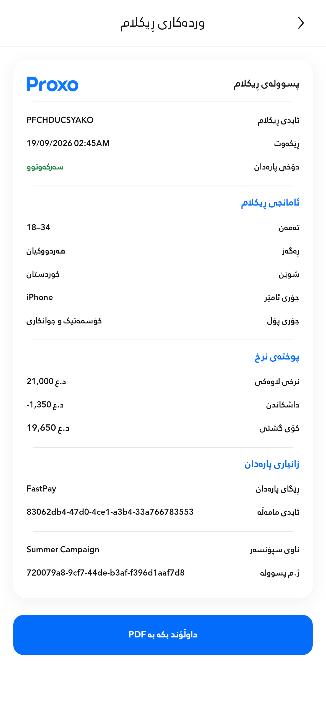
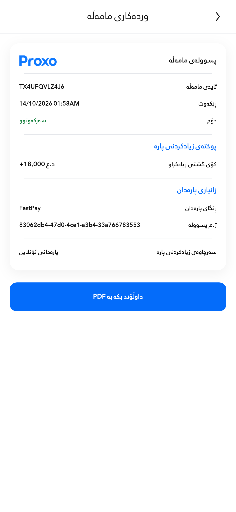

# Payment-status wording

Requested Sorani display labels are now consistent on advertisement and payment receipts:

| Payment state | Display |
| --- | --- |
| Paid / approved / spent | سەرکەوتوو |
| Pending / awaiting payment | چاوەڕوان |
| Refunded; or an approved refund transaction | گەڕاوە |
| Failed / rejected | شکست |

A pending or rejected refund retains its actual pending or failure label. Stored status codes, settlement rules, amounts, balances, colors and receipt geometry are unchanged. Unpaid, cancelled, partial-refund and unknown states retain their separate existing handling; they are not relabeled as successful payments or full refunds.

## Actual app screenshots

Production Flutter screens with fictional test data: **393 × 852dp**, normal text, 3× capture.

| Advertisement receipt | Payment receipt |
| --- | --- |
|  |  |

## Checks

- **161 existing tests passed** across localization, advertisement receipt data, receipt layouts/PDFs, the unchanged canonical golden and transaction history.
- Existing data-preservation tests now check the requested labels, known status aliases and unknown-state preservation. The transaction layout matrix verifies successful, pending and failed states for all receipt kinds, including settled versus pending refunds, across 280–768dp and enlarged text.
- Both screenshot capture cases passed, including PDF export completion. Both images were visually inspected.
- Pixel comparison: advertisement image changed 1,739 pixels; payment image changed 1,520 pixels. **Zero pixels changed outside the status-value area** on either screen.
- Scoped analysis: no errors or warnings; one pre-existing informational style lint on an unchanged line.

[Machine-readable comparison](verification.json). Host tests do not establish physical-device performance; no production deployment was performed.
