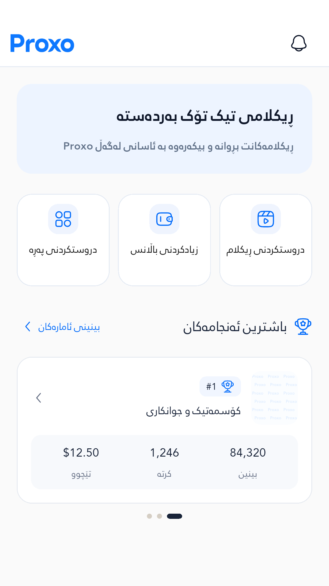
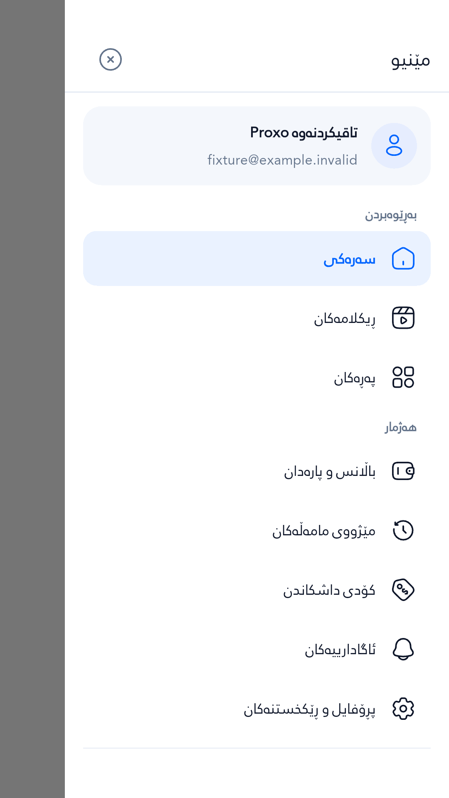
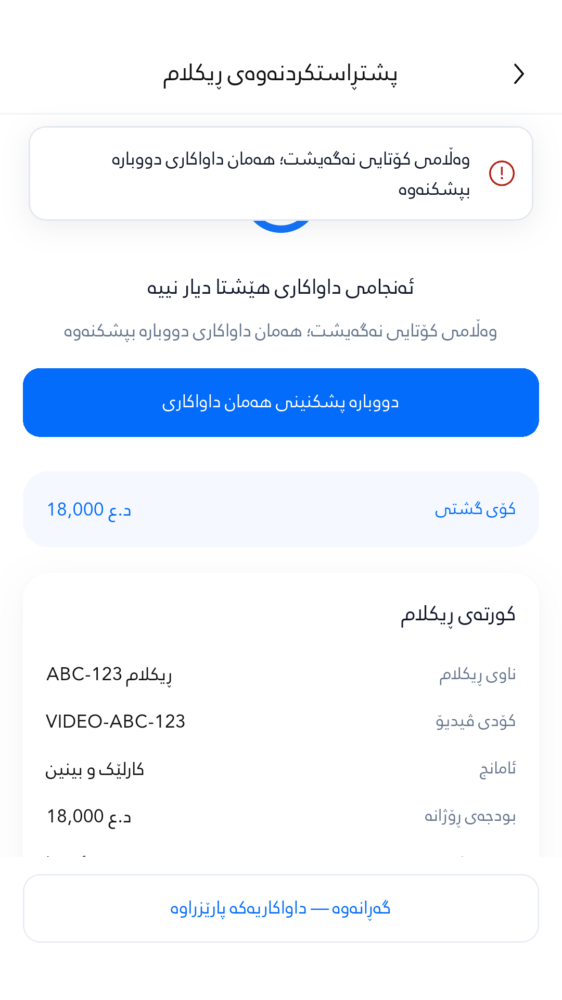
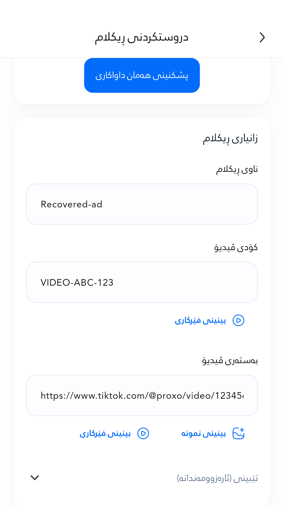
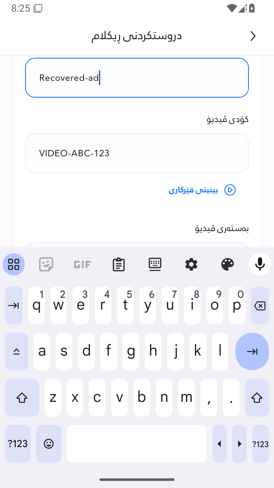
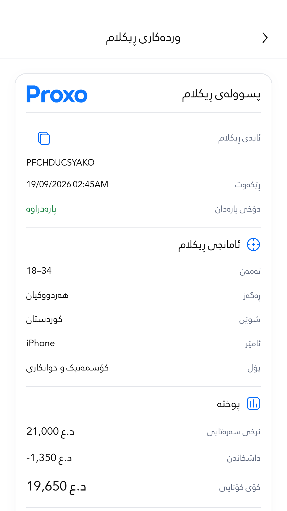
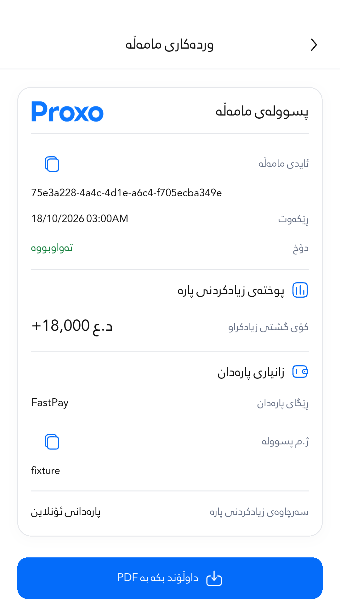

# Actual Android profile evidence

Source `12e4e7cc9048449cd46d347597fbedda714a5563`, October 22, 2026. [Successful CI run](https://github.com/Zana-Sponsor/proxobalance/actions/runs/39847041747) tested a PR merge with the identical full source tree. Android 15/API 35 x86_64 emulator, Flutter 3.47.2 profile/AOT, SwiftShader software GPU, animations enabled.

**Observed capture size: 1080×1920px, DPR 2.75, approximately 392.7×698.2 logical pixels.** The runner requested 1080×2340 but Android, Flutter and all PNG dimensions report 1080×1920. These labels use the observed size. Android/IME system surfaces appear in adb captures; Flutter surface captures show app content.

The fixture completed 45 screen/action scenarios, collecting 1,515 engine frames and 60 native PNGs (56 Flutter surface captures and four adb captures). Eight selected screenshots follow. All images use synthetic data and real production widgets; no live payment or hosted customer write occurred. Standalone screens omit the main-shell bottom navigation. The Home fixture also omits its menu callback; see the [widget gallery](../../gallery.md) for full shared app-bar renders.

| Check | Observed result |
| --- | --- |
| Android Back | Closed the real Drawer and kept the activity alive |
| Other menu dismissal | Backdrop and close control passed; three cycles, no unintended navigation |
| Ad error recovery | Editing, scrolling, navigation and retry restored; pending UUID reused and edited title retained |
| Real keyboard | Android text input succeeded; IME inset 946px and edited field visible |
| Validation error notice | Observed removal at 2,043ms with scrolling preserved; deterministic widget tests separately cover the 2,000ms logical deadline |

## Performance limits

| Sample | Frames | Build p95 | Raster p95 |
| --- | ---: | ---: | ---: |
| All scripted scenarios | 1,515 | 5.962ms | 92.598ms |
| Authentication login | 33 | 4.343ms | 63.087ms |
| Home cold mount | 6 | 11.065ms | 672.341ms |
| Home refresh | 56 | 3.513ms | 58.576ms |
| Advertisement creation cold mount | 8 | 34.230ms | 101.080ms |
| Advertisement error recovery | 272 | 9.853ms | 95.213ms |

**The performance target was not met on this software-rendered emulator.** 1,347 of 1,515 raster frames exceeded 16ms. These are mixed scripted/cold samples, not sustained production frame-rate sampling. Hardware-GPU and physical-device smoothness remain unverified; without a comparable baseline these results cannot establish whether an app regression exists. Functional success does not imply performance sign-off.

[Complete frame analysis](performance-analysis.json) · [Raw measurements](performance-summary.json) · [Runtime assertions](runtime.json) · [Device metadata](device.json) · [CI/source provenance](run.json) · [Screenshot hashes](screenshots.json) · [Release APK provenance](apk-provenance.json)

## Selected native screenshots

### Home

Home standalone fixture with summary-only Best Results. Main-shell menu callback and bottom navigation are omitted by the fixture. Viewport: 1080×1920px / 392.7×698.2dp.

### Menu Open Native

Actual open RTL Drawer before Android Back; lower menu content is scrollable and is outside this viewport. Viewport: 1080×1920px / 392.7×698.2dp.

### Menu After Dismissal

Intentionally empty fixture host after Back, scrim-tap and close-control dismissal cycles. The empty host is test setup, not a product screen. Viewport: 1080×1920px / 392.7×698.2dp.

### Ad Submit Error

Uncertain advertisement response with shared non-blocking notification and recovery controls. Viewport: 1080×1920px / 392.7×698.2dp.

### Ad Error Retry Restored

Advertisement form after retry, preserving the title edited through Android input. Viewport: 1080×1920px / 392.7×698.2dp.

### Ad Error Keyboard Android

Actual Android keyboard and editable Recovered-ad title following submission failure. Viewport: 1080×1920px / 392.7×698.2dp.

### Advertisement Receipt

Actual advertisement receipt screen; additional lower content remains scrollable. Viewport: 1080×1920px / 392.7×698.2dp.

### Payment Receipt

Actual payment receipt; long identifier uses contained single-line scrolling with copy control. Viewport: 1080×1920px / 392.7×698.2dp.

[Return to the 15-point report](../../README.md)
