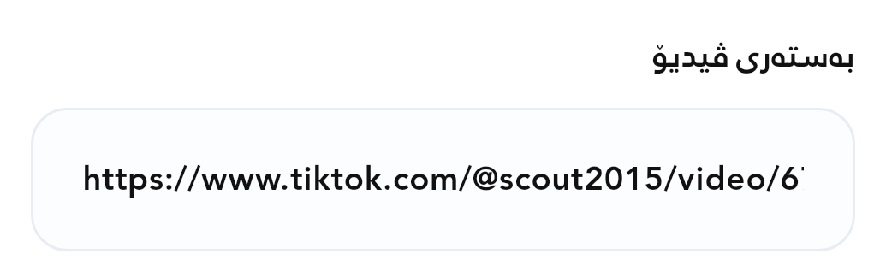
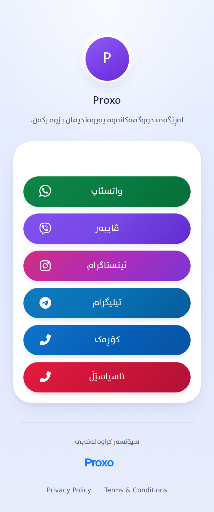
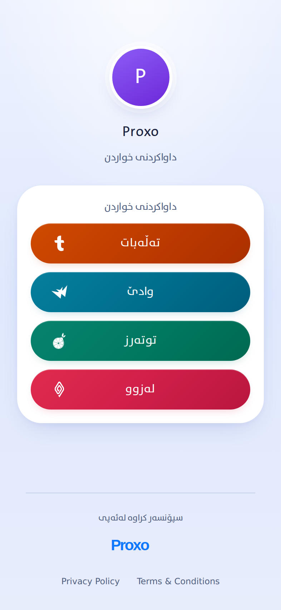
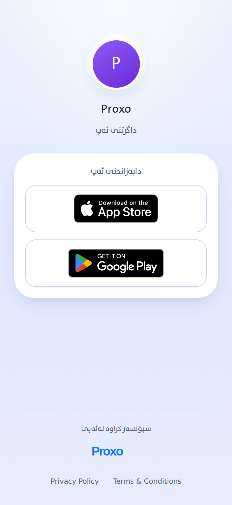

# نمونەی ڕاستەقینە و پشکنینی فۆتەری پەڕەکان

وێنەی دەستکردی بەستەری ڤیدیۆ گۆڕدرا بە **سکرینشۆتی ڕاستەقینەی خانەی بەستەر لە ئەپی Proxo**، بە قەبارەی ١٠٣٥ × ٣١٨ پیکسڵ. وێنەکە لە هەمان `AdCreateScreen` گیراوە؛ وێنەی ڕووکارێکی خەیاڵی یان شاشەی TikTok نییە. بەستەری نمونە لە بەڵگەنامەی فەرمی TikTok وەرگیراوە؛ دەقی تەواوی بەستەر لە ژێر وێنەکە هەڵدەبژێردرێت. هیچ ڕیکلامێک دروست نەکراوە.

کێشەی «بینینی نمونە» لە دروستکردنی پەڕە چاک کرا: پێشتر هەمیشە وێنەی کلاسیک پیشان دەدرا؛ ئێستا وێنەی **هەمان جۆری پەڕە و هەمان ستایلی هەڵبژێردراو** دەکرێتەوە. وێنەکان بە تەواوی دەبینرێن و لە پەنجەرەی نمونەدا بە سکڕۆڵ دەگەیتە فۆتەر.

[سەرچاوەی گۆڕانکاری](https://github.com/Zana-Sponsor/proxobalance/commit/eca117d1338e8b0e8f04e6573aa0e0af34574a28) لە [CI ـی نوێ](https://github.com/Zana-Sponsor/proxobalance/actions/runs/39232901508) تاقی کراوەتەوە: **٣٤ تێستی Flutter سەرکەوتوو**، لەوانە ٢٤ حاڵەتی گۆڕینی جۆر/ستایل لە شاشەی ڕاستەقینەی ئەپ بە پانی ٣٩٣ و ٣٢٠ و دەقی ١٠٠٪ و ١٦٠٪. تێستەکان ناو و دەقی پەڕە دەپارێزن، وێنەی هەڵبژێردراو دەکەنەوە، پیکسڵەکانی دەخوێننەوە، بە سکڕۆڵ خوارەوەی وێنە دەبینن و پەنجەرەکە دادەخەن. هەروەها نمونەکان بە سۆرانی/عەرەبی/بادینی، پانی ٣٩٣/٢٨٠ و دەقی ١٠٠٪/٢٠٠٪ تاقی کراونەتەوە.

[٢٤ سکرینشۆتی هەڵبژاردنی ستایل](app/page-example-evidence/) و [٢٤ سکرینشۆتی زمان و شاشەی بچووک](app/help-evidence/) لە Flutter گیراون؛ سکرینشۆتی مۆبایلی ڕاستەقینە نین. [تۆماری تێست](app/example-tests/tests.log) و [پێوانە و SHA256](app/page-example-evidence/manifest.json) هەمان ئەنجامی CI ـن.

| ستایل | نمونەی پەیوەندی لە ناو ئەپ | نمونەی خواردنگە لە ناو ئەپ | نمونەی داگرتن لە ناو ئەپ |
|---|---|---|---|
| کلاسیک | [سەرەوە](app/page-example-evidence/contact-pill-top.png) · [خوارەوە و فۆتەر](app/page-example-evidence/contact-pill-bottom.png) | [سەرەوە](app/page-example-evidence/order-pill-top.png) · [خوارەوە و فۆتەر](app/page-example-evidence/order-pill-bottom.png) | [سەرەوە](app/page-example-evidence/download-pill-top.png) · [خوارەوە و فۆتەر](app/page-example-evidence/download-pill-bottom.png) |
| سروشتی | [سەرەوە](app/page-example-evidence/contact-pill-mint-top.png) · [خوارەوە و فۆتەر](app/page-example-evidence/contact-pill-mint-bottom.png) | [سەرەوە](app/page-example-evidence/order-pill-mint-top.png) · [خوارەوە و فۆتەر](app/page-example-evidence/order-pill-mint-bottom.png) | [سەرەوە](app/page-example-evidence/download-pill-mint-top.png) · [خوارەوە و فۆتەر](app/page-example-evidence/download-pill-mint-bottom.png) |
| تاریک | [سەرەوە](app/page-example-evidence/contact-pill-dark-top.png) · [خوارەوە و فۆتەر](app/page-example-evidence/contact-pill-dark-bottom.png) | [سەرەوە](app/page-example-evidence/order-pill-dark-top.png) · [خوارەوە و فۆتەر](app/page-example-evidence/order-pill-dark-bottom.png) | [سەرەوە](app/page-example-evidence/download-pill-dark-top.png) · [خوارەوە و فۆتەر](app/page-example-evidence/download-pill-dark-bottom.png) |
| ڕووناک | [سەرەوە](app/page-example-evidence/contact-pill-white-top.png) · [خوارەوە و فۆتەر](app/page-example-evidence/contact-pill-white-bottom.png) | [سەرەوە](app/page-example-evidence/order-pill-white-top.png) · [خوارەوە و فۆتەر](app/page-example-evidence/order-pill-white-bottom.png) | [سەرەوە](app/page-example-evidence/download-pill-white-top.png) · [خوارەوە و فۆتەر](app/page-example-evidence/download-pill-white-bottom.png) |

[نمونەی لینک بە سۆرانی](app/help-evidence/video-link-ckb-393.png) · [عەرەبی](app/help-evidence/video-link-ar-393.png) · [بادینی](app/help-evidence/video-link-kmr-393.png) · [سۆرانی بە دەقی ٢٠٠٪](app/help-evidence/video-link-ckb-280.png)

بەشی دروستکردنی پەڕە **سێ جۆری پەڕە** هەیە: پەیوەندی، خواردنگە و ڕێستۆرانت، و داگرتنی ئەپ. هەر جۆرێک **چوار ستایل** هەیە: کلاسیک، سروشتی، تاریک و ڕووناک. کۆی پشکنینەکە ١٢ تێکەڵەی جۆر و ستایلە.

وێنەکانی خوارەوە سکرینشۆتی ڕاستەقینەی HTML ـی پەڕەکانن، کە بە هەمان renderer ـی پڕۆژەکە لە Chromium گیراون. زانیارییەکانی ناو پەڕەکان زانیاریی نمونەن؛ وێنەکان بە AI دروست نەکراون و وێنەی پەڕەی کڕیارێک نین. هەر وێنەیەک **١١٧٩ × ٣١٢٠ پیکسڵ** ـە، بە قەبارەی ٣٩٣ × ١٠٤٠ CSS pixel و DPR = 3، بە `fullPage: true` و بێ بچووککردنەوە گیراوە.

| جۆری پەڕە | کلاسیک | سروشتی | تاریک | ڕووناک |
|---|---|---|---|---|
| پەیوەندی | [وێنەی تەواو](../../../proxo_app/assets/proxolink_thumbnails/contact-pill.png) | [وێنەی تەواو](../../../proxo_app/assets/proxolink_thumbnails/contact-pill-mint.png) | [وێنەی تەواو](../../../proxo_app/assets/proxolink_thumbnails/contact-pill-dark.png) | [وێنەی تەواو](../../../proxo_app/assets/proxolink_thumbnails/contact-pill-white.png) |
| خواردنگە و ڕێستۆرانت | [وێنەی تەواو](../../../proxo_app/assets/proxolink_thumbnails/order-pill.png) | [وێنەی تەواو](../../../proxo_app/assets/proxolink_thumbnails/order-pill-mint.png) | [وێنەی تەواو](../../../proxo_app/assets/proxolink_thumbnails/order-pill-dark.png) | [وێنەی تەواو](../../../proxo_app/assets/proxolink_thumbnails/order-pill-white.png) |
| داگرتنی ئەپ | [وێنەی تەواو](../../../proxo_app/assets/proxolink_thumbnails/download-pill.png) | [وێنەی تەواو](../../../proxo_app/assets/proxolink_thumbnails/download-pill-mint.png) | [وێنەی تەواو](../../../proxo_app/assets/proxolink_thumbnails/download-pill-dark.png) | [وێنەی تەواو](../../../proxo_app/assets/proxolink_thumbnails/download-pill-white.png) |

فۆتەر لە هەر چوار HTML ـی ستایلەکاندا هەمان ناوەڕۆکی تەواوی هەیە:

- دەقی «سپۆنسەر کراوە لەئەپی».
- لۆگۆی Proxo بە قەبارەی ٨٤ × ٢٤ CSS pixel.
- لینکی `Privacy Policy` و `Terms & Conditions`.
- بەرزی کەمترین شوێنی کلیککردنی لینکەکان ٤٤ CSS pixel.
- پشتیوانیی `safe-area-inset-bottom` و ڕێکخستنی فۆتەر دوای ناوەڕۆک؛ لە پەڕەی درێژدا بە سکڕۆڵ دەگەیتە فۆتەری تەواو.

پشکنینی checksum ـی هەر ١٢ PNG لەگەڵ [manifest ـی سکرینشۆتەکان](../../../proxo_app/tool/proxolink-thumbnail-manifest.json) یەکسان بوو. [سکریپتی گرتنی وێنەکان](../../../proxo_app/tool/generate_proxolink_thumbnails.mjs) هەمان ڕێڕەوی `template-preview` بە زانیاریی نمونە بەکار دەهێنێت؛ هیچ پەڕەیەکی کڕیار ناگۆڕێت.

**پشکنینی نوێی فۆتەر سەرکەوتوو بوو: ٩٦ لە ٩٦ حاڵەت.** [verify-proxolink-footers.mjs](../../../scripts/verify-proxolink-footers.mjs) لە [CI run 39232901508](https://github.com/Zana-Sponsor/proxobalance/actions/runs/39232901508) بە Chromium `151.0.7922.34` جێبەجێ کرا: هەموو ١٢ تێکەڵە، پانی ٣٢٠ و ٣٩٣، دەقی ئاسایی و درێژ، و قەبارەی دەقی ١٠٠٪ و ١٦٠٪. تەواوی دەق و لۆگۆ و لینکەکانی فۆتەر دوای سکڕۆڵ دیار بوون؛ هیچ بەشێکیان نەبڕاوە و پێک نەکەوتوون.

| پێوانە | ئەنجامی تۆمارکراو |
|---|---|
| حاڵەتی سەرکەوتوو | ٩٦ / ٩٦ |
| بەرزی فۆتەر | ١٦٣ تا ٢٢١٫١٩ CSS pixel |
| قەبارەی لۆگۆ | ٨٤ × ٢٤ CSS pixel |
| بچووکترین شوێنی کلیککردنی لینک | ٩٣٫٧٨ × ٤٤ CSS pixel |
| کەمترین بۆشایی نێوان کۆتا دووگمەی پەڕە و فۆتەر | ٥٣ CSS pixel |
| ناوەڕۆک لە دەرەوەی پانی شاشە | ٠ |
| هەڵەی JavaScript | ٠ |
| داواکاری بۆ تۆڕی دەرەکی | ٠ |

[ئەنجام و هەموو پێوانەکان](rendered/results.json) و [٢٤ سکرینشۆتی نوێ](rendered/screens/) بە بێ دەستکاری لە ئەنجامی CI کۆپی کراونەتەوە. هەر ١٢ وێنەی فۆتەر و ١٢ وێنەی تەواو بە بینینیش پشکنران. قەبارەی وێنە تەواوەکانی پەیوەندی ٧٨٦ × ١٨٧٦ پیکسڵە؛ وێنە تەواوەکانی خواردنگە و داگرتن ٧٨٦ × ١٧٠٤ پیکسڵن. هەر ١٢ وێنەی خوارەوەی پەڕە ٧٨٦ × ١٧٠٤ پیکسڵن؛ ئەمانە بە DPR = 2 گیراون.

| پەیوەندی — وێنەی تەواو | خواردنگە — وێنەی تەواو | داگرتن — وێنەی تەواو |
|---|---|---|
|  |  |  |

| ستایل | فۆتەری پەیوەندی | فۆتەری خواردنگە | فۆتەری داگرتن |
|---|---|---|---|
| کلاسیک | [وێنە](rendered/screens/contact-pill-footer.png) | [وێنە](rendered/screens/order-pill-footer.png) | [وێنە](rendered/screens/download-pill-footer.png) |
| سروشتی | [وێنە](rendered/screens/contact-pill-mint-footer.png) | [وێنە](rendered/screens/order-pill-mint-footer.png) | [وێنە](rendered/screens/download-pill-mint-footer.png) |
| تاریک | [وێنە](rendered/screens/contact-pill-dark-footer.png) | [وێنە](rendered/screens/order-pill-dark-footer.png) | [وێنە](rendered/screens/download-pill-dark-footer.png) |
| ڕووناک | [وێنە](rendered/screens/contact-pill-white-footer.png) | [وێنە](rendered/screens/order-pill-white-footer.png) | [وێنە](rendered/screens/download-pill-white-footer.png) |

سەرچاوەی CI لە PR head ـی `eca117d1338e8b0e8f04e6573aa0e0af34574a28` ـە؛ commit ـی merge ـی تاقیکراوە `ba867942896571d6fbcc38e77ec533a320c239dc` لە `results.json` تۆمار کراوە. هاشی SHA256 ـی هەموو ٨ پەڕگەی renderer و پشکنین لەگەڵ کۆدی ئێستا یەکسانە؛ هاش و قەبارەی هەر ٢٤ وێنەش لەگەڵ ئەنجامی CI یەکسانن. HTML ـی فۆتەری ستایلەکان نەگۆڕدراوە.

لینکەکانی فۆتەر لە کۆدەکەدا `https://proxopages.com/`، `https://proxopages.com/policy` و `https://proxopages.com/terms` ـن. پشکنینی geometry تەنها قەبارە و ناوەڕۆک دەپێوێت. **پشکنینێکی جیاوازی HTTP لە ٢٠٢٦-١٠-١٩** هەرسێ لینکەکەی بە `200` پشتڕاست کردەوە؛ پەڕەی تایبەتمەندی و مەرج ناوەڕۆکی ڕاستەقینەی خۆیان هەبوو، نە پەڕەی 404. [کات، ناونیشان و ئەنجامی لینکەکان](footer-destinations.json). پشکنینی safe area لە Chromium ڕێسای CSS پشتڕاست دەکاتەوە، بەڵام جێگای تێستی مۆبایلێکی ڕاستەقینە ناگرێتەوە.

**تێستی گشتی و Android:** [Verify run 39232901469](https://github.com/Zana-Sponsor/proxobalance/actions/runs/39232901469) هەموو ٥ job ـەکەی سەرکەوتوو بوو؛ **٨٨٢ تێستی Flutter** تێپەڕین. [لۆگی گشتی](full-suite.log). [تێستی Android](https://github.com/Zana-Sponsor/proxobalance/actions/runs/39232901476) ـیش سەرکەوتوو بوو. کۆدی ڕێڕەوی API ـی ئیمێڵ لەم گۆڕانکارییەدا دەستکاری نەکراوە. [ناسنامەی کۆد و CI](ci-verification.json).

**APK ـی نوێ:** `Proxo-1.0.9-real-examples.apk`، وەشان `1.0.9+9`، قەبارە ٩٣٬٠٤٢٬٩٦٣ بایت. لە [artifact ـی GitHub](https://github.com/Zana-Sponsor/proxobalance/actions/runs/39232901469/artifacts/12177963826) بەردەستە. واژۆی v2، ناسنامەی ئەپ، وێنەی ڕاستەقینە و هەر ١٢ PNG ـی پەڕەکان پشکنران و لەگەڵ سەرچاوە یەکسانن؛ SVG ـی کۆن لە فایلەکەدا نییە. [پشکنینی APK](apk-verification.json) · [واژۆ](signature.txt).

SHA256: `40e212209fc4a3bbf29fbfefd013350dafaca1faa5c9a70a58bcb4376fff3fe4`.

ئەمە APK ـی **تاقیکردنەوە بە واژۆی Android Debug** ـە. واژۆکەی لە APK ـی تاقیکردنەوەی پێشوو جیاوازە؛ بۆیە ڕاستەوخۆ وەک update لەسەر ئەو وەشانە دانانرێت. گۆڕانکارییەکان لە PR ـن و هێشتا merge نەکراون.
