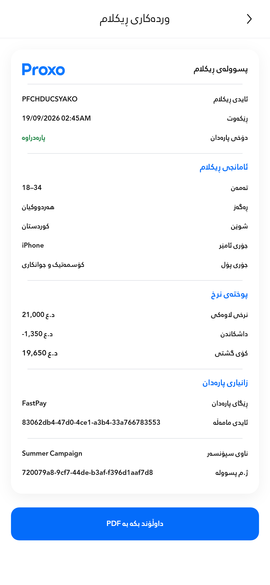

# Requested Kurdish labels — unchanged design

Only displayed names changed in Create Advertisement, confirmation and the advertisement receipt. Typography, colors, widget structure, geometry, pricing, discount conditions and `د.ع` formatting are unchanged. Payment receipts are unchanged.

| Label | Requested wording |
| --- | --- |
| Category | جۆری پۆل |
| Device | جۆری ئامێر |
| Price heading | پوختەی نرخ |
| Existing base amount | نرخی لاوەکی |
| Existing service fee | کرێی خزمەتگوزاری |
| Existing positive discount rows | داشکاندن |
| Total | کۆی گشتی |

No pricing rows were added, removed or consolidated. Each existing discount remains conditional. The receipt retains its existing persisted original amount; its data calculation has not changed.

## Actual app render

Advertisement receipt with fictional data: **393 × 852dp**, normal text, 3× capture. This is the production Flutter screen rendered in the host widget harness.

[Canonical receipt capture — 393 × 627dp, 4×](../../../proxo_app/docs/receipt_labels_preview.png)

## Verification

- **209 tests passed across seven existing files**, covering localization, creation/retry, responsive form layouts, receipt/PDF layouts and pricing. The golden was then compared normally without update mode.
- Canonical surface, card, all five dividers and all thirteen row rectangles still match the original exact geometry assertions.
- Pixel comparison against the immutable original `receipt_preview.png`: **9,901 changed pixels, all contained in the five requested receipt text regions; zero changes outside those regions**. The updated text has a separate golden, leaving the original intact.
- Scoped analysis of seven changed Dart files: no errors or warnings; three pre-existing informational style lints on unchanged lines.
- The 393dp receipt capture case passed, including PDF export completion. The refreshed app screenshot was visually inspected for the longer Kurdish labels and unchanged alignment.

[Machine-readable checks](verification.json). This is a PR change, not a production deployment or physical-device validation.
