# Receipts matching the supplied reference

Source: [`1c69818f`](https://github.com/Zana-Sponsor/proxobalance/commit/1c69818fe37ce0fdb3d7b95bf715a54288141a48); receipt implementation `2437d790` plus explicit font loading in app test fixtures. PR [#44](https://github.com/Zana-Sponsor/proxobalance/pull/44). These are actual Flutter widgets and exported PDFs using fictional records, not design mockups.

The advertisement receipt at **393 × 627dp, 100% text, captured at 4×** matches the unchanged historical reference **pixel for pixel: 0 differing pixels out of 3,942,576**. The rendered PNG is also byte-identical. The user's 1283 × 2048 attachment is a resized version: a uniform bilinear comparison differs by no more than two RGB levels, with 99.99882% of pixels within one level. The upload service's exact resampler is unknown; exact equality is claimed for the original canonical PNG, not the uploaded resize.

## What changed

- Restored original Rabar_021 outlines, black labels/values, 13sp blue headings, 11sp fields/identifiers, 12sp total, proportional logo, white shadow card, inset dividers and original spacing.
- Both receipt types use these shared components. Payment receipts retain their own transaction fields and status.
- The zero-charge advertisement retains its payment-information section and “no payment required” value. It does not add an extra status row or visible copy icons absent from the reference.
- Fitting IDs use the original 20dp row and long-press copy. Overflowing IDs retain a full-width single-line scroll area and 48dp copy action; PDF exports include the whole identifier.
- Native text sizing and wrapping remain responsive. Explicit multiline values stack under their labels. App headers and transaction history keep their existing regular typography and dimensions.
- Standard PDF artwork is pixel-identical to its on-screen capture. Only overflowing identifier viewports are repainted for complete export; long receipts paginate between rows.

## Exact reference capture

[Actual advertisement PNG](ad-reference-393dp-4x.png) · [Supplied attachment](reference-upload.png) · [Pixel measurements](comparison.json) · [Reproducible comparison script](verify_reference.py)


## Payment receipt

[Actual payment PNG](exports/transaction_standard.png) · [Payment PDF](exports/transaction_standard.pdf) · [Advertisement PDF](exports/standard_free.pdf)

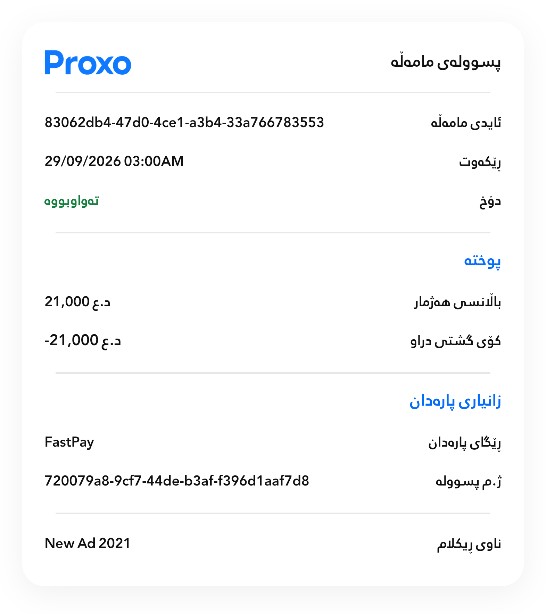

## Verification

| Check | Observed result |
| --- | --- |
| Focused Flutter suite | 215 passed, 0 failed, nine files |
| Wider UI workflow regression | 440 passed, 0 failed, 14 files; overlaps with the focused suite |
| Reference golden | Exact PNG and RGBA equality; included in 215 |
| Fullscreen capture cases | Eight passed; 10 fresh screenshots including two scrolled bottom states |
| Static analysis | Nine items; zero errors, warnings or informational findings |
| PDF export cases | Four passed; six rendered pages reviewed |
| Standard exported artwork | Both embedded PDF images have zero differing pixels from their widget capture |
| Responsive states | 280, 393 and 768dp captures; 200% text; layout tests additionally include 240dp/300% and Kurdish/Arabic mixed text |
| Preserved behavior | Full ID copying/scrolling/metadata, row-safe pagination, duplicate export prevention, retry/history controls and app-bar navigation |

[Wider regression log](logs/ui-workflow-regression-tests.log) · [Font-fixture analyzer](logs/font-loader-analysis.log) · [Verification metadata](verification.json) · [Test log](logs/focused-tests.log) · [Golden log](logs/reference-match-tests.log) · [Capture log](logs/receipt-capture-tests.log) · [Analyzer log](logs/focused-analysis.log) · [PDF review](pdf-review.json) · [Screen review](screen-review.json)

Environment: Flutter **3.47.2**, Dart **3.13.2**, Linux x86_64 host widget tests with real bundled fonts and decoded image assets. The wider run verifies the complete UI workflow test group plus golden, direction and responsive checks. App fixtures explicitly load Rabar_022 separately from the receipt font; this fixes the CI-only fixture fallback without changing production button dimensions. These checks do not measure physical-device frame rate. No production payment or deployment was performed.

## Responsive screen gallery

Each filename identifies the receipt type, logical width, system text scale and device-pixel ratio. Captures use a fictional paid advertisement or transaction so additional relevant fields appear. Bottom captures demonstrate scrolling and the PDF action.

### Advertisement receipt — scrolled bottom; 280 × 852dp, 100% text, 1× density

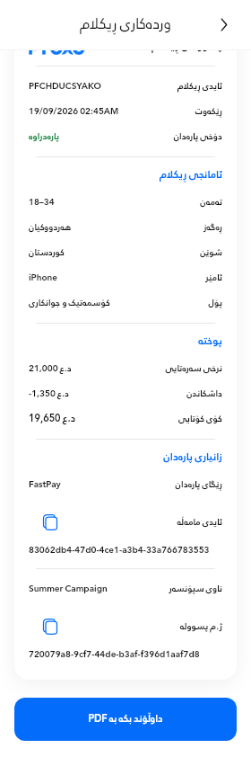

### Advertisement receipt — initial view; 280 × 852dp, 100% text, 1× density

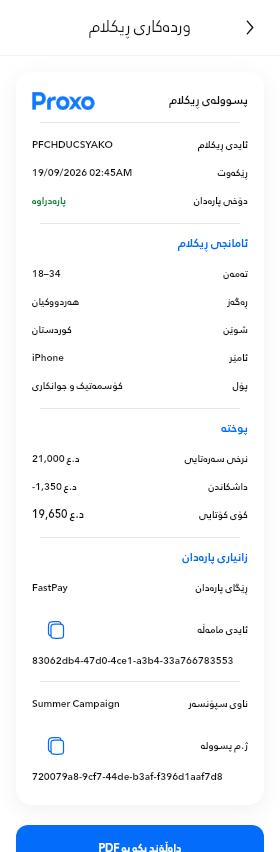

### Advertisement receipt — initial view; 393 × 852dp, 100% text, 3× density

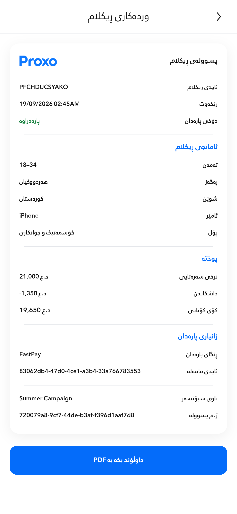

### Advertisement receipt — scrolled bottom; 393 × 852dp, 200% text, 1× density

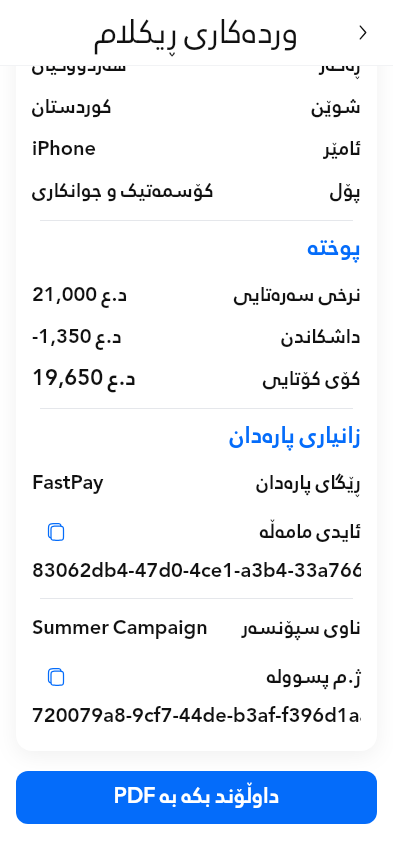

### Advertisement receipt — initial view; 393 × 852dp, 200% text, 1× density

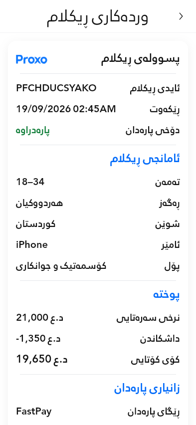

### Advertisement receipt — initial view; 768 × 852dp, 100% text, 2× density

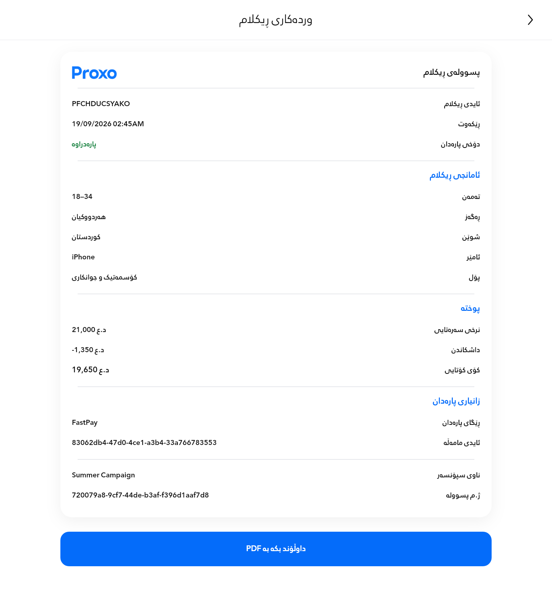

### Payment receipt — initial view; 280 × 852dp, 100% text, 1× density

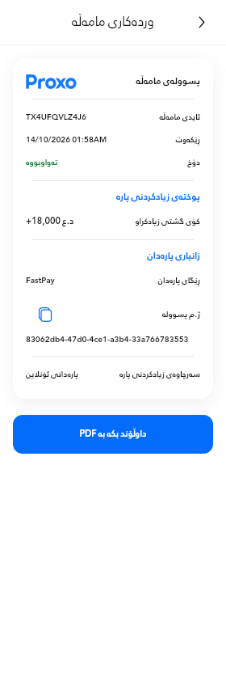

### Payment receipt — initial view; 393 × 852dp, 100% text, 3× density

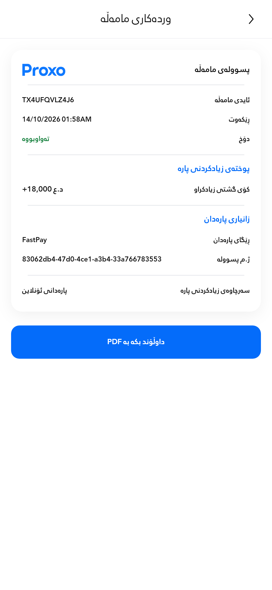

### Payment receipt — initial view; 393 × 852dp, 200% text, 1× density

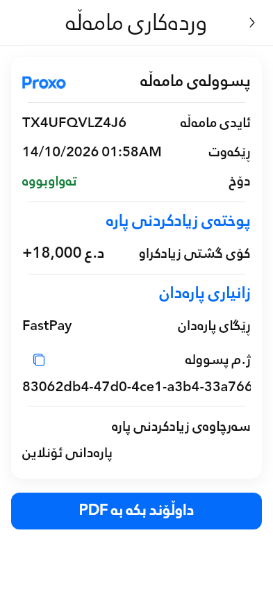

### Payment receipt — initial view; 768 × 852dp, 100% text, 2× density

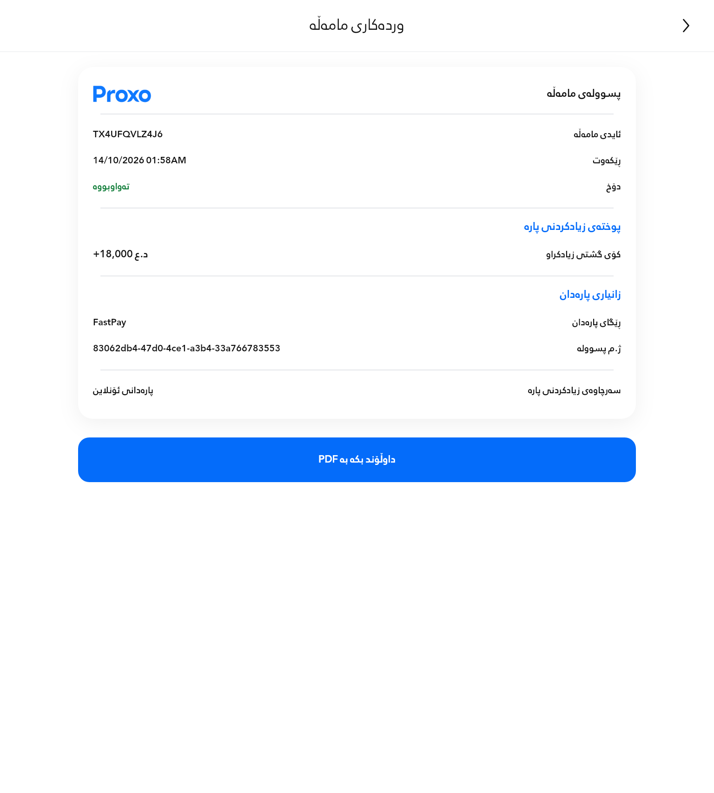

## Export pages

| Output | Rendered pages |
| --- | --- |
| [Standard advertisement](exports/standard_free.pdf) | [Page 1](rendered/standard_free-page-1.png) |
| [Standard payment](exports/transaction_standard.pdf) | [Page 1](rendered/transaction_standard-page-1.png) |
| [280dp/200% advertisement](exports/narrow_paid.pdf) | [Page 1](rendered/narrow_paid-page-1.png), [Page 2](rendered/narrow_paid-page-2.png) |
| [280dp/200% payment](exports/transaction_narrow.pdf) | [Page 1](rendered/transaction_narrow-page-1.png), [Page 2](rendered/transaction_narrow-page-2.png) |

On narrow enlarged-text views, identifier PNGs intentionally show a scrolled suffix as part of the regression case. Both PDFs preserve the complete IDs. The narrow payment's final multiline name continues intact on page 2.

## Reproduce

From `proxo_app`:

```sh
flutter test --no-pub test/receipt_reference_match_test.dart --dart-define=RECEIPT_REFERENCE_CAPTURE=build/receipt-reference/reference-match.png --reporter expanded
flutter test --no-pub test/receipt_layout_test.dart test/receipt_pdf_test.dart test/ad_receipt_data_test.dart test/ad_name_direction_test.dart test/responsive_ad_ui_test.dart test/iconography_money_test.dart test/ad_detail_loading_test.dart test/tx_history_layout_test.dart test/receipt_reference_match_test.dart --dart-define=RECEIPT_PDF_CAPTURE=build/receipt-reference/exports --reporter expanded
flutter test --no-pub test/ui_remediation_capture_test.dart --name 'render (ad-)?receipt ' --reporter expanded
```

The reference golden is the original `proxo_app/docs/receipt_preview.png`; do not regenerate it to accept drift. `verify_reference.py` compares PNGs without modifying them. All persisted artifact hashes are listed in `artifact-manifest.json`.
