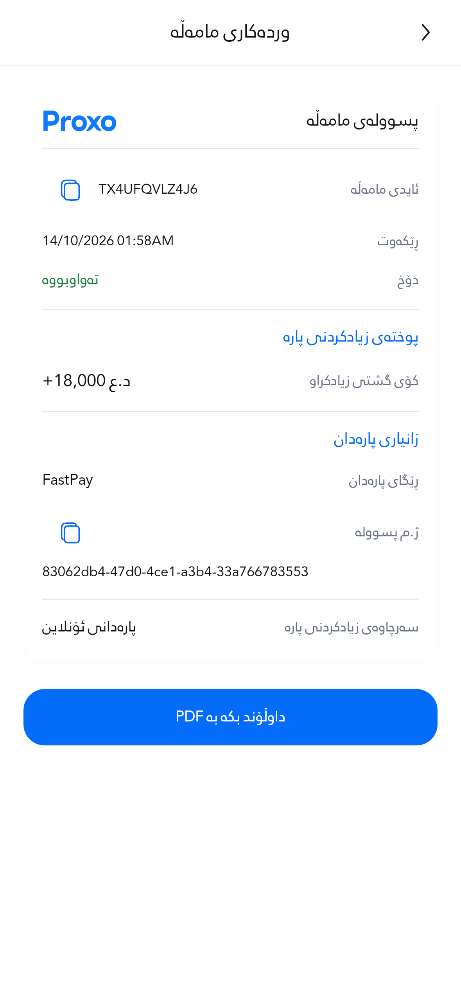

# Receipt style restoration — October 23, 2026

The receipt restyling changed the visual identity too broadly. This correction restores the original white, borderless receipt with blue text-only section headings and a simple PDF button, while retaining the readability and data-integrity fixes.

The visual reference is the pre-redesign implementation at `df2b873cd0116469473f6c07b61d35a590b838d0`, corroborated by the [original payment screenshot](../../visual-polish-2026-10-15/after/ui-receipt-393-s1.0-d3.0.png) and [original advertisement receipt](../../../proxo_app/docs/receipt_preview.png). This is a selective visual restoration: the old fixed-width scaling and bold-outlined font are not reintroduced.

| Element | Restored or balanced treatment |
| --- | --- |
| Card | Original borderless white surface, 16dp corners, restrained existing shadow |
| Section headings | Original blue text-only headings, 15sp |
| Header | Proportional 64×18dp Proxo logo and 16sp receipt title |
| Typography | Regular bundled Kurdish font, readable line heights, 13sp labels and 14sp values |
| Amounts | 14sp supporting amounts, 16sp final amount; transaction-history amount remains 20sp |
| References | Short codes share a compact row when they fit; long UUIDs retain a full-width single LTR line, scrolling and a 48dp copy target |
| PDF action | Original text-only treatment, 18dp corners, 48dp minimum height; loading state keeps dimensions |
| Export | Same restored design, full reference data and row-safe pagination |

Kurdish/Arabic text, status information, amounts and transaction identifiers remain intact. Receipt data calculation, payment behavior and shared app-bar styling are unchanged. The change removes decorative heading/button SVGs and adds no animation or network request; it is not a measured frame-rate improvement claim.

Source commit: `a73c8868b60058fb1a13b8b48cc44cd6145f9f79`. The five tested source hashes match the published commit.

## Verification

- **213 targeted tests passed** across receipt layout, PDF generation, data, text direction, responsive UI, money formatting, detail loading and transaction history.
- **Eight whole-screen capture cases passed**, covering both receipts at 280dp, 393dp, 393dp/200% text and 768dp.
- Scoped analyzer: **0 errors, 0 warnings**; four existing informational capture-log findings.
- Four focused PDF exports were rendered and all **seven A4 pages** inspected. Standard exports fit one page each; 280dp/200% exports paginate across three/two pages. Full identifiers survive copying and PDF export after horizontal scrolling.
- The initial run's 48 failures were the same obsolete black-heading expectation across 48 configurations. Updating it to the requested blue heading produced a clean 121-case layout rerun; the other 92 tests had already passed.

[Exact environment, source hashes and test record](verification.json) · [PDF inspection](pdf-inspection.json) · [Artifact checksums](artifact-manifest.json)

No physical-device profiling was repeated for this visual correction. The prior software-emulator performance limitations remain unresolved; this work makes no new frame-rate claim. Sharing is verified through the production PDF generator with a mocked platform destination.

## Actual restored screens

These are actual Flutter renders with fictional data, not mockups or live customer receipts. All listed screens are 852dp tall; the image density varies as stated in the test record.

| Receipt | State | Width / text | Screenshot |
| --- | --- | --- | --- |

| Advertisement | Bottom and PDF action | 280dp / 100% | [Open](screens/ad-receipt-280-s1.0-d1.0-bottom.png) |
| Advertisement | Initial view | 280dp / 100% | [Open](screens/ad-receipt-280-s1.0-d1.0.png) |
| Advertisement | Bottom and PDF action | 393dp / 100% | [Open](screens/ad-receipt-393-s1.0-d3.0-bottom.png) |
| Advertisement | Initial view | 393dp / 100% | [Open](screens/ad-receipt-393-s1.0-d3.0.png) |
| Advertisement | Bottom and PDF action | 393dp / 200% | [Open](screens/ad-receipt-393-s2.0-d1.0-bottom.png) |
| Advertisement | Initial view | 393dp / 200% | [Open](screens/ad-receipt-393-s2.0-d1.0.png) |
| Advertisement | Bottom and PDF action | 768dp / 100% | [Open](screens/ad-receipt-768-s1.0-d2.0-bottom.png) |
| Advertisement | Initial view | 768dp / 100% | [Open](screens/ad-receipt-768-s1.0-d2.0.png) |
| Payment | Initial view | 280dp / 100% | [Open](screens/receipt-280-s1.0-d1.0.png) |
| Payment | Initial view | 393dp / 100% | [Open](screens/receipt-393-s1.0-d3.0.png) |
| Payment | Bottom and PDF action | 393dp / 200% | [Open](screens/receipt-393-s2.0-d1.0-bottom.png) |
| Payment | Initial view | 393dp / 200% | [Open](screens/receipt-393-s2.0-d1.0.png) |
| Payment | Initial view | 768dp / 100% | [Open](screens/receipt-768-s1.0-d2.0.png) |

## Actual PDF exports

| Receipt | Test size | Pages | Export |
| --- | --- | ---: | --- |
| Advertisement, free | 393dp / 100% | 1 | [PDF](exports/standard_free.pdf) |
| Advertisement, paid | 280dp / 200% | 3 | [PDF](exports/narrow_paid.pdf) |
| Payment | 393dp / 100% | 1 | [PDF](exports/transaction_standard.pdf) |
| Payment | 280dp / 200% | 2 | [PDF](exports/transaction_narrow.pdf) |

