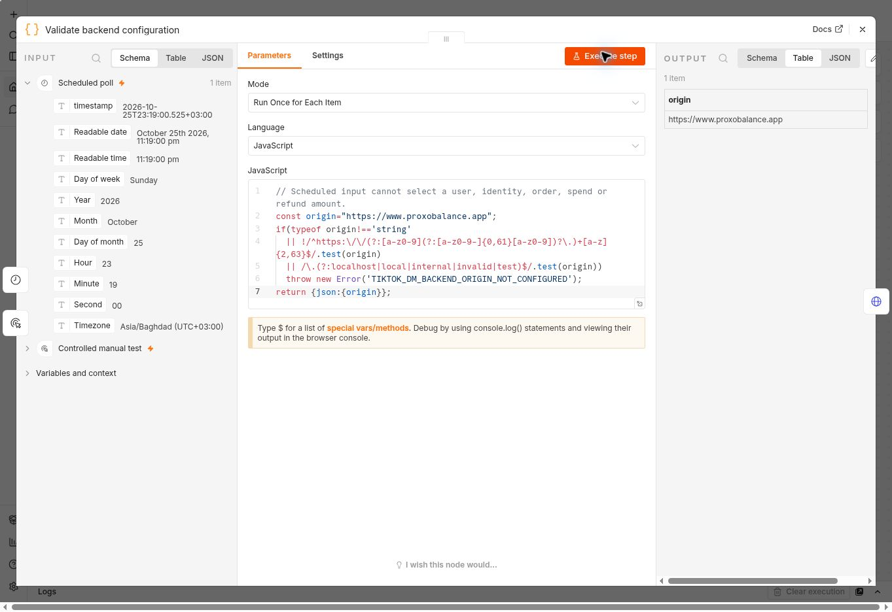

# Runtime repair — 25 October 2026

Contact, Restaurant and App Download page creation still cannot complete against the current production API. This update fixes the missing page database schema and n8n backend-origin configuration, and integrates the current production branch into the release source. It does not certify a live TikTok account, ad, payment or production page write.

## Production changes completed

- Applied `proxolink_v6_independent_pages_management_release` to Supabase project `cojchkwssmasiejcgvbk`. It runs the three existing reviewed typed-page, management and moderation migrations in one transaction, with bounded lock and statement timeouts.
- Verified the four new columns, moderation default and owner protection. All **23 existing pages** remain; the stored-data digest before and after is identical. No customer page was created or edited, and anonymous read/insert remain denied. [Database verification and source hashes](page-database.json).
- Saved the public origin `https://www.proxobalance.app` in the existing configuration node of **all seven n8n drafts**. This uses the already supported fixed-origin generator option because this instance's Variables screen requires an upgrade. Secrets remain in credential stores; environment access was not enabled.
- Downloaded every saved workflow and verified its graph, parameters, retry settings, privacy settings and credentials against the configured export. All seven have new saved version IDs, remain unpublished, and all nine HTTP nodes retain unbound credential markers. Existing published workflows were not changed. [Saved versions, hashes and configured exports](n8n-configured-inventory.json).
- Executed **only the configuration node** in account-connection workflow `5hn0cuwYvezL8r0G`. Its output is the expected origin. No HTTP worker, provider call, financial operation or full workflow was executed in this follow-up.

## Release-source integration

The release source incorporates `main` at `c407dc7c8058213943718205ef9ef45ffadf1161`, including its current refund reports, shortfall refunds, payout rounding, staff permissions, customer/admin bundles and browser/request security changes. This avoids replacing those newer production features with the older PR baseline.

The current typed-page implementation supersedes the older 6 October four-template implementation on `main`. Its owner-scoped previews, typed provider validation, persistence, recovery and private renderer remain intact. The obsolete client template-editor source and v5-only test files are not restored. The existing `proxo-four-verify.yml` workflow now runs the current typed-page, management, Tools and advertisement suites plus the template-source isolation scan; its backend and Flutter jobs remain enabled.

Malformed JSON and invalid Content-Length retain the page API's validation response instead of becoming server errors, while oversized UTF-8 bodies are rejected before persistence. Regression tests cover parsed and streamed input. Four existing VM test harnesses now expose Node's real `Buffer` global to match the production runtime; their financial and authorization assertions are unchanged.

Flutter application source and the approved color/price screenshot directory are byte-identical to `e97aa84bc72a55e1bcfc95a8543310bcdb81c8b7`. The merge retains `main`'s deletion of unbundled legacy style-preview images; none is referenced by the current Flutter asset manifest. The current reference colors, Kurdish Sorani text, receipt design and balanced price breakdown are unchanged.

## Verification

- Full merged Node suite: **484 passed, 0 failed, 0 skipped**. This supersedes the 315-test pre-merge run; counts must not be added.
- Three isolated page SQL suites passed before the production migration; production columns, retained-data digest and RLS were checked after it.
- `npm run lint` passed. `npm run build` passed and verified **25 referenced assets**. The template-source isolation scan passed.
- The new configured exports were structurally compared with all seven actual saved n8n downloads; each differs from its portable source only in its non-secret origin configuration.
- The unchanged Flutter source previously passed all four CI workflows at `e97aa84`, including 1,332 Flutter tests and Android runtime checks. A fresh local Flutter run was not completed: the available SDK lacked its tool snapshot and stalled during bootstrap dependency resolution. No new Flutter pass is claimed; the updated CI must finish on the new PR head.
- [Machine-readable verification and log hashes](verification.json).

## Remaining deployment and provider blockers

Anonymous production route checks at `2026-10-25T20:23:20Z` returned:

| Route | Result | Meaning |
|---|---|---|
| `GET /api/page-providers` | 404 | The typed-page catalog API has not been deployed. |
| `POST /api/tiktok-dm?op=accounts` with `{}` | 404 | The TikTok API route has not been deployed. |
| `GET /api/contact-cards` | 401 | The legacy route exists and requires authentication; this is not proof that typed-page creation works. |

The Vercel connector lists no projects under the known team and returns `404 not_found` for the known `proxobalance` project ID and name. Browser fallback requires the user's approval under the browser access rules. No Vercel deployment or production release flag was changed.

Backend deployment/configuration and an authenticated create/save/reopen check remain necessary for each page type. Pages use the authenticated Proxo API and Supabase, rather than an n8n page-creation webhook. The finance/TikTok/OAuth/activation/report migration stack remains unapplied. Both dedicated n8n worker credentials are still unbound; selecting an unrelated existing credential would be incorrect.

Accounts OAuth cannot honestly become `CONNECTED` until a provider-supported immutable relationship to the actual Marketing identity and Business Center asset is established. The current state remains `VERIFIED_UNLINKED` with `TIKTOK_IDENTITY_JOIN_UNVERIFIED` after Accounts verification. The official identity-info, identity-list and BC-link documents were rechecked and did not supply that missing relationship. Advertiser eligibility, Conversation targeting, final-spend completeness and live sandbox acceptance also remain unverified. No paid ad was activated and no real customer was messaged.

The screenshot proves only the configuration-node result. It does not prove the missing backend is deployed or that TikTok Direct Message ads work.
