# PR46 screenshot gallery

**63 image paths (61 distinct binaries): 33 PR46 Flutter fixture captures, 3 actual n8n browser captures, and 27 historical/reference images.** All images link to their full-resolution originals. The gallery combines committed images from `4e755dd8` with two subsequent actual n8n readiness-check captures and one archived “before” fixture. It does not represent a physical-device or successful live-provider test run.

All **60 existing tracked images** were verified byte-for-byte against `4e755dd8`. The added historical “before” copy was verified against `88287b3`; both new browser captures were visually reviewed and hashed. The [machine-readable inventory](screenshots-inventory.json) records every path, image dimensions, SHA-256, Git blob hash, origin and comparison commit. No relevant current screenshot is missing from the checked workspace or `/tmp`.

The fixture screenshots use synthetic account, budget, order and payment values. The QR image is explicitly synthetic. No physical-device captures are included. Historical audit sections remain labeled with their original provenance. The screenshot files and approved receipt pixels were not edited.

| Evidence | Images | Origin |
|---|---:|---|
| PR46 creation, Meta/TikTok, accounts and payment UI | 33 | Flutter widgets with controlled fixtures |
| n8n import and subsequent blocked readiness check | 3 | Actual authenticated browser UI; import, guard failure and restored unpublished state |
| Approved receipt references | 2 | Preserved PR44 originals |
| Older responsive/payment comparison | 3 | Historical widget fixtures |
| PR44 receipt audit | 22 | Historical supplied reference, widget captures/exports and PDF rasters |

## Shared creation launcher — 3 captures

Rendered Flutter widget with controlled test fixtures; not a physical-device or live-provider capture.

[Test or provenance source](../../../proxo_app/test/meta_ad_form_test.dart)

| Capture | Capture | Capture |
|---|---|---|
| <a href="../../../proxo_app/docs/meta_ads_evidence/launcher.png">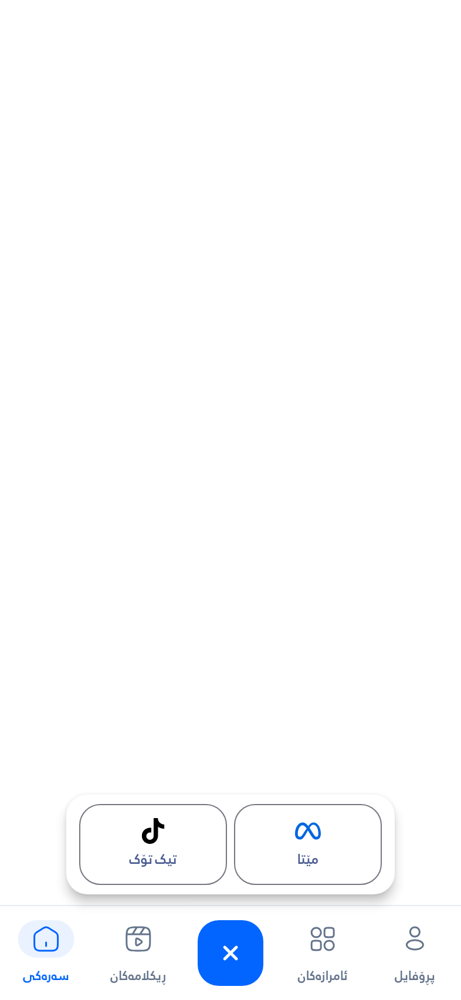</a> [launcher.png](../../../proxo_app/docs/meta_ads_evidence/launcher.png) 786 × 1704 px |  [launcher_280_2x.png](../../../proxo_app/docs/meta_ads_evidence/launcher_280_2x.png) 560 × 1704 px | <a href="../../../proxo_app/docs/meta_ads_evidence/launcher_768_2x.png">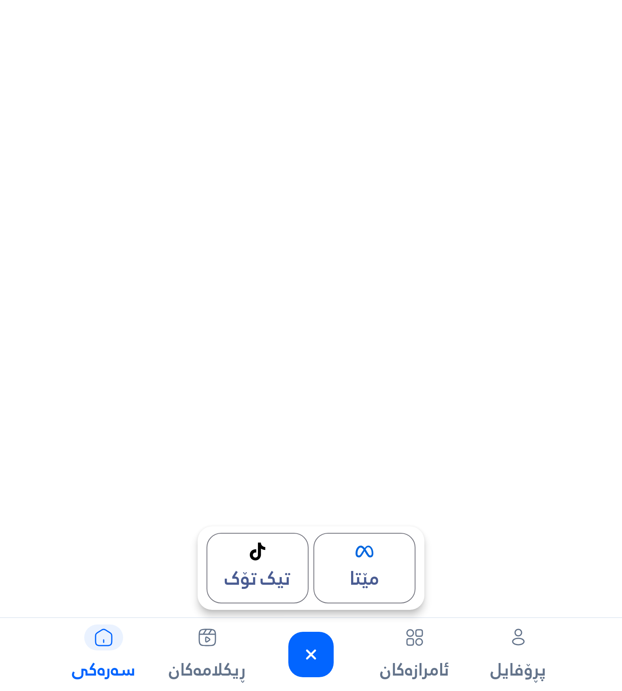</a> [launcher_768_2x.png](../../../proxo_app/docs/meta_ads_evidence/launcher_768_2x.png) 1536 × 1704 px |

## Meta form — 6 captures

Real Meta form widgets at 280/393/768 logical pixels and 1×/2× text, using a controlled repository. Rendered Flutter widget with controlled test fixtures; not a physical-device or live-provider capture.

[Test or provenance source](../../../proxo_app/test/meta_ad_form_test.dart)

| Capture | Capture | Capture |
|---|---|---|
| <a href="../../../proxo_app/docs/meta_ads_evidence/meta_280_1x.png">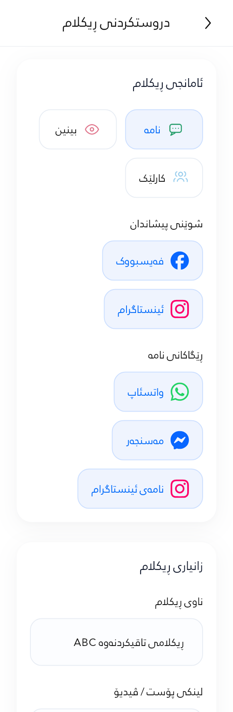</a> [meta_280_1x.png](../../../proxo_app/docs/meta_ads_evidence/meta_280_1x.png) 560 × 1704 px | <a href="../../../proxo_app/docs/meta_ads_evidence/meta_393_1x.png">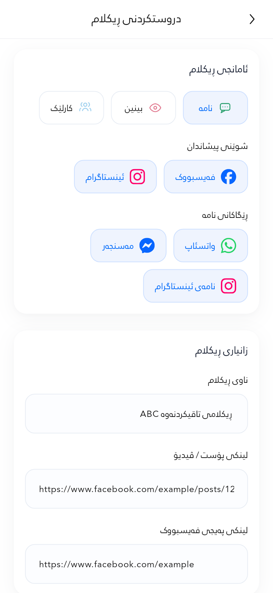</a> [meta_393_1x.png](../../../proxo_app/docs/meta_ads_evidence/meta_393_1x.png) 786 × 1704 px | <a href="../../../proxo_app/docs/meta_ads_evidence/meta_768_1x.png">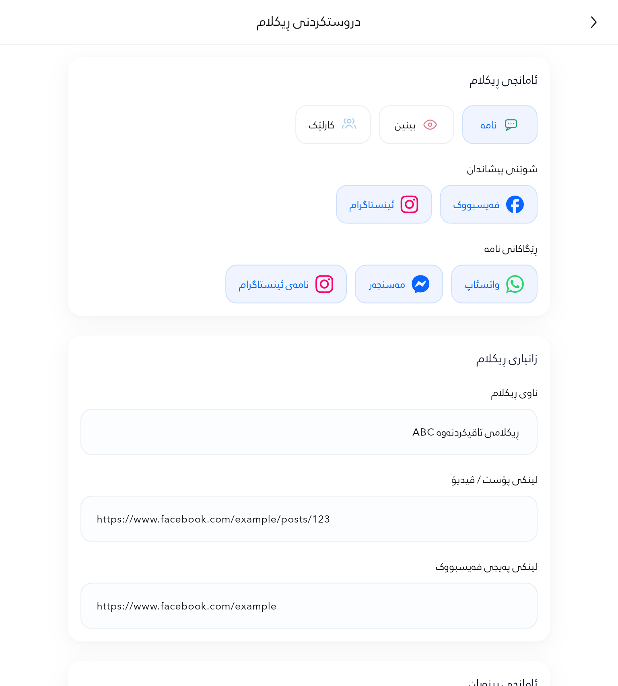</a> [meta_768_1x.png](../../../proxo_app/docs/meta_ads_evidence/meta_768_1x.png) 1536 × 1704 px |

| Capture | Capture | Capture |
|---|---|---|
| <a href="../../../proxo_app/docs/meta_ads_evidence/meta_280_2x.png">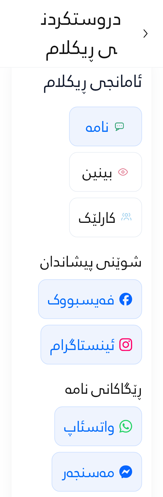</a> [meta_280_2x.png](../../../proxo_app/docs/meta_ads_evidence/meta_280_2x.png) 560 × 1704 px | <a href="../../../proxo_app/docs/meta_ads_evidence/meta_393_2x.png">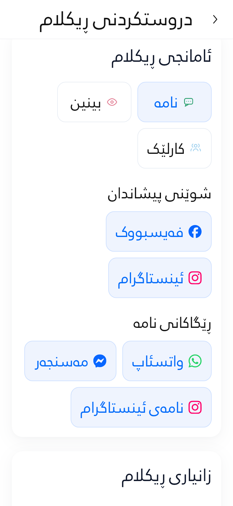</a> [meta_393_2x.png](../../../proxo_app/docs/meta_ads_evidence/meta_393_2x.png) 786 × 1704 px | <a href="../../../proxo_app/docs/meta_ads_evidence/meta_768_2x.png">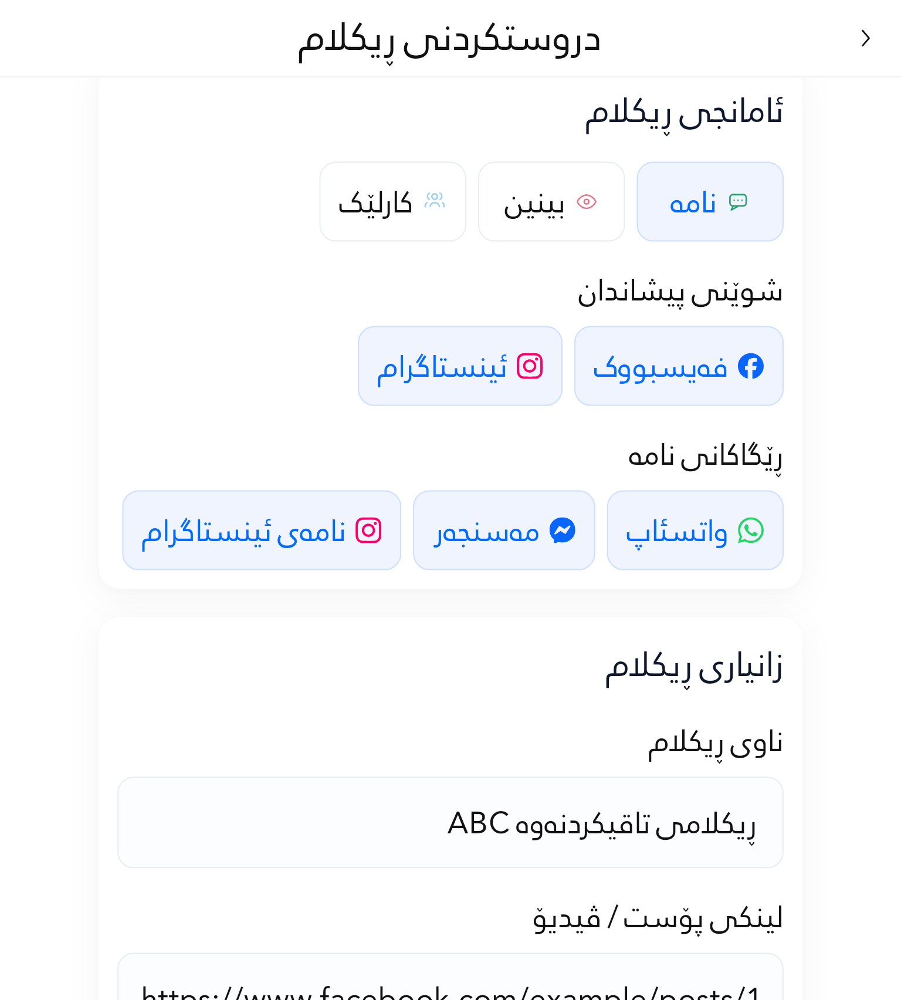</a> [meta_768_2x.png](../../../proxo_app/docs/meta_ads_evidence/meta_768_2x.png) 1536 × 1704 px |

## TikTok Direct Message form and selected accounts — 6 captures

280/393/768 logical pixels at 2× text. Account/video records and readiness are synthetic fixtures; these images do not prove a connected TikTok identity.

[Test or provenance source](../../../proxo_app/test/tiktok_dm_form_test.dart)

| Capture | Capture | Capture |
|---|---|---|
| <a href="../../../proxo_app/docs/meta_ads_evidence/tiktok_direct_form_280_2x.png">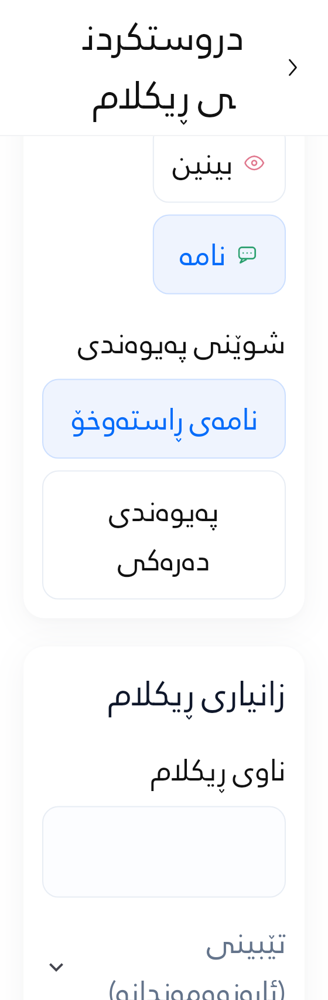</a> [tiktok_direct_form_280_2x.png](../../../proxo_app/docs/meta_ads_evidence/tiktok_direct_form_280_2x.png) 560 × 1704 px | <a href="../../../proxo_app/docs/meta_ads_evidence/tiktok_direct_form_393_2x.png">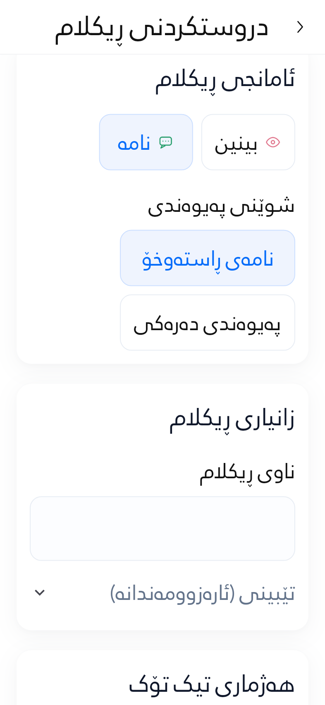</a> [tiktok_direct_form_393_2x.png](../../../proxo_app/docs/meta_ads_evidence/tiktok_direct_form_393_2x.png) 786 × 1704 px | <a href="../../../proxo_app/docs/meta_ads_evidence/tiktok_direct_form_768_2x.png">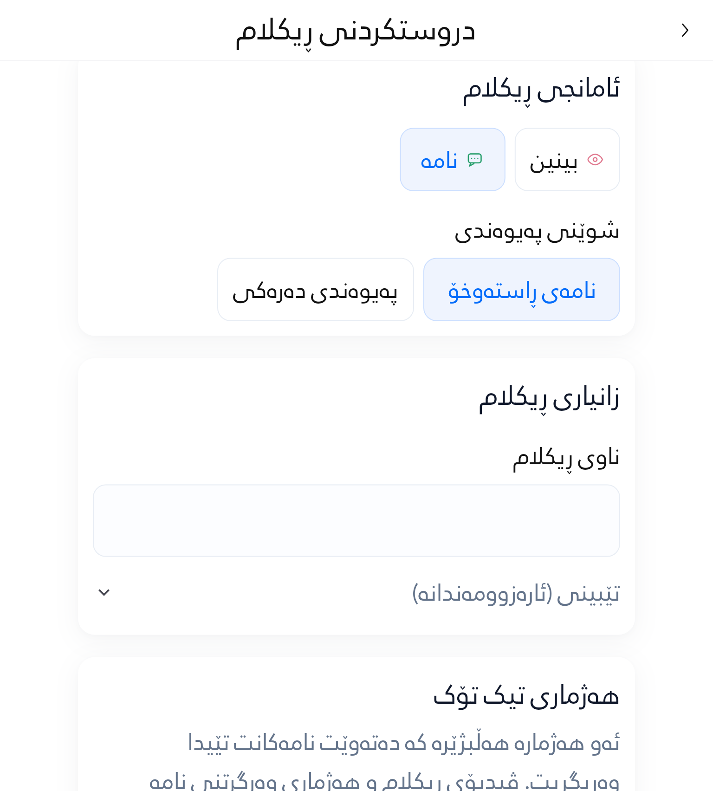</a> [tiktok_direct_form_768_2x.png](../../../proxo_app/docs/meta_ads_evidence/tiktok_direct_form_768_2x.png) 1536 × 1704 px |

| Capture | Capture | Capture |
|---|---|---|
| <a href="../../../proxo_app/docs/meta_ads_evidence/tiktok_direct_accounts_280_2x.png">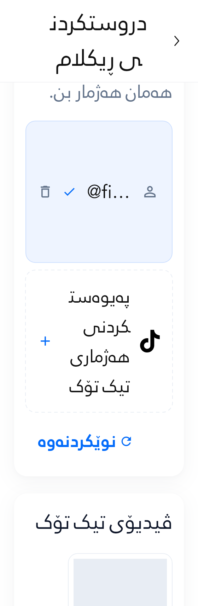</a> [tiktok_direct_accounts_280_2x.png](../../../proxo_app/docs/meta_ads_evidence/tiktok_direct_accounts_280_2x.png) 560 × 1704 px | <a href="../../../proxo_app/docs/meta_ads_evidence/tiktok_direct_accounts_393_2x.png">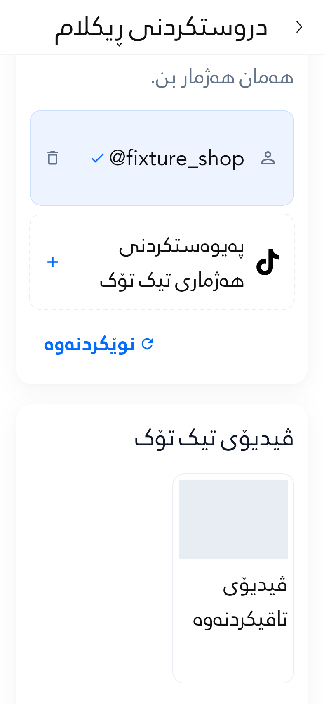</a> [tiktok_direct_accounts_393_2x.png](../../../proxo_app/docs/meta_ads_evidence/tiktok_direct_accounts_393_2x.png) 786 × 1704 px | <a href="../../../proxo_app/docs/meta_ads_evidence/tiktok_direct_accounts_768_2x.png">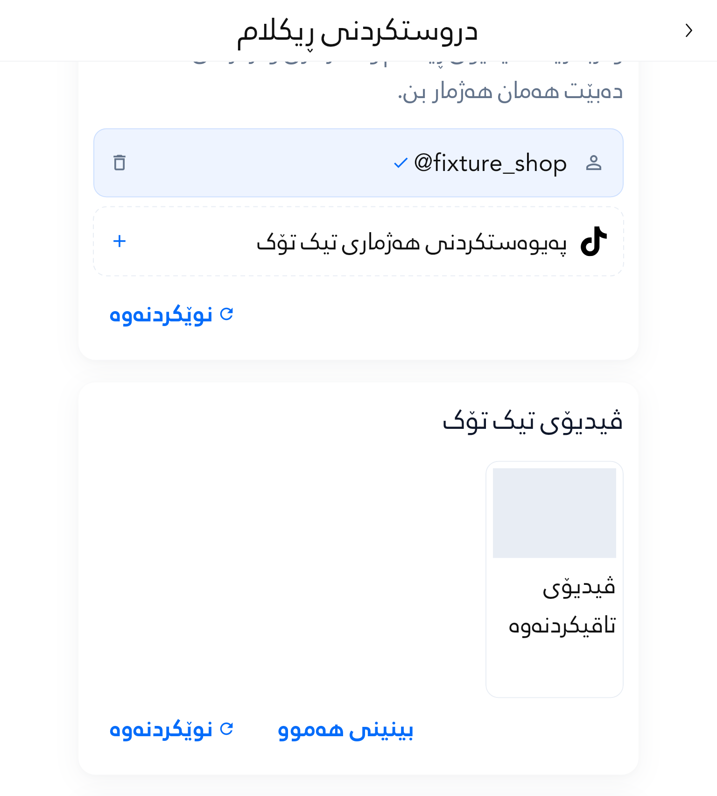</a> [tiktok_direct_accounts_768_2x.png](../../../proxo_app/docs/meta_ads_evidence/tiktok_direct_accounts_768_2x.png) 1536 × 1704 px |

## Account picker and QR presentation — 3 captures

Fixture-only account controls at 393px/1× and 280px/2×. The QR encodes the synthetic `https://business.tiktok.com/authorize?state=fixture` URL; it is not a working authorization session or provider-issued QR.

[Test or provenance source](../../../proxo_app/test/tiktok_dm_accounts_test.dart)

| Capture | Capture | Capture |
|---|---|---|
| <a href="../../../proxo_app/docs/tiktok_dm_evidence/accounts_393.png">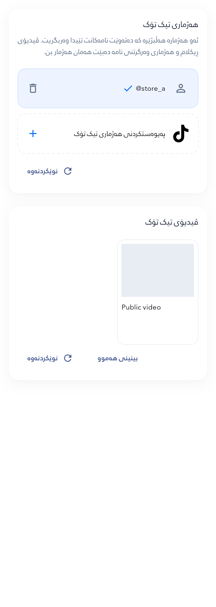</a> [accounts_393.png](../../../proxo_app/docs/tiktok_dm_evidence/accounts_393.png) 786 × 2200 px |  [accounts_280.png](../../../proxo_app/docs/tiktok_dm_evidence/accounts_280.png) 560 × 3600 px |  [qr_fixture_393.png](../../../proxo_app/docs/tiktok_dm_evidence/qr_fixture_393.png) 786 × 2200 px |

## Selected payment card and shared sheet — 7 captures

Controlled wallet/FastPay presentation. The 280px/2× sheet image was refreshed in continuation commit `4e755dd8`; the sheet itself is unchanged, while the dimmed background scroll reflects the narrow-card correction. Amounts and balances are fixtures.

[Test or provenance source](../../../proxo_app/test/meta_ad_form_test.dart)

| Capture | Capture | Capture |
|---|---|---|
| <a href="../../../proxo_app/docs/meta_ads_evidence/meta_payment.png">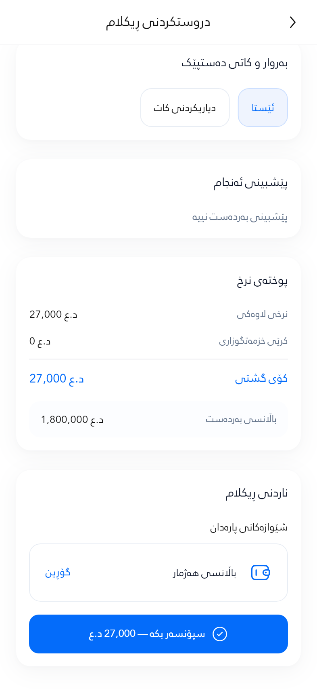</a> [meta_payment.png](../../../proxo_app/docs/meta_ads_evidence/meta_payment.png) 786 × 1704 px | <a href="../../../proxo_app/docs/meta_ads_evidence/payment_sheet_280_1x.png">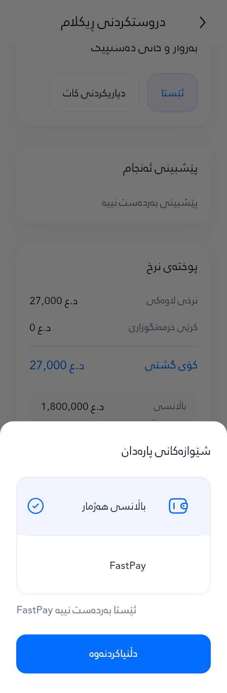</a> [payment_sheet_280_1x.png](../../../proxo_app/docs/meta_ads_evidence/payment_sheet_280_1x.png) 560 × 1704 px | <a href="../../../proxo_app/docs/meta_ads_evidence/payment_sheet_393_1x.png">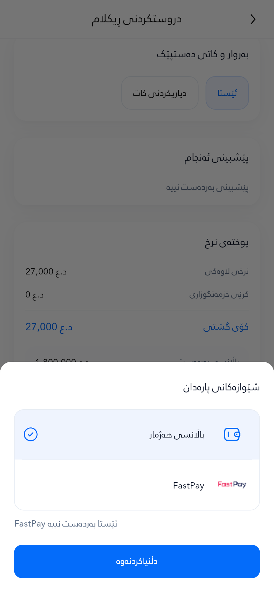</a> [payment_sheet_393_1x.png](../../../proxo_app/docs/meta_ads_evidence/payment_sheet_393_1x.png) 786 × 1704 px |

| Capture | Capture | Capture |
|---|---|---|
| <a href="../../../proxo_app/docs/meta_ads_evidence/payment_sheet_768_1x.png">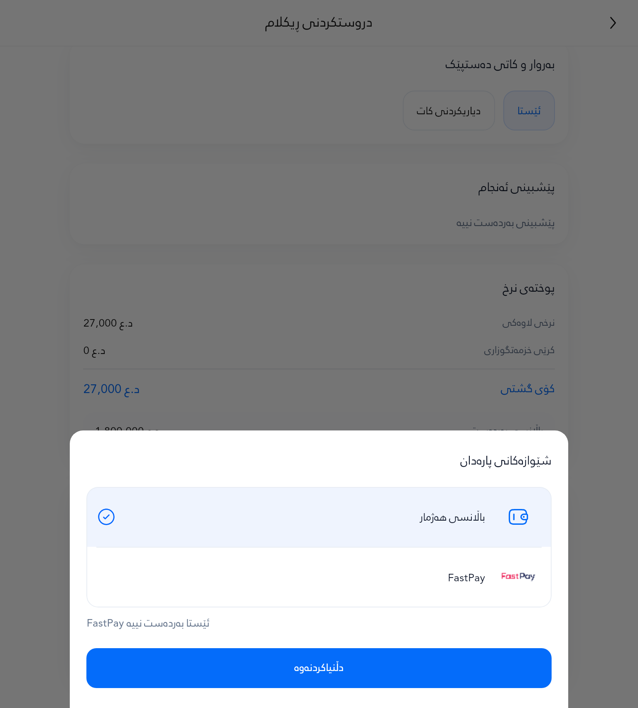</a> [payment_sheet_768_1x.png](../../../proxo_app/docs/meta_ads_evidence/payment_sheet_768_1x.png) 1536 × 1704 px | <a href="../../../proxo_app/docs/meta_ads_evidence/payment_sheet_280_2x.png">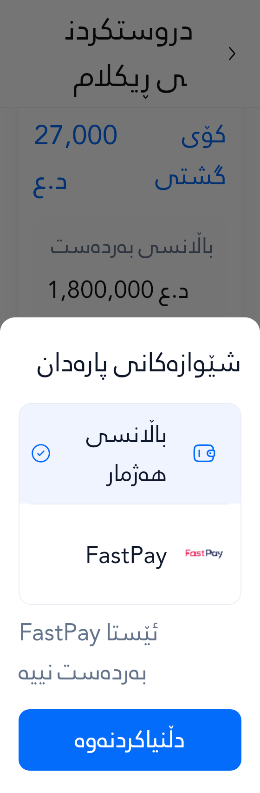</a> [payment_sheet_280_2x.png](../../../proxo_app/docs/meta_ads_evidence/payment_sheet_280_2x.png) 560 × 1704 px | <a href="../../../proxo_app/docs/meta_ads_evidence/payment_sheet_393_2x.png">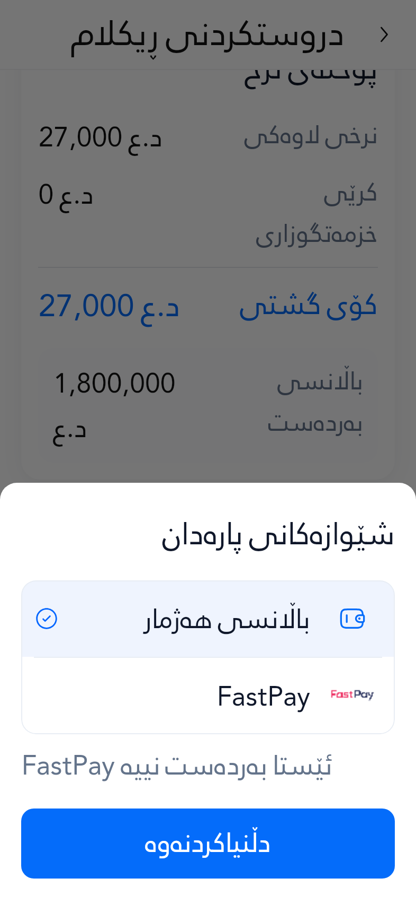</a> [payment_sheet_393_2x.png](../../../proxo_app/docs/meta_ads_evidence/payment_sheet_393_2x.png) 786 × 1704 px |

| Capture |
|---|
| <a href="../../../proxo_app/docs/meta_ads_evidence/payment_sheet_768_2x.png">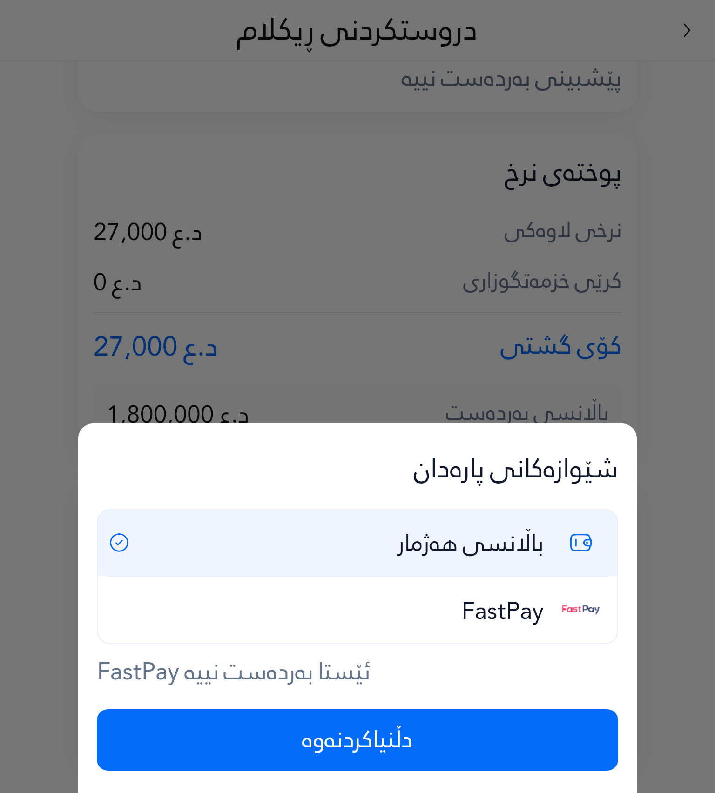</a> [payment_sheet_768_2x.png](../../../proxo_app/docs/meta_ads_evidence/payment_sheet_768_2x.png) 1536 × 1704 px |

## Existing creation flow and confirmation — 8 captures

These existing-flow widget previews were refreshed in PR46 commit `88287b3`. They cover form, budget, schedule, coupon, pricing, confirmation and validation with fake repositories; they do not show a funded external order. The full-page image uses an expanded test surface.

[Test or provenance source](../../../proxo_app/test/ad_creation_flow_test.dart)

| Capture | Capture | Capture |
|---|---|---|
| <a href="../../../proxo_app/docs/create_ad_preview.png">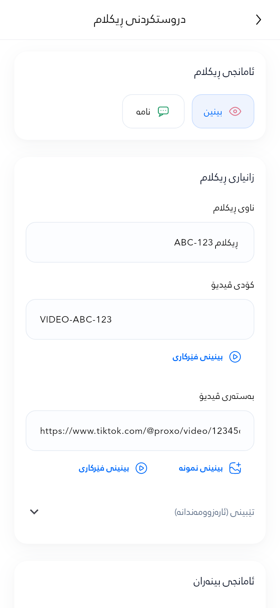</a> [create_ad_preview.png](../../../proxo_app/docs/create_ad_preview.png) 786 × 1704 px | <a href="../../../proxo_app/docs/create_ad_full_preview.png">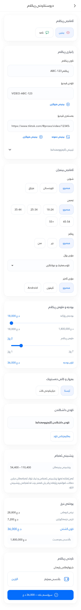</a> [create_ad_full_preview.png](../../../proxo_app/docs/create_ad_full_preview.png) 786 × 5846 px | <a href="../../../proxo_app/docs/create_ad_budget_preview.png">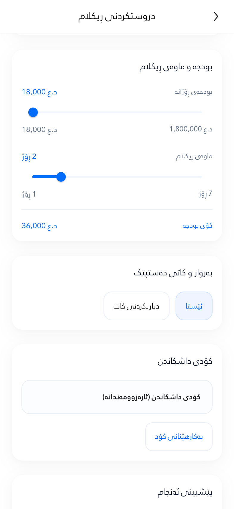</a> [create_ad_budget_preview.png](../../../proxo_app/docs/create_ad_budget_preview.png) 786 × 1704 px |

| Capture | Capture | Capture |
|---|---|---|
| <a href="../../../proxo_app/docs/create_ad_schedule_preview.png">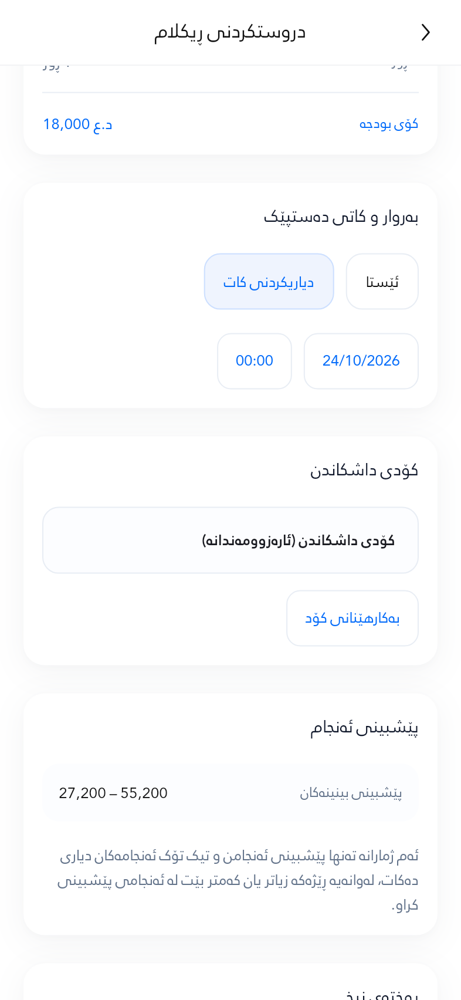</a> [create_ad_schedule_preview.png](../../../proxo_app/docs/create_ad_schedule_preview.png) 786 × 1704 px | <a href="../../../proxo_app/docs/create_ad_coupon_preview.png">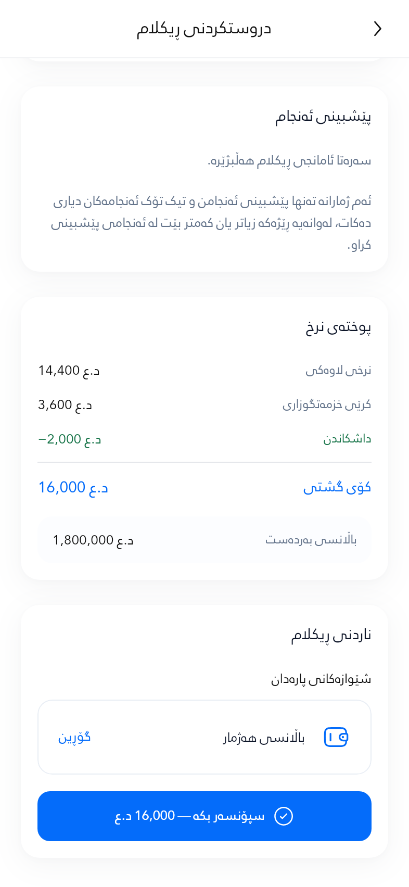</a> [create_ad_coupon_preview.png](../../../proxo_app/docs/create_ad_coupon_preview.png) 786 × 1704 px | <a href="../../../proxo_app/docs/create_ad_pricing_preview.png">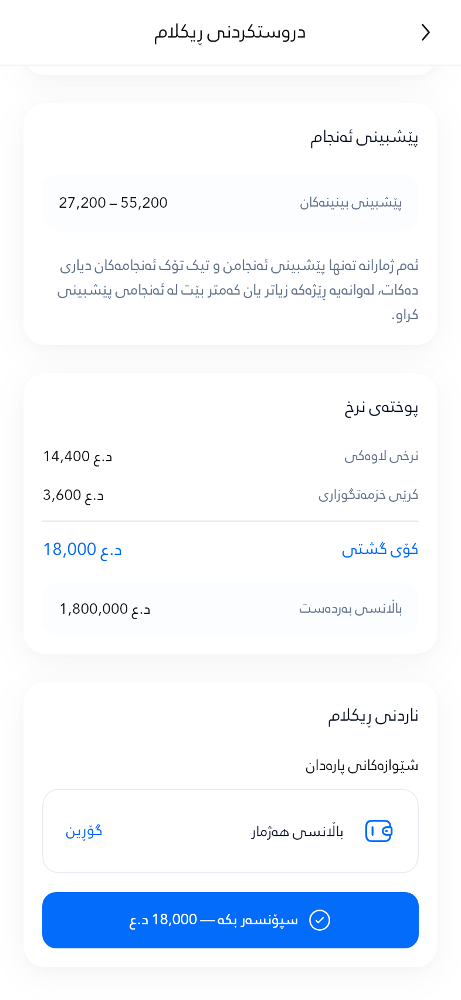</a> [create_ad_pricing_preview.png](../../../proxo_app/docs/create_ad_pricing_preview.png) 786 × 1704 px |

| Capture | Capture |
|---|---|
| <a href="../../../proxo_app/docs/ad_confirmation_preview.png">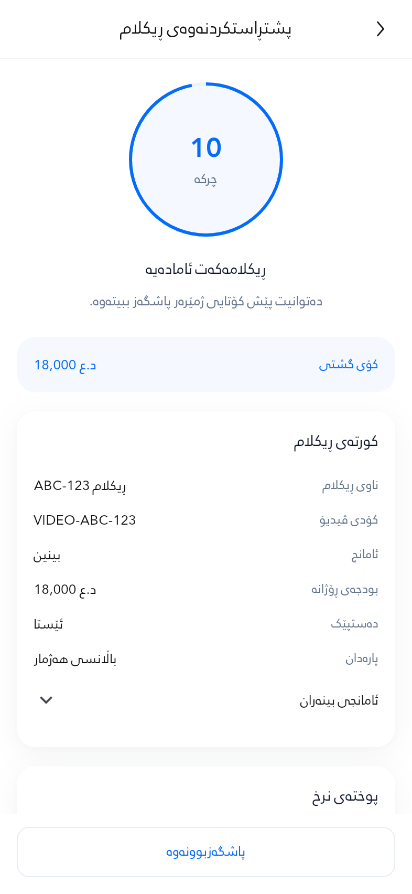</a> [ad_confirmation_preview.png](../../../proxo_app/docs/ad_confirmation_preview.png) 786 × 1704 px | <a href="../../../proxo_app/docs/ad_validation_preview.png">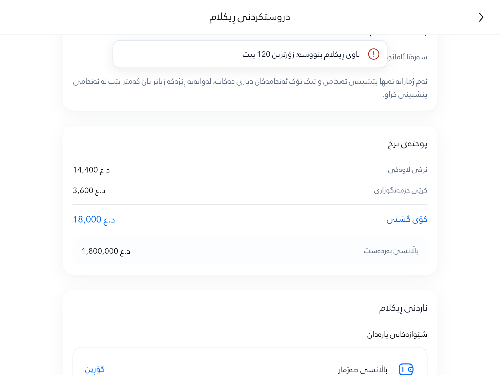</a> [ad_validation_preview.png](../../../proxo_app/docs/ad_validation_preview.png) 1600 × 1200 px |

## Actual n8n browser evidence — 1 capture

Authenticated n8n 2.23.4 UI, recorded during inactive import verification. The seven new workflows were saved and downloaded for graph/settings checks; this capture is not evidence of publication or execution. See the [verified import inventory](n8n-import-inventory.json). Existing unrelated workflow rows visible in the image were not modified.

[Test or provenance source](n8n-import-inventory.json)

| Capture |
|---|
| <a href="n8n-imports-verified.jpg">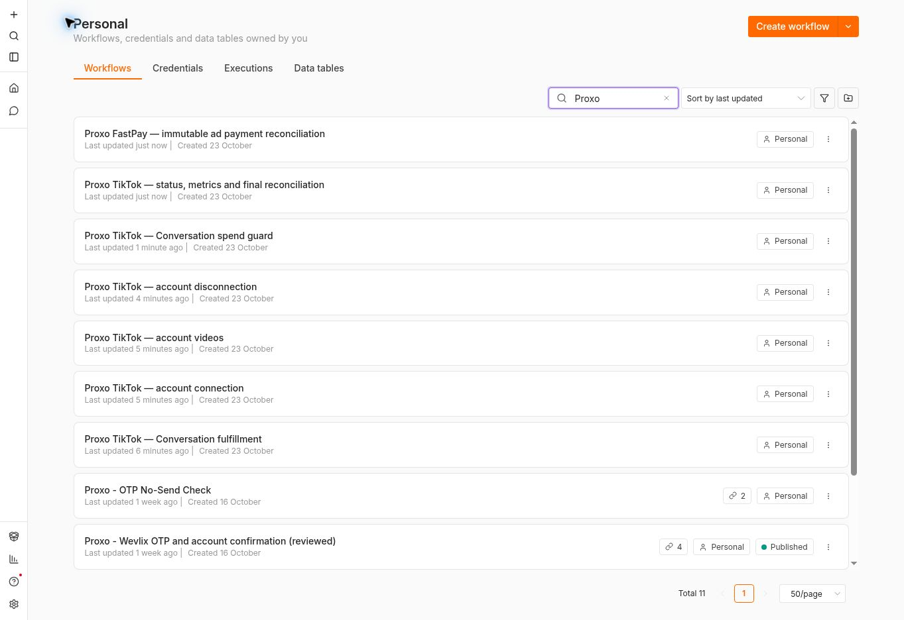</a> [n8n-imports-verified.jpg](n8n-imports-verified.jpg) 1363 × 936 px |

## Actual n8n failed readiness check and unpublished state — 2 captures

These are subsequent **actual browser captures**, not fixtures. A controlled execution of the account-connection configuration node failed at `TIKTOK_DM_BACKEND_ORIGIN_NOT_CONFIGURED` on 24 October at 00:11:41 Asia/Baghdad, before the worker HTTP step. The temporarily published workflow was then unpublished again; the final saved download was verified inactive with null worker credentials. The second image shows all seven new workflows without Published state, while the pre-existing OTP workflow remains published. Neither image proves a working backend, connected TikTok account, paid delivery or production readiness. [Dated readiness record](production-readiness-2026-10-24.json) · [Handover](../../tiktok-dm-completion-status-2026-10-23.md).

| Failed configuration guard | Restored unpublished state |
|---|---|
| <a href="n8n-production-config-blocked-2026-10-24.jpg">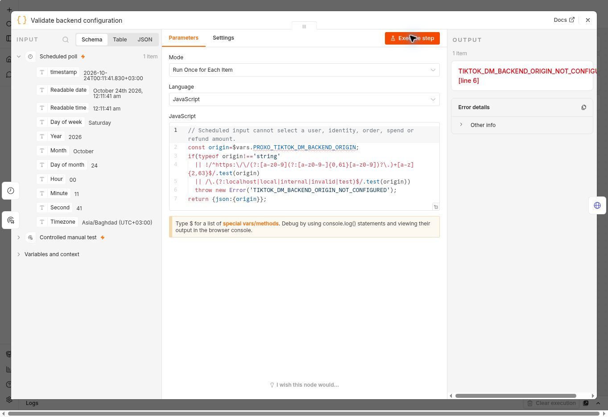</a> [n8n-production-config-blocked-2026-10-24.jpg](n8n-production-config-blocked-2026-10-24.jpg) 1363 × 936 px | <a href="n8n-unpublished-after-check-2026-10-24.jpg">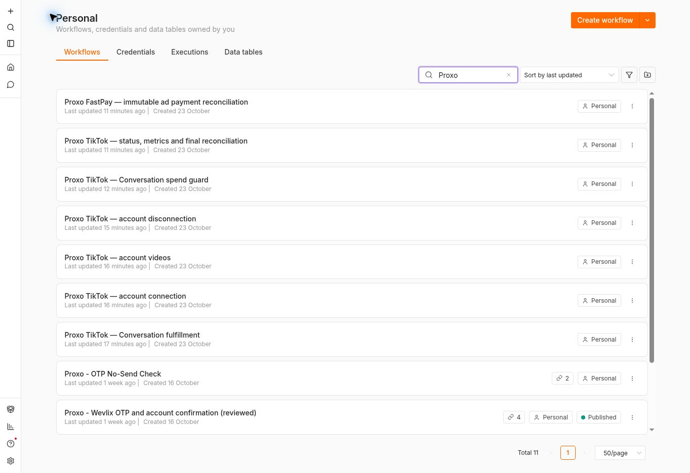</a> [n8n-unpublished-after-check-2026-10-24.jpg](n8n-unpublished-after-check-2026-10-24.jpg) 1363 × 936 px |

## Preserved receipt references — 2 images

Preserved PR44 references, not newly generated screenshots. `receipt_labels_preview.png` is the current canonical golden with the approved Kurdish label changes; `receipt_preview.png` is the original historical reference. Both remain byte-identical to the approved baseline `058f2f6`. No new platform-logo slot or receipt redesign is shown.

[Test or provenance source](../../../proxo_app/docs/RECEIPT_MEASUREMENTS.md)

| Capture | Capture |
|---|---|
| <a href="../../../proxo_app/docs/receipt_labels_preview.png">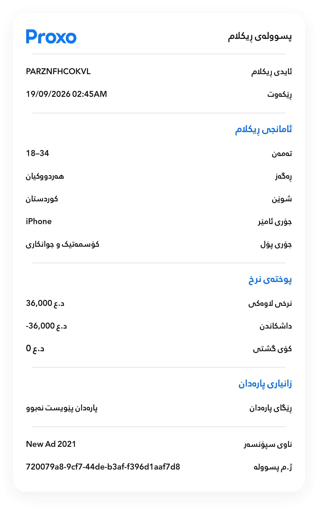</a> [receipt_labels_preview.png](../../../proxo_app/docs/receipt_labels_preview.png) 1572 × 2508 px |  [receipt_preview.png](../../../proxo_app/docs/receipt_preview.png) 1572 × 2508 px |

Historical layout and pre-correction comparison — 3 images

Historical fixture captures only. The tablet and enlarged-text confirmation previews were deliberately preserved from `058f2f6`, not regenerated to claim current acceptance. The payment-sheet “before” image is an exact archived copy of the `88287b3` file; compare it with the current sheet above. No physical device was used.

[Test or provenance source](../../../proxo_app/test/responsive_ad_ui_test.dart)

| Capture | Capture | Capture |
|---|---|---|
| <a href="../../../proxo_app/docs/create_ad_tablet_preview.png">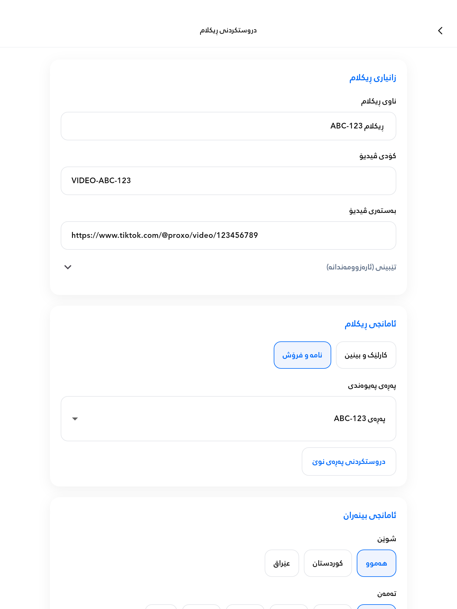</a> [create_ad_tablet_preview.png](../../../proxo_app/docs/create_ad_tablet_preview.png) 1536 × 2048 px | <a href="../../../proxo_app/docs/ad_confirmation_large_text_preview.png">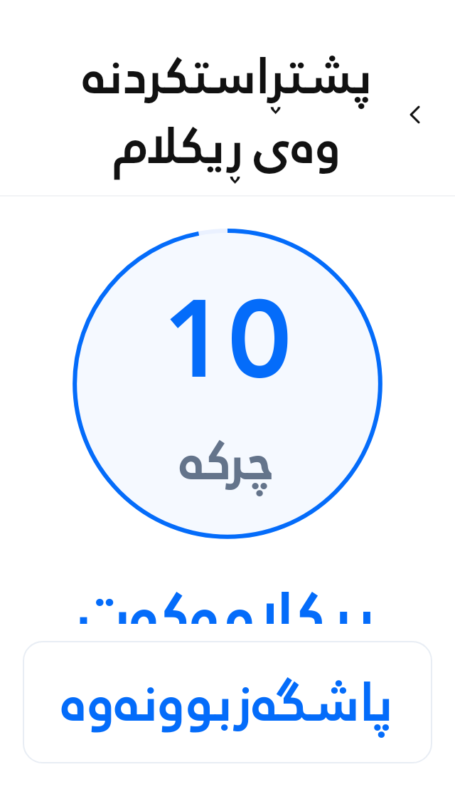</a> [ad_confirmation_large_text_preview.png](../../../proxo_app/docs/ad_confirmation_large_text_preview.png) 640 × 1136 px | <a href="historical/payment-sheet-280-2x-before.png">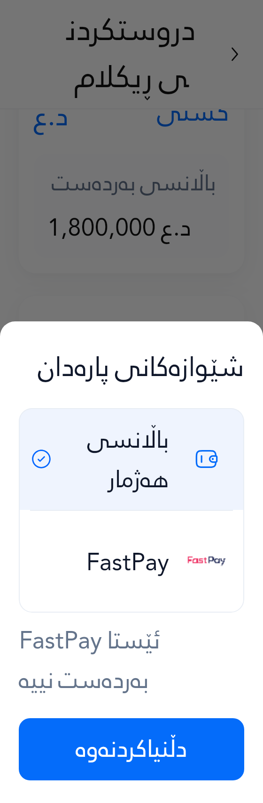</a> [payment-sheet-280-2x-before.png](historical/payment-sheet-280-2x-before.png) 560 × 1704 px |

Historical PR44 receipt-reference audit — 22 images

These pre-existing PR44 artifacts belong to source `1c69818f` and its receipt-reference audit, before the final Kurdish label update. They include the supplied reference, canonical capture, fictional ad/payment records, responsive screen views and rendered PDF pages. PDF raster pages and supplied reference images are not native-device screenshots. They are included to preserve the design evidence, not relabeled as current PR46 captures. [Original audit and provenance](../receipt-reference-match-2026-10-23/README.md).

[Test or provenance source](../receipt-reference-match-2026-10-23/README.md)

| Capture | Capture | Capture |
|---|---|---|
|  [ad-reference-393dp-4x.png](../receipt-reference-match-2026-10-23/ad-reference-393dp-4x.png) 1572 × 2508 px | <a href="../receipt-reference-match-2026-10-23/exports/narrow_paid.png">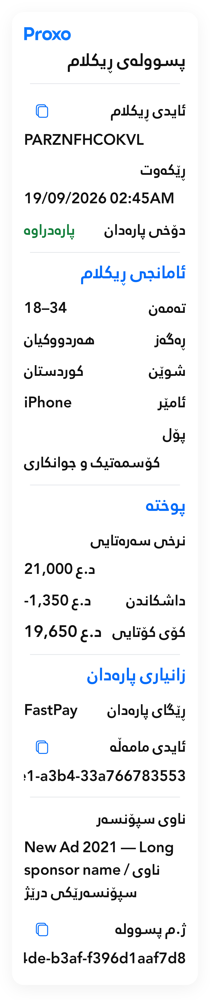</a> [narrow_paid.png](../receipt-reference-match-2026-10-23/exports/narrow_paid.png) 1120 × 5332 px |  [standard_free.png](../receipt-reference-match-2026-10-23/exports/standard_free.png) 1572 × 2508 px |

| Capture | Capture | Capture |
|---|---|---|
| <a href="../receipt-reference-match-2026-10-23/exports/transaction_narrow.png">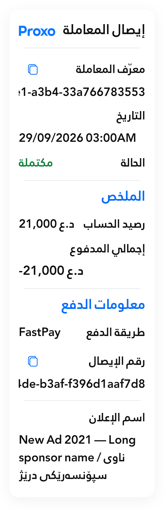</a> [transaction_narrow.png](../receipt-reference-match-2026-10-23/exports/transaction_narrow.png) 1120 × 3460 px |  [transaction_standard.png](../receipt-reference-match-2026-10-23/exports/transaction_standard.png) 1572 × 1768 px | <a href="../receipt-reference-match-2026-10-23/reference-upload.png">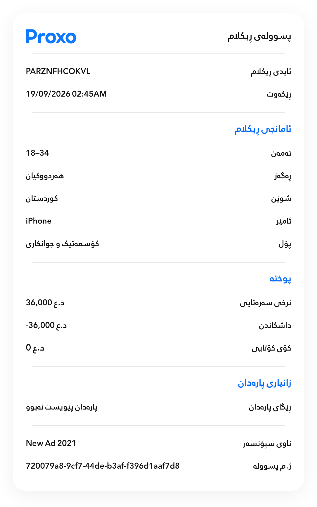</a> [reference-upload.png](../receipt-reference-match-2026-10-23/reference-upload.png) 1283 × 2048 px |

| Capture | Capture | Capture |
|---|---|---|
| <a href="../receipt-reference-match-2026-10-23/rendered/narrow_paid-page-1.png">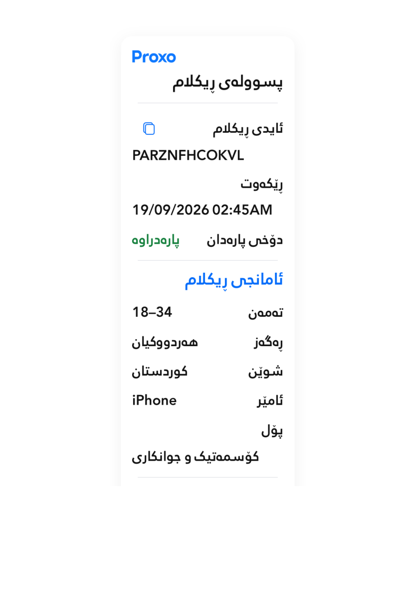</a> [narrow_paid-page-1.png](../receipt-reference-match-2026-10-23/rendered/narrow_paid-page-1.png) 834 × 1179 px | <a href="../receipt-reference-match-2026-10-23/rendered/narrow_paid-page-2.png">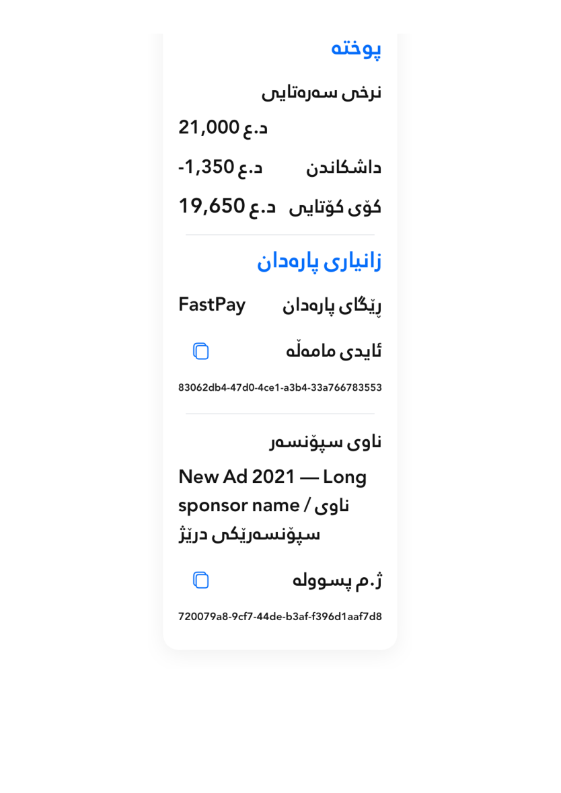</a> [narrow_paid-page-2.png](../receipt-reference-match-2026-10-23/rendered/narrow_paid-page-2.png) 834 × 1179 px | <a href="../receipt-reference-match-2026-10-23/rendered/standard_free-page-1.png">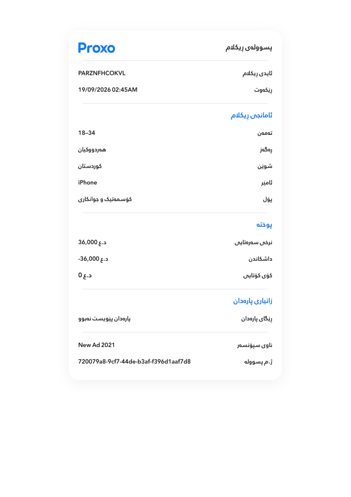</a> [standard_free-page-1.png](../receipt-reference-match-2026-10-23/rendered/standard_free-page-1.png) 834 × 1179 px |

| Capture | Capture | Capture |
|---|---|---|
| <a href="../receipt-reference-match-2026-10-23/rendered/transaction_narrow-page-1.png">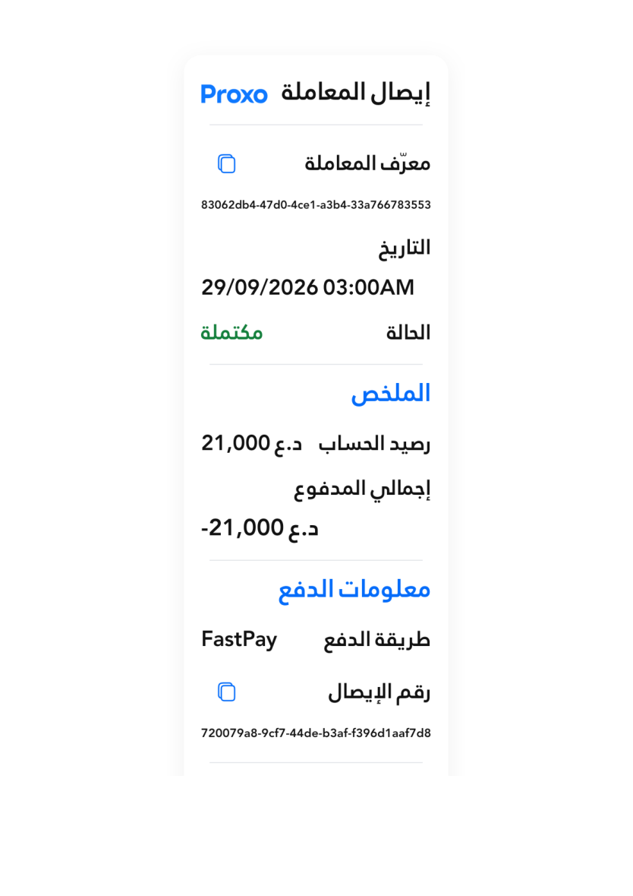</a> [transaction_narrow-page-1.png](../receipt-reference-match-2026-10-23/rendered/transaction_narrow-page-1.png) 834 × 1179 px |  [transaction_narrow-page-2.png](../receipt-reference-match-2026-10-23/rendered/transaction_narrow-page-2.png) 834 × 1179 px | <a href="../receipt-reference-match-2026-10-23/rendered/transaction_standard-page-1.png">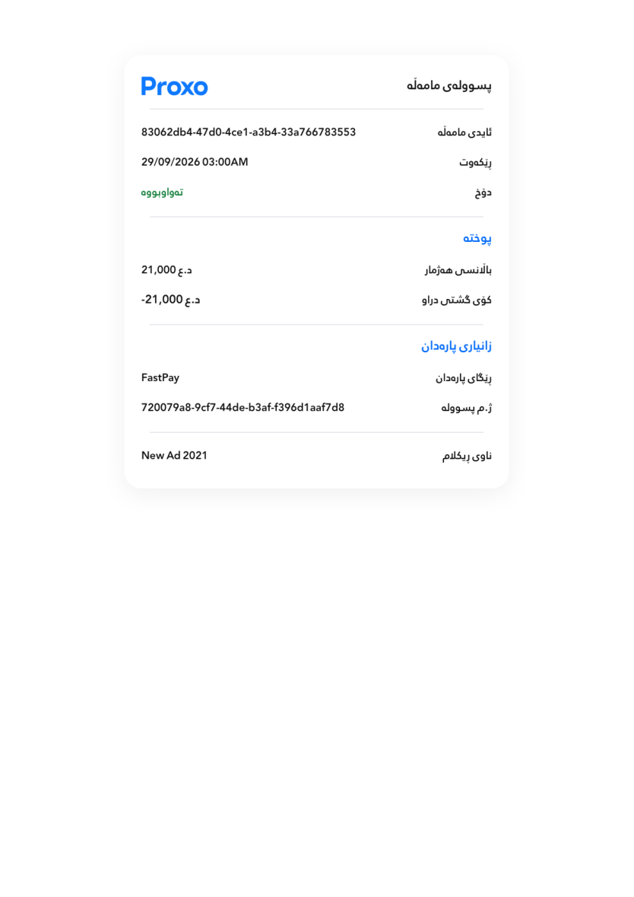</a> [transaction_standard-page-1.png](../receipt-reference-match-2026-10-23/rendered/transaction_standard-page-1.png) 834 × 1179 px |

| Capture | Capture | Capture |
|---|---|---|
|  [ad-receipt-280-s1.0-d1.0-bottom.png](../receipt-reference-match-2026-10-23/screens/ad-receipt-280-s1.0-d1.0-bottom.png) 280 × 852 px |  [ad-receipt-280-s1.0-d1.0.png](../receipt-reference-match-2026-10-23/screens/ad-receipt-280-s1.0-d1.0.png) 280 × 852 px |  [ad-receipt-393-s1.0-d3.0.png](../receipt-reference-match-2026-10-23/screens/ad-receipt-393-s1.0-d3.0.png) 1179 × 2556 px |

| Capture | Capture | Capture |
|---|---|---|
|  [ad-receipt-393-s2.0-d1.0-bottom.png](../receipt-reference-match-2026-10-23/screens/ad-receipt-393-s2.0-d1.0-bottom.png) 393 × 852 px |  [ad-receipt-393-s2.0-d1.0.png](../receipt-reference-match-2026-10-23/screens/ad-receipt-393-s2.0-d1.0.png) 393 × 852 px |  [ad-receipt-768-s1.0-d2.0.png](../receipt-reference-match-2026-10-23/screens/ad-receipt-768-s1.0-d2.0.png) 1536 × 1704 px |

| Capture | Capture | Capture |
|---|---|---|
|  [receipt-280-s1.0-d1.0.png](../receipt-reference-match-2026-10-23/screens/receipt-280-s1.0-d1.0.png) 280 × 852 px |  [receipt-393-s1.0-d3.0.png](../receipt-reference-match-2026-10-23/screens/receipt-393-s1.0-d3.0.png) 1179 × 2556 px |  [receipt-393-s2.0-d1.0.png](../receipt-reference-match-2026-10-23/screens/receipt-393-s2.0-d1.0.png) 393 × 852 px |

| Capture |
|---|
|  [receipt-768-s1.0-d2.0.png](../receipt-reference-match-2026-10-23/screens/receipt-768-s1.0-d2.0.png) 1536 × 1704 px |

## Coverage and exclusions

All image files introduced or changed in PR46 relative to `058f2f6` are included. The historical receipt package is the audit directly referenced by the approved receipt measurements. Unrelated ProxoLink, authentication, profile and older broad UI-audit images are outside this ad/receipt/workflow gallery. Two external “before” files were exact duplicates of preserved repository previews and are linked here through those existing files rather than copied again.

[Completion ledger](../../tiktok-dm-completion-status-2026-10-23.md) · [Local validation](local-validation.json) · [n8n import inventory](n8n-import-inventory.json)
