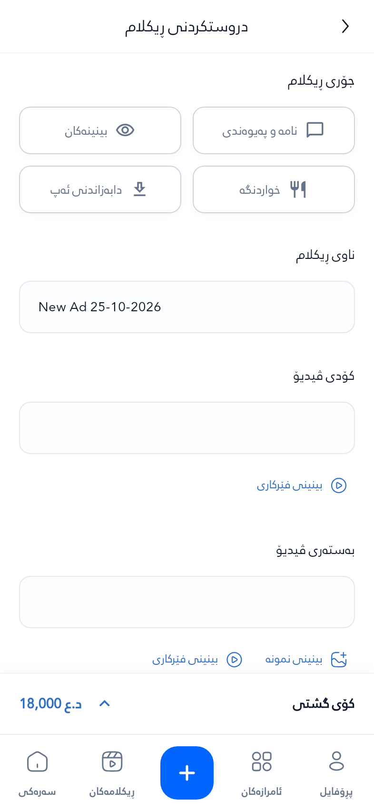
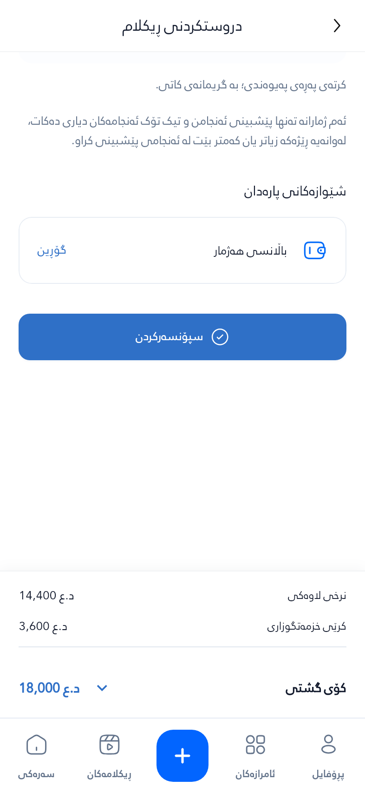

# TikTok Create Ad — supplied final-price reference

> Historical price-geometry captures. The latest [reference-color gallery](../tiktok-reference-colors-2026-10-25/README.md) applies the picture's sampled palette without changing these measurements.

**39 fresh captures for the supplied final-price image.** The price surface is now flush, full-width and square-cornered. [Original user reference](reference-user.jpg). Actual Flutter widgets and bundled Auth fonts are rendered with fictional deterministic data, not live payments or TikTok delivery.

[Reference comparison and implementation report](../../tiktok-price-reference/implementation-report.md) · [Actual measurements](measurements.json) · [Image hashes](manifest.json) · [Browser gallery](index.html)

| Top of form | Long price breakdown |
|---|---|
|  |  |

At normal text: 20dp gutters, 16dp heading gap, 32dp between sections, 50dp choices, 56dp fields, 64dp collapsed price, 0dp price corners, 0dp gap above navigation. The white price surface fills the viewport; its text retains 20dp inner gutters. The amount and divider remain anchored while expanded details scroll at large text sizes.

## Full capture set

| # | State | Logical size | Text scale |
|---|---|---|---|
| 1 | [top create ad](01-top-create-ad.png) | 393 × 852 | 1× |
| 2 | [ad types](02-ad-types.png) | 393 × 852 | 1× |
| 3 | [ad name](03-ad-name.png) | 393 × 852 | 1× |
| 4 | [media](04-media.png) | 393 × 852 | 1× |
| 5 | [contact destination](05-contact-destination.png) | 393 × 852 | 1× |
| 6 | [contact page collapsed](06-contact-page-collapsed.png) | 393 × 852 | 1× |
| 7 | [contact page expanded](07-contact-page-expanded.png) | 393 × 852 | 1× |
| 8 | [age](08-age.png) | 393 × 852 | 1× |
| 9 | [gender](09-gender.png) | 393 × 852 | 1× |
| 10 | [budget](10-budget.png) | 393 × 852 | 1× |
| 11 | [schedule](11-schedule.png) | 393 × 852 | 1× |
| 12 | [payment](12-payment.png) | 393 × 852 | 1× |
| 13 | [separate sponsor](13-separate-sponsor.png) | 393 × 852 | 1× |
| 14 | [price collapsed](14-price-collapsed.png) | 393 × 852 | 1× |
| 15 | [price expanded](15-price-expanded.png) | 393 × 852 | 1× |
| 16 | [price loading](16-price-loading.png) | 393 × 852 | 1× |
| 17 | [scroll behind price](17-scroll-behind-price.png) | 393 × 852 | 1× |
| 18 | [price and bottom navigation](18-price-and-bottom-navigation.png) | 393 × 852 | 1× |
| 19 | [layout 320](19-layout-320.png) | 320 × 800 | 1× |
| 20 | [layout 320 expanded](19-layout-320-expanded.png) | 320 × 800 | 1× |
| 21 | [layout 280](20-layout-280.png) | 280 × 700 | 1× |
| 22 | [layout 280 expanded](20-layout-280-expanded.png) | 280 × 700 | 1× |
| 23 | [large text 393](21-large-text-393.png) | 393 × 852 | 2× |
| 24 | [large text 393 expanded](21-large-text-393-expanded.png) | 393 × 852 | 2× |
| 25 | [contact selected platform logos](22-contact-selected-platform-logos.png) | 393 × 852 | 1× |
| 26 | [price expanded loading](23-price-expanded-loading.png) | 393 × 852 | 1× |
| 27 | [restaurant resources](24-restaurant-resources.png) | 393 × 852 | 1× |
| 28 | [app resources](25-app-resources.png) | 393 × 852 | 1× |
| 29 | [direct message open sections](26-direct-message-open-sections.png) | 393 × 852 | 1× |
| 30 | [large text 320](27-large-text-320.png) | 320 × 800 | 2× |
| 31 | [large text 320 expanded](27-large-text-320-expanded.png) | 320 × 800 | 2× |
| 32 | [large text 280](28-large-text-280.png) | 280 × 700 | 2× |
| 33 | [large text 280 expanded](28-large-text-280-expanded.png) | 280 × 700 | 2× |
| 34 | [price with discount](29-price-with-discount.png) | 393 × 852 | 1× |
| 35 | [price error](30-price-error.png) | 393 × 852 | 1× |
| 36 | [price recovered](31-price-recovered.png) | 393 × 852 | 1× |
| 37 | [narrow price details scrolled](32-narrow-price-details-scrolled.png) | 280 × 700 | 2× |
| 38 | [tablet 768](33-tablet-768.png) | 768 × 1024 | 1× |
| 39 | [tablet 768 expanded](33-tablet-768-expanded.png) | 768 × 1024 | 1× |

## Review sheets

- [Sheet 01](review-sheet-01.jpg)
- [Sheet 02](review-sheet-02.jpg)
- [Sheet 03](review-sheet-03.jpg)
- [Sheet 04](review-sheet-04.jpg)
- [Sheet 05](review-sheet-05.jpg)
- [Sheet 06](review-sheet-06.jpg)
- [Sheet 07](review-sheet-07.jpg)

The narrow-screen expanded captures show Sponsor fully above the price card. The final capture demonstrates scrolling the large-text price details while the divider, total and navigation remain fixed. Navigation retains its existing horizontal scroll behavior at very large text sizes.
