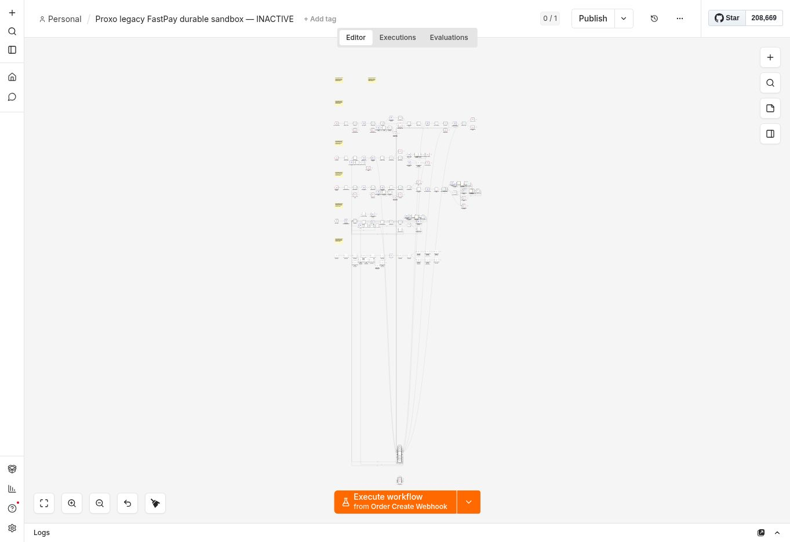
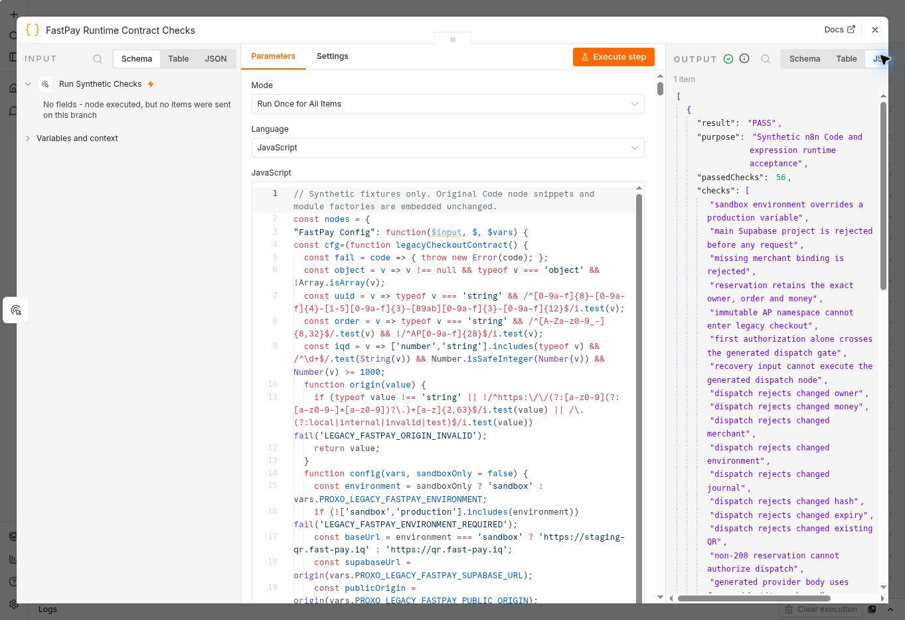

# FastPay n8n runtime audit — 27 October 2026

The repaired FastPay sandbox workflow is now imported into n8n, and its separate manual runtime harness passed **56 synthetic checks in n8n**. **Real payment acceptance remains outstanding.** The published `FastPay Checkout + Supabase v12` workflow was not replaced or republished, and no production database migration or routing change was performed.

## Imported sandbox draft

The [inactive sandbox workflow](https://email.proxopages.com/workflow/pA8Zn5xnDitCmDiP), `Proxo legacy FastPay durable sandbox — INACTIVE`, was imported from the reviewed [152-node export](../../integrations/legacy-fastpay/proxo_fastpay_durable_sandbox.json).

After saving and reloading, an export confirmed:

- **152 nodes**, `active:false`, and **zero bound credentials**.
- Connections match the reviewed source graph.
- Import differences are n8n default normalization: omitted `onError:stopWorkflow`, omitted `neverError:false`, omitted default GET method and added empty IF `leftValue`. These did not replace any gate, request body or Code snippet.
- The dedicated staging paths, sandbox-only origin guard and main-project rejection remain in place. Refund and notification paths remain disabled.

The draft was not published or executed. Its selected credentials remain unconfigured.



## Actual n8n runtime result

The [manual-only runtime workflow](https://email.proxopages.com/workflow/8fLksW8MXDWJQ810), `Proxo FastPay runtime contract checks — MANUAL ONLY`, contains a Manual Trigger and one Code node. It ran manually and produced **`PASS` with `passedChecks:56`**. It remains inactive.

The [reproducible harness](../../integrations/legacy-fastpay/runtime-harness.mjs) embeds **16 actual Code snippets**, **four actual expressions** and the original contract factories unchanged from the reviewed source. The test data is synthetic. There are no HTTP, webhook, schedule, credential or notification nodes, and no database or provider action is available to the harness.

The result explicitly records:

```json
{
  "result": "PASS",
  "passedChecks": 56,
  "syntheticOnly": true,
  "providerRequests": 0,
  "ledgerWrites": 0,
  "livePaymentAccepted": false
}
```

The embedded source-export SHA-256, calculated over `JSON.stringify` of the reviewed sandbox export, is:

```text
7d5165735d12c832b96beb05e95bacd053206f9652c4824965e15510a8cc1a11
```

Checks cover sandbox target rejection, immutable-order isolation, original owner/order/amount binding, one authorization crossing the dispatch gate, retry recovery without dispatch, expiry, QR origin enforcement, malformed and non-200 evidence, independent callback validation, exact transaction/amount/currency matching, approved ledger confirmation, duplicate credit responses, nonterminal declines and historical-order recovery restrictions. They verify the supplied authority checks in n8n; they do not simulate a real financial settlement.



## Remaining payment acceptance

The runtime result verifies Code/expression compatibility for these synthetic cases. It does **not** verify HTTP-node behavior, protected credential injection, database compatibility, provider responses or callbacks.

The sandbox still needs an isolated Supabase/backend target, migration preflight and the reviewed financial dependency chain, protected sandbox merchant and database credential bindings, a matching merchant reference, and registered sandbox callback. Then perform controlled QR/status/validation, interrupted checkout, duplicate callback, expiry and late-payment acceptance against that isolated target, confirming exactly one financial credit.

See the [setup instructions](../../integrations/legacy-fastpay/README.md) for the required variables and credentials. Production activation, the existing v12 workflow, production routing and domain assignments remain unchanged.
