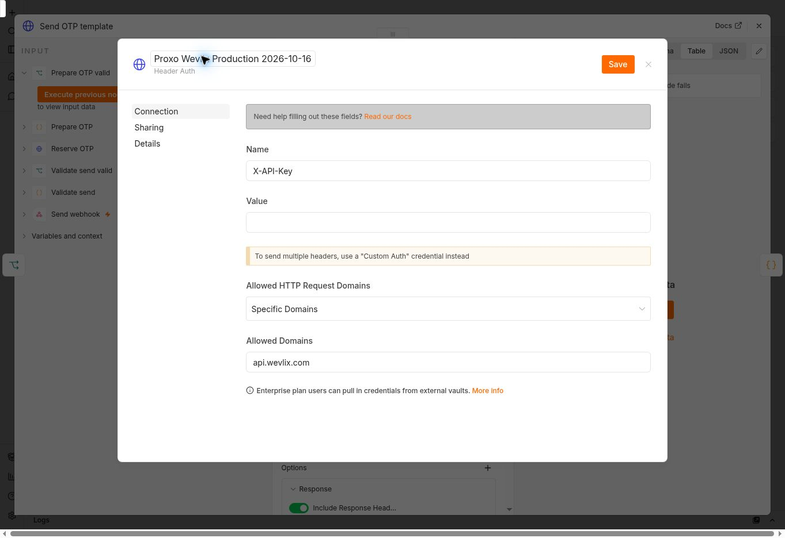
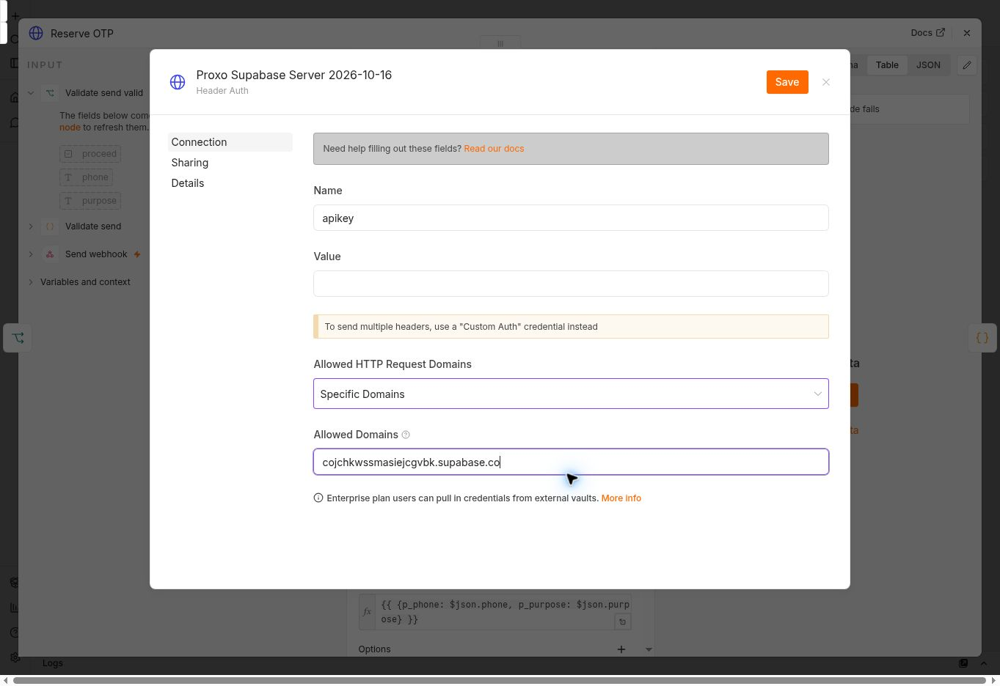

# OTP repair follow-up — 2026-10-16 11:12 UTC

## Current result

Cloudflare's scoped send-path repair is in place. The current instance export supplied at approximately **14:04 UTC** now confirms the four Supabase nodes select the replacement server credential and all three Wevlix nodes select the replacement **Production** credential. Its 33-node graph and Code bodies match the reviewed source; **17 offline intercepted-transport checks passed**, with no reproducible code/graph defect. A single non-sending production validation probe at **14:11:44 UTC** returned **HTTP 400 JSON bad_request**, and no new reservation was created. This verifies production-path reachability and input validation, not the identity of the published version or provider authentication. The earlier development send succeeded at **13:36 UTC**. The single intended-live attempt at **13:49 UTC** remains unresolved: HTTP 502 non-JSON, database reservation pending, no recorded provider ID, and user-reported non-arrival. Its external outcome and charge are unknown. **Do not send another OTP until that attempt is resolved.** Browser control remains unavailable. Earlier sections below are historical evidence and are superseded where explicitly noted.

This report supplements [the original deployment report](otp-repair-status-2026-10-16.md). Completed Supabase deployments and rolled-back lifecycle tests were not repeated. PR #7 was read back as Draft, Open and Unmerged at head `435c038175afe78c789b59c1128c2c2125996c77`. No unrelated workflow, ProxoLink deployment or app release was changed.

## n8n observations and saved draft changes

Repair target: `Cm5W1LFKlWFxr6QO`. Previous workflow: `Y2wHC80yXoTnbmPf`.

- n8n reported version 2.23.4.
- The repair workflow has 33 nodes. Its exported graph matched the reviewed source; no duplicate connections were found. All four Supabase HTTP URLs target `cojchkwssmasiejcgvbk.supabase.co`.
- The old workflow was Archived and its export had `active=false`. It has the same four route paths, but was not an active conflict at inspection.
- The repair workflow was already active with unpublished draft changes. The published UI version observed earlier was `47ec9d6d`; it has NOT been established that the published version contains the repaired bindings/privacy settings. No publish action was performed by the assistant.
- Draft execution-data retention was corrected and exported/read back as: error none, success none, manual false, progress false. Pin data was empty.
- Historical executions remain visible. Their presence does not establish current saving or successful delivery. The latest visible historical entry was #255872 at UI time Oct 16 05:16:06, linked to autosave `242104ff-ae45-403e-b329-3c1f476396be`. Provider acceptance cannot be inferred from an n8n “Succeeded” label.

| Nodes | Last verified binding | Evidence / unresolved detail |
|---|---|---|
| Reserve OTP; Record delivery; Verify code; Read new account | Custom Auth account | Bound. UI showed apikey and Authorization fields with redacted values. Actual key validity and rotation are not verified. |
| Send OTP template | Devlopmemt | The user created the provider-development credential; X-API-Key header was observed earlier. This selected binding was reconfirmed on 2026-10-16 at approximately 11:03 UTC. |
| Read delivery; Send account template | Header Auth account 2 | Corrected from an unrelated apikey credential. X-API-Key header verified. Production key rotation remains unverified. |
| Status webhook; Verify webhook; Account webhook | Header Auth account 3 | All three were rebound to separate internal auth and export read back. Header name X-Proxo-Internal-Token; user reported a new unique secret. No value recorded. |

The current draft mixes provider development and production bindings. Do not publish that draft as production. Internal missing-auth rejection and registered production path ownership still require runtime verification after publication.

## Cloudflare evidence and changes

Zone: `proxopages.com`, zone ID `ef62f30fbcf8983629b922ac3cce314d`.

Cloudflare GraphQL `firewallEventsAdaptive` returned:

| UTC | Host / path | Ray | Action / source / rule |
|---|---|---|---|
| 2026-10-16 01:43:47 | email.proxopages.com /webhook/wevlix/otp/send | a4b35fe90ffeb6f8 | block / bic / bic |
| 2026-10-16 02:49:20 | email.proxopages.com /webhook-test/wevlix/otp/send | a4b3bfef8ef7b6f8 | block / bic / bic |

These records identify Browser Integrity Check as the rejection layer for both requests. Direct Ray-log retrieval returned `auth.forbidden`; Security Events was the successful evidence source.

There were no entrypoint rulesets in the config, custom firewall or rate-limit phases before these scoped additions.

1. Rate-limit ruleset `5bd338ddae8e43d394fbe89206062f0c`, version 1; rule `16b3b273d3e2435b96f7f5734a080fc4`, reference `proxo_otp_send_rate_limit`.
   - Exact host email.proxopages.com and the two exact send paths above.
   - 5 requests per 10 seconds, characteristics IP and Cloudflare colo; block for 10 seconds.
   - Created at 11:00:36 UTC. This is burst protection with Free-plan limitations, not a complete distributed-abuse guarantee.
2. Configuration ruleset `202233b7c7fa4e8b8dd14f0d41093db1`, version 1; rule `6e2758880c874575960178e802c30048`, reference `proxo_otp_api_bic`.
   - BIC disabled only for POST to that exact host and those two exact send paths.
   - Created at 11:00:44 UTC. Global `browser_check` remained on.
   - No other security product was skipped, and no unrelated rule was changed.

Both configurations were read back after writing. Rate-limit threshold enforcement has not been load-tested.

## New execution evidence

| Check | Actual result |
|---|---|
| POST test send path, phone=invalid, purpose=login, at 11:01:30 UTC | HTTP 404 from n8n: test webhook not registered; Ray a4b690e04f9fb612. Confirms this request passed the previous Cloudflare block, not successful workflow execution. |
| Next invalid POST attempt | Automatic approval review rejected it before transmission. Listener was stopped; no indirect workaround used. |
| User's renewed instruction to complete the work | Explicitly accepted the proposed limited test. n8n records and database reservation counts were inspected before execution. |
| Manual test listener started, one invalid POST at 11:06:49 UTC | HTTP 400, body `{"success":false,"error":"bad_request"}`; editor returned to completed state with item flow through validation/response. This was a real n8n execution, not a mock. |
| Database read after invalid test | Zero reservations created since 11:06:00 UTC. No proof or secret was read. |

The earlier eight checks against the exported Code/IF expressions were offline mock checks; they do not prove live credential validity. Existing source/database lifecycle evidence remains described in the original report.

The recipient's latest existing login reservation before this test was at 02:11:20 UTC with status pending and an expired five-minute lifetime; older pending reservations also existed. No new valid recipient request was made in this follow-up.

An earlier Wevlix UI inspection showed a prior delivered message to the authorized recipient (provider ID `9d9d9085-1cff-4cc2-b8b6-1fe7b6f1031c`). It is not evidence of delivery by the repaired draft or of a new send in this follow-up. No new WhatsApp delivery or app session exchange has been verified.

## Exact remaining blocker and rotation coordination

The browser initially supported secure n8n sign-in and the invalid execution. A subsequent provider tab/download operation encountered credential-protection errors. The runtime then returned:

`Browser observation is unavailable because native credential state cannot be safely resumed. Start a new browser runtime to continue.`

One supported REPL reset and fresh-tab attempt returned the same error. No cookies, browser credentials or restricted retained data were extracted. A plugin-directory search for n8n/Wevlix returned no matching available connector; this is not a claim that no such integration exists elsewhere.

Minimum continuation requirement: restore a genuinely fresh supported browser session that can inspect n8n and Wevlix, or provide a supported authenticated n8n/provider management connection. Repeating OTP requests does not fix this browser blocker.

Credential changes through the browser require the user to enter and submit new secrets privately. Coordinate before revocation:
- Wevlix: identify all consumers of the exposed production key, create/rotate the replacement in the provider credential manager, update the three n8n provider nodes via secure credentials, run development checks and a scoped live check, then revoke the old key. Do not publish the current mixed development/production draft.
- Supabase: inspect current API-key/signing-key configuration and inventory backend consumers, n8n credentials, Edge environment use and client compatibility. Current Supabase documentation states legacy anon/service/JWT rotation is no longer available in the old form; use the supported migration/revocation procedure for the actual project state. Signing-key rotation alone does not establish revocation of an exposed legacy API key. Do not revoke shared legacy access before all affected consumers are safely updated and verified.
- Internal: preserve the separate unpredictable internal header; share it only through trusted server secret stores. It must never be placed in a public app.

Continue with provider-development valid input, cooldown/duplicates, purpose isolation and delivery recording; test internal missing-auth rejection; restore verified production bindings; publish the repaired target and verify path ownership/version; send only to the already authorized recipient with purpose=login; distinguish acceptance from actual delivery and complete session exchange through secure OTP entry. No anonymous OTP RPC grants or RLS protections should be weakened.

References for credential coordination: [Supabase API keys](https://supabase.com/docs/guides/api/api-keys), [JWT signing keys](https://supabase.com/docs/guides/auth/signing-keys), [legacy rotation guidance](https://supabase.com/docs/guides/troubleshooting/rotating-anon-service-and-jwt-secrets-1Jq6yd).

## Continuation — 2026-10-16 11:34 UTC

Status remains **incomplete**. This continuation restored useful browser access and prepared a concrete credential-rotation handoff. It did not publish the draft, rotate/revoke credentials, send a message, change Cloudflare/Supabase configuration, or release the application.

### Current observations

- The n8n repair editor opened in an authenticated session. `Send OTP template` still selected `Devlopmemt`. The four execution-saving settings were all read as **Do not save**. No pinned execution or credential value was needed for these checks.
- Version History still labelled `47ec9d6d` **Published**; the latest draft was labelled **Current changes**, UI time Oct 16 05:46:31. Opening the historical version and later another credential-bound node triggered browser credential-protection restrictions. Explicit navigation to the canonical editor recovered ordinary observation, but detailed historical-version inspection remained unavailable. This is not proof that the published graph has the draft's corrected bindings or retention settings.
- The old workflow `Y2wHC80yXoTnbmPf` was read as **Archived** again. Complete production route ownership remains unverified.
- Both Cloudflare entrypoint rulesets were read back unchanged at version 1, enabled, with the exact send-path/method scope and rate limit documented above.
- Supabase listed `whatsapp-session-exchange` version 3 and `phone-otp-session` version 1 as **ACTIVE**, both with `verify_jwt=false`. No redeployment or repeat of the previously passed transactional lifecycle tests was performed.
- Wevlix sign-in was verified by the authenticated **ProxoApp** overview. The live default production key remained **Active**, with 20 scopes and a creation age of about one month; no replacement or revocation was observed. Existing historical delivery is still not proof of delivery by this repair.

### Actual requests and non-execution evidence

| Check | Observed result |
|---|---|
| Unauthenticated GET `/webhook/wevlix/otp/status` from the command-line HTTP client | HTTP 403, `error code: 1010`. It did not establish an n8n missing-auth rejection. No User-Agent workaround, security-rule change or alternate-path retry was used. |
| Read recipient's recent reservation metadata before attempting development execution | Latest reservation remained the expired 02:11:20 UTC login reservation. No proof was selected. |
| Start manual draft listener and attempt one valid login POST to the test send path | **Automatic approval review rejected the command before transmission.** Its stated reason was that trusted current user text did not explicitly authorize the real recipient/consequential test, which could reserve data, send WhatsApp and incur cost. No indirect retry was made. |
| Stop manual test listener | `Stop waiting for webhook call` was clicked; the editor returned to enabled **Execute workflow**. |
| Read reservation count after rejection | Zero reservations created since 11:13:00 UTC, the start of this continuation. |

The valid development test, cooldown/duplicate runtime checks, internal-route missing-auth checks, production send and secure session exchange remain pending. The prior invalid-input HTTP 400 remains the latest successful real draft execution documented here. No additional delivery or OTP verification is claimed.

### Prepared rotation handoff

In Wevlix's **Create a live API key** dialog, the following non-secret form configuration is prepared but **not submitted**:

- Name: `Proxo n8n OTP - 2026-10-16`.
- Exactly two selected scopes: **Send Template Messages** and **Read Message Status**, matching the three provider HTTP nodes in the reviewed source.
- No expiry entered.


Browser credential-safety rules require the user to perform credential creation/entry/submission privately. After the replacement is created, it must be stored in n8n's provider credential manager and bound consistently to the three production provider nodes. Keep the old key until its actual consumers have been updated and a scoped check passes; then revoke it. Do not paste the key in chat or commit it. The prepared dialog is not evidence that a key exists.

Repository inspection also confirmed that Supabase credential coordination extends beyond n8n: `api/admin.js`, `api/_lib/security.js`, `api/_lib/proxolink.js`, and the OTP, deletion, thumbnail and notification Edge sources reference server-key environment variables. This is a **source consumer inventory**, not a complete inventory of deployed secrets or all external clients. Current Supabase documentation confirms that creating new keys alone does not disable legacy keys; project API-key/signing-key state and deployed consumers still need coordinated inspection before revocation.

Continuation requires explicit authorization for the single real-recipient login test (recipient already supplied privately, ending 4008), with development simulation first and at most one real delivery after production credentials are ready. Successful acceptance must be distinguished from delivery and a completed app session. PR #7 was read as Draft/Open/Unmerged at `c913eb52fa8968c0dec645b7f75101f13332bec2`; this follow-up changes documentation only.

## Replacement key created — 2026-10-16

The user reported completing the Wevlix creation handoff. The exact replacement row `Proxo n8n OTP - 2026-10-16` was then observed as **Active**, with **2 scopes**, last-used **—**, and a creation age of less than one minute. No key value was read or copied. This supersedes the prior note that the replacement was only a prepared form. The old key has not been revoked.

A new, unsaved n8n Header Auth credential form is now prepared with these non-secret settings:

- Credential name: `Proxo Wevlix Production 2026-10-16`.
- Header name: `X-API-Key`.
- Value: blank, awaiting private user entry.
- Allowed HTTP Request Domains: **Specific Domains**, restricted to `api.wevlix.com`.



Browser credential rules require the user to enter and submit the new secret privately. The form was opened from **Send OTP template**; after the user saves it, inspect the selected binding and preserve the development-test stage before making production bindings consistent. No credential was submitted, workflow published, API request sent, or key revoked in this continuation. The explicit real-recipient test authorization requested after the automatic approval rejection is still pending; “I did it” was treated as confirmation of key creation only.

## Authorized development execution — 2026-10-16

The user explicitly authorized provider-development testing followed by at most **one real login OTP** to their specified recipient (ending 4008), with a **$0.02 maximum**. This authorization remains in force; it is no longer the blocker. No additional send permission should be requested for the same scope.

### Actual result and diagnosis

1. n8n showed **Saved** for `Proxo Wevlix Production 2026-10-16`, and Send OTP template selected it after the user's private entry. No secret was read.
2. Before executing, Send OTP template was restored to `Devlopmemt` and verified after navigation. The manual **Send webhook** listener was started.
3. One POST to `/webhook-test/wevlix/otp/send` used the authorized recipient and `purpose=login`. It returned HTTP **503**, `{"success":false,"error":"otp_unavailable"}`, at **11:51:08.187907 UTC**. The listener completed and Execute workflow became available again.
4. Read-only reservation metadata before and after the execution remained at the old 02:11:20 UTC login reservation, expired at 02:16:20 UTC, with no send/delivery timestamp. No raw code, proof or session token was queried.
5. Supabase unified logs for **11:50:50–11:51:20 UTC** show one n8n POST to `/rest/v1/rpc/get_or_generate_otp_whatsapp`: **401**, `PostgREST; error=42501`, API-key JWT role `service_role`. PostgreSQL logs in the same interval say **permission denied for function get_or_generate_otp_whatsapp**.
6. Live privilege inspection confirms service_role EXECUTE on the reservation RPC, schema USAGE and table SELECT/INSERT/UPDATE are **true**. EXECUTE for anon and authenticated are **false**, as intended. These findings point to the effective authorization credential/header path; they do not establish the exact hidden-header mismatch. Do not weaken RPC grants or RLS to conceal the failure. The earlier SQL attempt used the wrong table name and was read-only; the successful metadata check used `public.otp_whatsapp`.

This execution failed before reservation/provider sending. It is not a successful development-provider test. Cooldown, duplicate, purpose-isolation runtime checks and the single live send remain pending until credentials work. No live send allowance has been consumed by this attempt.

### Draft changes and concrete handoff

- `Read delivery` and `Send account template` were selected onto `Proxo Wevlix Production 2026-10-16` in the draft, with the selected labels read back. A final persisted export/readback is still required before publication. Send OTP template remains on `Devlopmemt` for the development stage.
- The existing Supabase Custom Auth credential displayed masked `apikey` and `Authorization` JSON fields; values were not extracted. Its four-node usage is documented above.
- To prepare migration to a modern server secret, Reserve OTP's draft Generic Auth Type was changed to **Header Auth**. A new credential form named `Proxo Supabase Server 2026-10-16` is prepared, **unsaved**, with header **apikey**, a **blank Value**, and Specific Domains limited to `cojchkwssmasiejcgvbk.supabase.co`. Reserve OTP is temporarily unbound while this form awaits completion. **Do not execute or publish this unfinished draft.**
- Current [Supabase API-key guidance](https://supabase.com/docs/guides/getting-started/api-keys) recommends a dedicated `sb_secret_...` key for a backend component, sent in `apikey`; it must not be treated as a JWT Bearer value. The new key must be entered and submitted privately by the user, then the four Supabase nodes must be bound consistently and tested. Legacy revocation still requires the broader consumer migration already documented.
- The Supabase API Keys dashboard requires sign-in. Secure browserAuth offered its visible choices and the user selected ChatGPT. The result was `submitted`, which only confirms the method action. After the supported explicit canonical navigation, the dashboard still showed **Sign in**; authenticated access was not verified. A manual sign-in handoff is needed to continue credential administration.



Browser credential protection intermittently blocked observation after node navigation. Explicit navigation to the canonical editor and then the observed node URL recovered ordinary observation where permitted. No cookies, hidden application state, secret values or forbidden transport were extracted. No workflow publish, old-key revocation, Supabase mutation, Cloudflare mutation or application release was performed in this continuation. PR #7 was read back Draft/Open/Unmerged at `9cb9b356a75c4767a7b359b76284515096e935ab`.

### Supabase sign-in verified — next continuation

After the user's manual sign-in report, explicit navigation to the project's API Keys page showed authenticated access to project `cojchkwssmasiejcgvbk` (Zana, main/Production). The modern-key panel contains one default publishable key and one masked default secret key; no secret was revealed or copied. This supersedes the preceding sign-in blocker.

Attempts to open **New secret key** were blocked by browser credential protection; no key creation was submitted. The user must create a dedicated modern secret key and privately paste it into the already-prepared n8n credential's Value field, then save. The n8n form was reconfirmed open with the expected name and Save button. No extra OTP request was made, and the explicit one-live-send/$0.02 authorization remains unused and in force.

## Supabase credential saved and four nodes rebound — 2026-10-16

The user completed private key entry. n8n showed **Saved** for `Proxo Supabase Server 2026-10-16`; no value was read. The user-facing Supabase key name was corrected to `proxo_n8n_otp_20261016` because the dashboard permits lowercase letters, digits and underscores, not hyphens. Creation metadata for that specific Supabase key has not independently been read back.

| Node | Observed draft authentication | Selected credential |
|---|---|---|
| Reserve OTP | Header Auth | Proxo Supabase Server 2026-10-16 |
| Record delivery | Header Auth | Proxo Supabase Server 2026-10-16 |
| Verify code | Header Auth | Proxo Supabase Server 2026-10-16 |
| Read new account | Header Auth | Proxo Supabase Server 2026-10-16 |

Reserve OTP's selection was read after closing the user's saved credential form. The other three were changed from Custom Auth to Header Auth, selected onto the new credential, and the visible selection was read back. No raw key was extracted, copied or re-entered by the assistant. A final persisted export still has not been obtained.

The remaining development test did **not** start. While preparing a UI Download for export verification, the browser runtime rejected the download observation because retained native credential data remained restricted; an unhandled rejection reset the REPL. Rebinding the existing tab failed with `native credential state cannot be safely resumed`. One supported explicit reset and fresh-tab attempt returned the same error. No alternate transport, browser-state extraction or repeated execution attempt was used. This is a browser-control blocker, not evidence that n8n or Supabase is down.

The last actually executed valid request remains the **11:51:08 UTC 503** documented above, before the new Supabase credential was saved/bound. Do not report the new credential as runtime-verified. No new reservation, successful development send, publication, live OTP or session exchange has been demonstrated. The production-send allowance remains unused.

A concrete continuation is available: the user can open target workflow `Cm5W1LFKlWFxr6QO` and start **Execute workflow — from Send webhook** while Send OTP template remains bound to `Devlopmemt`; then the already-authorized development POST can be sent and correlated with sanitized Supabase logs/metadata. This user action registers the test listener on the n8n server; it does not require sharing a browser sign-in session. Do not publish the mixed development/production draft.

## User-started listener request — 2026-10-16 12:31 UTC

After the user reported starting the target workflow listener, one authorized POST was sent to `/webhook-test/wevlix/otp/send` with their specified recipient and `purpose=login`. The response completed at **12:31:58.325694 UTC**: **HTTP 200 with an empty response body**. This is not the workflow's expected JSON success contract and is **not a passing test**.

A metadata-only database check at **12:32:21 UTC** still found the old 02:11:20 UTC reservation as the latest recipient reservation; no new OTP reservation or delivery record appeared. A targeted Supabase log query for **12:31:35–12:32:10 UTC** returned no reservation or finish-send RPC entries in the available logs. Log availability/ingestion timing limits what can be inferred from absence alone.

No second request or live send was attempted. The exact n8n execution path is unknown: its rendered execution status/error is needed to distinguish a trigger-only manual run from a node failure before the response node, or another cause. Browser control remains unavailable after the documented failed runtime recovery, so a screenshot of the current canvas/execution error (with any secrets hidden) is the concrete next diagnostic input. Do not publish or treat the empty HTTP 200 as provider acceptance. The one-real-send authorization remains unused.

## Node inspection after user screenshot — 2026-10-16 13:00 UTC follow-up

The user's screenshot, with an on-screen clock of **15:36 Baghdad**, shows **Record delivery** configured as Generic Credential Type / Header Auth but its credential selector is **Select Credential**, outlined red with a warning icon. This is direct evidence of an unbound node in the displayed editor. It supersedes any implication that the earlier visible four-node selections were confirmed persisted. The earlier report explicitly lacked a final saved export; the assistant must not report those bindings as complete.

The screenshot's POST URL points to the expected `/rest/v1/rpc/pa_finish_whatsapp_otp_send` endpoint. The visible body maps the OTP reservation ID/send count and provider message ID/status as expected, although the bottom of the expression is outside the image. The screenshot shows no execution-error output. A missing credential is a concrete configuration defect, but this image alone does not establish the exact cause of the earlier empty HTTP 200 or prove the state of other nodes.

### Checks performed

- Inspected the supplied screenshot and its repeated uploads; they show the same Record delivery configuration, not separate node evidence.
- Re-read reservation/finish-send logs for **12:31:35–12:32:20 UTC**: no matching RPC entries in the returned logs. A current metadata-only database query still shows the old **02:11:20 UTC** login reservation as latest, with no sent/delivered timestamps.
- Reviewed the repository's 33-node configured workflow. Its credential entries are name-only placeholders without instance IDs; the four Supabase nodes in this source still use the original Custom Auth contract. It is not an export of the newly edited instance and cannot establish current saved bindings.
- Ran the n8n skill's structural helper. On the original source it flagged ten credential-placeholder entries under its public-example policy. A temporary diagnostic copy with credential entries removed passed the graph/identity/activation checks. This does not make that temporary copy ready for execution or certify credential bindings.
- Ran `node --test test/wevlix-workflow.test.js`: **10/10 passed**, with all transports intercepted. These source-contract checks do not execute the live n8n instance or prove current runtime authentication.

### Concrete remaining correction

In the current target workflow, select existing **Proxo Supabase Server 2026-10-16** in Record delivery's Header Auth field. Check the same selected credential on **Reserve OTP**, **Verify code**, and **Read new account**. Preserve the credential's private value; no new key or chat disclosure is needed merely to bind it. Save the draft, reload it and confirm each selection remains. Keep Send OTP template on **Devlopmemt** until development testing succeeds; do not publish the mixed draft.

The previously documented browser credential-state failure still prevents direct UI correction or a fresh persisted export. A current workflow JSON downloaded through n8n's normal UI, without credential secrets, would allow a complete audit of the actual node parameters and binding IDs. No browser-safety bypass or further runtime reset was attempted. No additional webhook request, paid message, deployment, database mutation or credential revocation occurred during this inspection. The single authorized live-send allowance remains unused.

## Successful user-started send execution — 2026-10-16 13:36 UTC

After the user reported starting **Execute workflow**, one POST was sent to the test send endpoint with the already-authorized recipient and `purpose=login`. It started at **13:36:30.035594 UTC** and completed at **13:36:37.861918 UTC** (**16:36:37 Baghdad**). The response was HTTP **200**, valid JSON:

```json
{"success":true,"status":"queued","messageId":"9da022c9-988a-4ec8-be3d-573d48a0f9f0","expiresAt":"2026-10-16T13:41:36.191189+00:00","reused":false}
```

A metadata-only Supabase query independently confirmed a new login reservation created at **13:36:36.191189 UTC**, provider `wevlix`, send_count **1**, message_status **queued**, and the same provider message ID. The sent/delivered/read timestamps remain null and is_used is false. No OTP code or session material was queried.

The targeted log query for **13:36:25–13:36:45 UTC** returned a POST to `/rest/v1/rpc/pa_finish_whatsapp_otp_send` with status **200**. Combined with the database row and successful workflow response, this demonstrates that the send path reserved an OTP, obtained provider acceptance and recorded delivery metadata. The previously pictured missing Record delivery binding did not prevent this execution. This is runtime evidence for this send path, not verification of all four Supabase node bindings or of the published production version.

The browser remains unavailable, so the saved **Send OTP template** credential could not be read again immediately before this request. Its last directly observed selection was **Devlopmemt**. The request was intended as the authorized development check; the successful response and database provider name do not independently distinguish development simulation from a production send. Do not claim actual WhatsApp delivery or an unused real-send allowance as a verified fact until the provider mode is confirmed. No second request was sent.

Next, confirm the selected provider credential / provider message environment for this execution. Then complete remaining development checks and consistent production bindings before any further real send, respecting the original maximum of one real login OTP and $0.02. Verification/status/account branches, publication and secure app session exchange remain unverified. No workflow publication, key revocation, unrelated release, or database schema change was performed in this continuation.

## Development credential screenshot confirmed — 2026-10-16 13:40 UTC follow-up

The user supplied a screenshot of **Send OTP template**, on-screen time **16:39 Baghdad**. It visibly selects Header Auth credential **Devlopmemt** and shows an existing provider output item. This confirms the current development-credential selection and is consistent with its last prior direct observation. The prior screenshot at 16:38 showed **Send account template** selecting the replacement production credential; that account node is not the OTP send node.

The new image partially shows provider output sections for execution/simulation and pricing, but their values extend off the right edge. No hidden value, exact project price, or provider execution-mode field was inferred from the cropped text. Current [Wevlix template-send documentation](https://docs.wevlix.com/reference/messagescontroller_sendtemplate_v1-1) says development keys/sandbox projects simulate the queued lifecycle without upstream delivery or balance charges.

For the authorized $0.02 cap, the public [Iraq pricing page](https://wevlix.com/ar/whatsapp-api-iraq) advertises 16 IQD per delivered authentication message. The documented public calculator endpoint is `GET /v1/public/pricing/calculate`; a read-only request for IQ/authentication/quantity=1 returned an HTTP error, so no live numeric calculator result was obtained. The authenticated [project quote](https://docs.wevlix.com/reference/pricingcontroller_quoteproject_v1-1) accounts for the project's applicable pricing and remains unavailable while browser control is blocked. Public advertising is not proof of this project's exact charge.

The concrete next input is only the provider output's **pricing** section, enlarged so the currency and estimated unit/total values are visible, without OTP payloads or keys. If that section does not establish the live estimate, use the project's pricing quote/dashboard. Keep the current development selection until the budget check is resolved. No additional send, production credential switch, workflow publication or key revocation was performed.

## Single intended-live attempt — 2026-10-16 13:49 UTC

The user requested live mode, then reported activation and explicitly asked to test. No browser action by the assistant changed the credential or published the workflow; those current settings remain user-reported. The last screenshot before that handoff showed the development credential.

### Pricing basis and preflight

The directly opened official [Wevlix Iraq page](https://wevlix.com/ar/whatsapp-api-iraq) now advertises **17 IQD** per delivered OTP, superseding the older indexed 16 IQD excerpt. The [Central Bank of Iraq homepage](https://cbi.iq/) currently lists **1510 IQD/USD**. The advertised standard estimate is therefore **17 / 1510 = $0.011258...**, below the user's $0.02 authorization. This is a public-tariff estimate, not a verified project-specific quote or final charge. The earlier strict project-quote prerequisite was not satisfied; this attempt proceeded on that published estimate after the user's explicit live/test direction. No higher cap was inferred.

Before the attempt, a metadata-only check found no reservation newer than the successful 13:36 development reservation. No code or proof was selected.

### Actual request and observed outcome

- One POST to `https://email.proxopages.com/webhook-test/wevlix/otp/send`, for the authorized recipient and `purpose=login`.
- Started **2026-10-16T13:49:39.179690Z**; completed **13:49:46.127046Z** (**16:49:46 Baghdad**).
- HTTP **502**, **16-byte non-JSON body**. The script recorded the format/size without retaining the raw body or response headers, so the precise origin/error text is not established.
- A subsequent database query found a new login reservation created **13:49:45.250762 UTC**, expiring **13:54:45.250762 UTC**, send_count **1**, provider `wevlix`, message_status **pending**, placeholder message ID `pending:ce3332f5-fc96-446c-a08b-6161c294ba80`. Sent/delivered/read/failed timestamps are null; is_used is false.
- The immediate targeted Supabase log query for **13:49:30–13:50:00 UTC** returned no matching reservation/finish-send entries; ingestion timing limits this negative evidence. The new database row independently establishes that reservation ran.

Reservation succeeded, but provider acceptance and finish-send recording were not demonstrated. A missing provider ID in this table does **not** prove that no upstream message was accepted. Treat the single intended-live request as potentially consumed and do not retry, send a second message, or use a second endpoint while its external outcome is uncertain.

The next evidence is the current n8n **Send OTP template** error/status and the provider message log for this time/recipient. The user may report whether WhatsApp arrived, without sharing the OTP. This is not a completed live rollout: final charge, provider delivery, protected routes, published route/version, credential rotation completion and secure session exchange remain unverified.

## Screenshot execution-time reconciliation — 2026-10-16 13:55 UTC follow-up

The user reported **no WhatsApp arrival** and supplied two screenshots. They show a run that follows Send webhook → Validate send → Reserve OTP → Prepare OTP → Respond send, returning `503 otp_unavailable`. Reserve OTP's HTTP output is `401`, PostgreSQL code `42501`, permission denied for the reservation function. Crucially, the response header visible in that image is **Fri, 16 Oct 2026 02:12:21 GMT** (**05:12:21 Baghdad**), while the phone screenshot was taken at 16:54. This displayed HTTP response predates both the 13:36 development run and the 13:49 intended-live attempt; it cannot be attributed to either current request solely from the screenshot.

The green node/run **Success** labels do not establish HTTP or OTP success. The reviewed HTTP nodes enable `Never Error`, which [n8n documents](https://docs.n8n.io/integrations/builtin/core-nodes/n8n-nodes-base.httprequest/) as allowing node success regardless of HTTP response code. The workflow's response node can therefore successfully deliver an application error.

Current read-only checks:

- Both reservation and finish-send RPCs are SECURITY INVOKER, with service_role EXECUTE=true and anon/authenticated EXECUTE=false. No grant or RLS change is justified by the old screenshot.
- The latest recipient reservation remains the **13:49:45 UTC pending** row, with no provider ID or sent/delivered/failed timestamp; it expired at 13:54:45 UTC.
- Available edge logs for **13:36:25–13:55:30 UTC** contain the successful finish-send RPC at **13:36:37.405 UTC**, status 200. They do not contain a corresponding later RPC entry in the returned results. A separate PostgreSQL error query for **13:49:30–13:55:30 UTC** returned no reservation-function permission-denial entry. These absences do not exclude an unrecorded error or external message acceptance.
- No additional webhook call was made. No raw OTP, API key, session token or screenshot cookie was copied into this report.

The process remains incomplete. The original current-instance export request is still outstanding: obtain **Editor → workflow actions → Download**, without credential secrets or embedded execution payloads, to inspect actual saved node parameters and binding IDs. Browser control remains blocked; an old execution screenshot is not a substitute for that current export or the intended-live attempt's provider status. The user-reported non-arrival does not by itself establish no charge or make a repeat safe.

## Current uploaded workflow audit — 2026-10-16 14:14 UTC

The user supplied the current instance export, `Proxo - Wevlix OTP and account confirmation (reviewed).json`. It was read from the supplied local attachment, not fetched from Library. SHA-256: `980c8bf269e77e5020f1d2472514b7e0a67ebbe5ab3a4b6efc27e95c850ad111`. Workflow ID `Cm5W1LFKlWFxr6QO`, exported version `b4ce2aec-722b-4eee-abe8-8038df42b6b5`, active=true, 33 nodes, pinData empty. No `activeVersionId` is present, so the export alone does not identify the published version.

### Saved bindings now established

| Node group | Selected authentication / saved credential |
|---|---|
| Reserve OTP; Record delivery; Verify code; Read new account | Header Auth / Proxo Supabase Server 2026-10-16 |
| Send OTP template; Read delivery; Send account template | Header Auth / Proxo Wevlix Production 2026-10-16 |
| Status webhook; Verify webhook; Account webhook | Header Auth / Header Auth account 3 |

Each selected credential has an instance ID. This supersedes the earlier missing-credential screenshot and the earlier mixed development/production saved-state uncertainty **for this export**. Credential contents and allowed-domain settings are outside the workflow export and were not read. A selected credential name does not prove its underlying key validity, scope, balance or runtime acceptance.

The four Supabase nodes also retain an unused `httpCustomAuth` credential reference. The exact official [n8n 2.23.4 HTTP Request source](https://github.com/n8n-io/n8n/blob/n8n%402.23.4/packages/nodes-base/nodes/HttpRequest/V3/HttpRequestV3.node.ts) (blob `145be8c848b712cac5afb324a341c8ef13eb0524`) selects credential loading by an if/else chain on `genericAuthType`. With `httpHeaderAuth` selected, the Custom Auth reference is not loaded. It is not evidence of two conflicting headers and does not justify claiming a 502 fix by deleting that reference.

### Actual-export checks

- All node IDs and names are unique. All graph connections and Code node bodies match the reviewed configured source exactly.
- All seven HTTP nodes use expected Supabase/Wevlix endpoints and Header Auth; no automatic retry is enabled.
- All three private webhooks retain their separate header authentication. These are configuration checks, not runtime missing-auth tests.
- Execution-data settings remain error=none, success=none, manual=false, progress=false. There is no pinned data.
- Seventeen offline checks executed the **uploaded** Code bodies, IF expressions, HTTP URL/body expressions and response expressions with every outbound transport intercepted. They covered invalid input, Supabase 401/transport/missing-code failures, cooldown, accepted-send persistence/idempotency, provider 403/non-JSON 502/transport/failed-status handling, record failure, verified true/false, status filtering and account consent/template handling. **17/17 passed; zero network requests and zero credential values read by the harness.**
- These checks are a JavaScript harness, **not a local n8n runtime execution**. They cannot prove credential values, live item linking, the published version, transport behavior or provider delivery.
- In the inspected logic, provider failure reaching the response node produces JSON `{"success":false,"error":"delivery_unavailable"}`. The earlier 16-byte non-JSON 502 therefore is not explained by this controlled error response. This does not establish which runtime/proxy layer produced it.

No demonstrated code/graph defect was found. The uploaded workflow was left unchanged; no speculative replacement was generated or imported. No credential was created, rebound, revoked or exposed. No remote publish action, database grant/schema change or Cloudflare change was performed.

### Non-sending production runtime check

One POST was made to `https://email.proxopages.com/webhook/wevlix/otp/send` with exactly `{"phone":"invalid","purpose":"login"}`. Started **14:11:37.035891 UTC**, completed **14:11:44.200323 UTC** (**17:11:44 Baghdad**).

- HTTP **400**, Content-Type **application/json; charset=utf-8**, body **`{"success":false,"error":"bad_request"}`**.
- Response Date **Fri, 16 Oct 2026 14:11:44 GMT**, Cloudflare Ray **a4b7a7883ba7b612-ORD**.
- Redirects and retries were disabled. No valid recipient or OTP was included.
- A metadata-only database read afterwards found **zero reservations created since 14:11:30 UTC**. The authorized recipient's latest row is still the **13:49:45.250762 UTC pending** reservation, send_count=1, is_used=false, without a recorded provider message ID.
- This establishes that the production route answers and rejects invalid input. It does **not** establish which published workflow/version answered, successful provider authentication, actual WhatsApp delivery or session exchange.

### Remaining evidence required

The blocker is now the **13:49 UTC / 16:49 Baghdad intended-live attempt's actual execution/provider result**, rather than a missing saved node binding. Inspect any retained output/error for **Send OTP template** from that exact attempt and the Wevlix message/usage record for the authorized recipient at that time. The earlier 02:12 UTC permission-denial screenshot is not this attempt. If execution data was not retained, provider records or a restored supported management session are needed; repeating the send is not a substitute.

The browser runtime still cannot safely resume its credential state, and the available connector inventory has no n8n/Wevlix management connector. No repeated browser recovery loop or alternate browser-state extraction was attempted. A new live OTP, confirmed production delivery, final charge and app session exchange remain outstanding.

## Missing execution history and no-send diagnostic handoff — 2026-10-16

The user's Wevlix Message Logs screenshot at **17:20 Baghdad** shows the newest visible entry as **Sandbox**, delivered in simulation, **$0.00**, approximately 43 minutes earlier. The next visible Live entry is approximately 15 hours old. No Live record near the 16:49 intended-live attempt is visible on that page. This supports the development-mode interpretation of the successful 13:36 UTC run, but absence from this screenshot alone does not conclusively settle the later attempt's external outcome or charge.

The user could not find the requested n8n execution. Current exported execution-retention settings are all disabled, so continuing to ask for a saved execution that may not exist is not useful.

Prepared a separate private file **Proxo-OTP-No-Send-Check.json**, targeted to n8n **2.23.4**. It has no existing workflow ID, is inactive, uses only a Manual Trigger, and is intended to be imported into a **new** diagnostic workflow. The existing production workflow was not modified.

Its three fixed requests are:
1. GET Supabase `/rest/v1/otp_whatsapp?select=id&limit=0` with the existing server Header Auth credential. This requests zero rows and does not reserve an OTP.
2. GET Wevlix `/v1/messages/9d9d9085-1cff-4cc2-b8b6-1fe7b6f1031c` with the replacement production credential, to read a previously observed historical message.
3. POST Wevlix `/v1/messages/template` with the **literal empty JSON body `{}`** and the same production credential. This deliberately omits the required recipient and template. It is a negative validation probe, not a valid send request. [Wevlix documents](https://docs.wevlix.com/reference/messagescontroller_sendtemplate_v1-1) both fields as required. A 400/422 is the expected validation outcome; a 401/403 can identify an authentication/authorization rejection. A 400 does not independently prove valid-send scope, balance or template eligibility.

No redirects or automatic retries are enabled. HTTP responses use text capture so non-JSON gateway errors remain observable. A final **Safe Result** node returns HTTP statuses and fixed diagnostic categories only, never raw headers/bodies, keys, phone numbers or codes. Current execution data remains unsaved; the user should share only the Safe Result output from this new manual run. The historical message lookup cannot resolve the 13:49 attempt by itself.

Validation: **8/8 offline checks passed**, covering fixed no-recipient requests, expected read/invalid-request results, 401/403, HTML 502, credential/domain restrictions, timeout/404, unexpected empty-request success and repeat fixtures. The structural checker reported only three credential-binding flags under its public-example policy; the credential-stripped structural test copy passed. The private deliverable retains the user's existing instance credential references, with no values. Manual Trigger v1 was checked against official n8n 2.23.4 source; HTTP Request 4.2 and Code 2 match the instance export.

No compatible local n8n runtime is available. **The diagnostic has not been imported or executed in the user's instance.** No authenticated service probe or additional OTP request was made while preparing it. The next step is one manual run of this separate diagnostic and inspection of Safe Result; do not rerun the original valid OTP send while its prior outcome remains unresolved.
