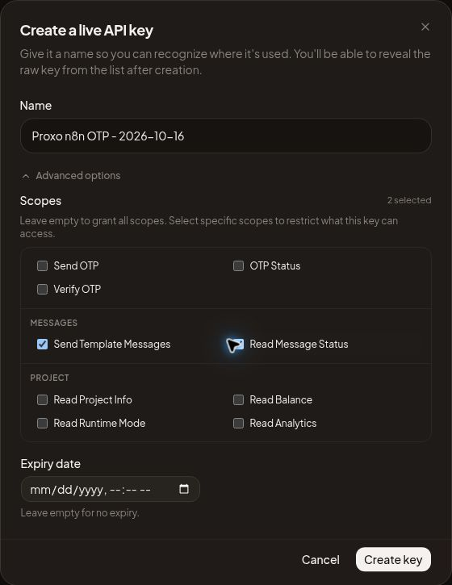

# OTP repair follow-up — 2026-10-16 11:12 UTC

## Current result

The Cloudflare rejection has been diagnosed from actual Security Events and corrected for the two OTP send API paths. One real invalid-input execution of the repair workflow returned the expected HTTP 400. Full provider-development execution, credential rotation, publication of the repaired draft, real delivery and secure app session exchange remain incomplete because the supported browser runtime again cannot safely resume native credential state.

This report supplements [the original deployment report](otp-repair-status-2026-10-16.md). Completed Supabase deployments and rolled-back lifecycle tests were not repeated. PR #7 was read back as Draft, Open and Unmerged at head `435c038175afe78c789b59c1128c2c2125996c77`. No unrelated workflow, ProxoLink deployment or app release was changed.

## n8n observations and saved draft changes

Repair target: `Cm5W1LFKlWFxr6QO`. Previous workflow: `Y2wHC80yXoTnbmPf`.

- n8n reported version 2.23.4.
- The repair workflow has 33 nodes. Its exported graph matched the reviewed source; no duplicate connections were found. All four Supabase HTTP URLs target `cojchkwssmasiejcgvbk.supabase.co`.
- The old workflow was Archived and its export had `active=false`. It has the same four route paths, but was not an active conflict at inspection.
- The repair workflow was already active with unpublished draft changes. The published UI version observed earlier was `47ec9d6d`; it has NOT been established that the published version contains the repaired bindings/privacy settings. No publish action was performed by the assistant.
- Draft execution-data retention was corrected and exported/read back as: error none, success none, manual false, progress false. Pin data was empty.
- Historical executions remain visible. Their presence does not establish current saving or successful delivery. The latest visible historical entry was #255872 at UI time Oct 16 05:16:06, linked to autosave `242104ff-ae45-403e-b329-3c1f476396be`. Provider acceptance cannot be inferred from an n8n “Succeeded” label.

| Nodes | Last verified binding | Evidence / unresolved detail |
|---|---|---|
| Reserve OTP; Record delivery; Verify code; Read new account | Custom Auth account | Bound. UI showed apikey and Authorization fields with redacted values. Actual key validity and rotation are not verified. |
| Send OTP template | Devlopmemt | The user created the provider-development credential; X-API-Key header was observed earlier. This selected binding was reconfirmed on 2026-10-16 at approximately 11:03 UTC. |
| Read delivery; Send account template | Header Auth account 2 | Corrected from an unrelated apikey credential. X-API-Key header verified. Production key rotation remains unverified. |
| Status webhook; Verify webhook; Account webhook | Header Auth account 3 | All three were rebound to separate internal auth and export read back. Header name X-Proxo-Internal-Token; user reported a new unique secret. No value recorded. |

The current draft mixes provider development and production bindings. Do not publish that draft as production. Internal missing-auth rejection and registered production path ownership still require runtime verification after publication.

## Cloudflare evidence and changes

Zone: `proxopages.com`, zone ID `ef62f30fbcf8983629b922ac3cce314d`.

Cloudflare GraphQL `firewallEventsAdaptive` returned:

| UTC | Host / path | Ray | Action / source / rule |
|---|---|---|---|
| 2026-10-16 01:43:47 | email.proxopages.com /webhook/wevlix/otp/send | a4b35fe90ffeb6f8 | block / bic / bic |
| 2026-10-16 02:49:20 | email.proxopages.com /webhook-test/wevlix/otp/send | a4b3bfef8ef7b6f8 | block / bic / bic |

These records identify Browser Integrity Check as the rejection layer for both requests. Direct Ray-log retrieval returned `auth.forbidden`; Security Events was the successful evidence source.

There were no entrypoint rulesets in the config, custom firewall or rate-limit phases before these scoped additions.

1. Rate-limit ruleset `5bd338ddae8e43d394fbe89206062f0c`, version 1; rule `16b3b273d3e2435b96f7f5734a080fc4`, reference `proxo_otp_send_rate_limit`.
   - Exact host email.proxopages.com and the two exact send paths above.
   - 5 requests per 10 seconds, characteristics IP and Cloudflare colo; block for 10 seconds.
   - Created at 11:00:36 UTC. This is burst protection with Free-plan limitations, not a complete distributed-abuse guarantee.
2. Configuration ruleset `202233b7c7fa4e8b8dd14f0d41093db1`, version 1; rule `6e2758880c874575960178e802c30048`, reference `proxo_otp_api_bic`.
   - BIC disabled only for POST to that exact host and those two exact send paths.
   - Created at 11:00:44 UTC. Global `browser_check` remained on.
   - No other security product was skipped, and no unrelated rule was changed.

Both configurations were read back after writing. Rate-limit threshold enforcement has not been load-tested.

## New execution evidence

| Check | Actual result |
|---|---|
| POST test send path, phone=invalid, purpose=login, at 11:01:30 UTC | HTTP 404 from n8n: test webhook not registered; Ray a4b690e04f9fb612. Confirms this request passed the previous Cloudflare block, not successful workflow execution. |
| Next invalid POST attempt | Automatic approval review rejected it before transmission. Listener was stopped; no indirect workaround used. |
| User's renewed instruction to complete the work | Explicitly accepted the proposed limited test. n8n records and database reservation counts were inspected before execution. |
| Manual test listener started, one invalid POST at 11:06:49 UTC | HTTP 400, body `{"success":false,"error":"bad_request"}`; editor returned to completed state with item flow through validation/response. This was a real n8n execution, not a mock. |
| Database read after invalid test | Zero reservations created since 11:06:00 UTC. No proof or secret was read. |

The earlier eight checks against the exported Code/IF expressions were offline mock checks; they do not prove live credential validity. Existing source/database lifecycle evidence remains described in the original report.

The recipient's latest existing login reservation before this test was at 02:11:20 UTC with status pending and an expired five-minute lifetime; older pending reservations also existed. No new valid recipient request was made in this follow-up.

An earlier Wevlix UI inspection showed a prior delivered message to the authorized recipient (provider ID `9d9d9085-1cff-4cc2-b8b6-1fe7b6f1031c`). It is not evidence of delivery by the repaired draft or of a new send in this follow-up. No new WhatsApp delivery or app session exchange has been verified.

## Exact remaining blocker and rotation coordination

The browser initially supported secure n8n sign-in and the invalid execution. A subsequent provider tab/download operation encountered credential-protection errors. The runtime then returned:

`Browser observation is unavailable because native credential state cannot be safely resumed. Start a new browser runtime to continue.`

One supported REPL reset and fresh-tab attempt returned the same error. No cookies, browser credentials or restricted retained data were extracted. A plugin-directory search for n8n/Wevlix returned no matching available connector; this is not a claim that no such integration exists elsewhere.

Minimum continuation requirement: restore a genuinely fresh supported browser session that can inspect n8n and Wevlix, or provide a supported authenticated n8n/provider management connection. Repeating OTP requests does not fix this browser blocker.

Credential changes through the browser require the user to enter and submit new secrets privately. Coordinate before revocation:
- Wevlix: identify all consumers of the exposed production key, create/rotate the replacement in the provider credential manager, update the three n8n provider nodes via secure credentials, run development checks and a scoped live check, then revoke the old key. Do not publish the current mixed development/production draft.
- Supabase: inspect current API-key/signing-key configuration and inventory backend consumers, n8n credentials, Edge environment use and client compatibility. Current Supabase documentation states legacy anon/service/JWT rotation is no longer available in the old form; use the supported migration/revocation procedure for the actual project state. Signing-key rotation alone does not establish revocation of an exposed legacy API key. Do not revoke shared legacy access before all affected consumers are safely updated and verified.
- Internal: preserve the separate unpredictable internal header; share it only through trusted server secret stores. It must never be placed in a public app.

Continue with provider-development valid input, cooldown/duplicates, purpose isolation and delivery recording; test internal missing-auth rejection; restore verified production bindings; publish the repaired target and verify path ownership/version; send only to the already authorized recipient with purpose=login; distinguish acceptance from actual delivery and complete session exchange through secure OTP entry. No anonymous OTP RPC grants or RLS protections should be weakened.

References for credential coordination: [Supabase API keys](https://supabase.com/docs/guides/api/api-keys), [JWT signing keys](https://supabase.com/docs/guides/auth/signing-keys), [legacy rotation guidance](https://supabase.com/docs/guides/troubleshooting/rotating-anon-service-and-jwt-secrets-1Jq6yd).

## Continuation — 2026-10-16 11:34 UTC

Status remains **incomplete**. This continuation restored useful browser access and prepared a concrete credential-rotation handoff. It did not publish the draft, rotate/revoke credentials, send a message, change Cloudflare/Supabase configuration, or release the application.

### Current observations

- The n8n repair editor opened in an authenticated session. `Send OTP template` still selected `Devlopmemt`. The four execution-saving settings were all read as **Do not save**. No pinned execution or credential value was needed for these checks.
- Version History still labelled `47ec9d6d` **Published**; the latest draft was labelled **Current changes**, UI time Oct 16 05:46:31. Opening the historical version and later another credential-bound node triggered browser credential-protection restrictions. Explicit navigation to the canonical editor recovered ordinary observation, but detailed historical-version inspection remained unavailable. This is not proof that the published graph has the draft's corrected bindings or retention settings.
- The old workflow `Y2wHC80yXoTnbmPf` was read as **Archived** again. Complete production route ownership remains unverified.
- Both Cloudflare entrypoint rulesets were read back unchanged at version 1, enabled, with the exact send-path/method scope and rate limit documented above.
- Supabase listed `whatsapp-session-exchange` version 3 and `phone-otp-session` version 1 as **ACTIVE**, both with `verify_jwt=false`. No redeployment or repeat of the previously passed transactional lifecycle tests was performed.
- Wevlix sign-in was verified by the authenticated **ProxoApp** overview. The live default production key remained **Active**, with 20 scopes and a creation age of about one month; no replacement or revocation was observed. Existing historical delivery is still not proof of delivery by this repair.

### Actual requests and non-execution evidence

| Check | Observed result |
|---|---|
| Unauthenticated GET `/webhook/wevlix/otp/status` from the command-line HTTP client | HTTP 403, `error code: 1010`. It did not establish an n8n missing-auth rejection. No User-Agent workaround, security-rule change or alternate-path retry was used. |
| Read recipient's recent reservation metadata before attempting development execution | Latest reservation remained the expired 02:11:20 UTC login reservation. No proof was selected. |
| Start manual draft listener and attempt one valid login POST to the test send path | **Automatic approval review rejected the command before transmission.** Its stated reason was that trusted current user text did not explicitly authorize the real recipient/consequential test, which could reserve data, send WhatsApp and incur cost. No indirect retry was made. |
| Stop manual test listener | `Stop waiting for webhook call` was clicked; the editor returned to enabled **Execute workflow**. |
| Read reservation count after rejection | Zero reservations created since 11:13:00 UTC, the start of this continuation. |

The valid development test, cooldown/duplicate runtime checks, internal-route missing-auth checks, production send and secure session exchange remain pending. The prior invalid-input HTTP 400 remains the latest successful real draft execution documented here. No additional delivery or OTP verification is claimed.

### Prepared rotation handoff

In Wevlix's **Create a live API key** dialog, the following non-secret form configuration is prepared but **not submitted**:

- Name: `Proxo n8n OTP - 2026-10-16`.
- Exactly two selected scopes: **Send Template Messages** and **Read Message Status**, matching the three provider HTTP nodes in the reviewed source.
- No expiry entered.

Browser credential-safety rules require the user to perform credential creation/entry/submission privately. After the replacement is created, it must be stored in n8n's provider credential manager and bound consistently to the three production provider nodes. Keep the old key until its actual consumers have been updated and a scoped check passes; then revoke it. Do not paste the key in chat or commit it. The prepared dialog is not evidence that a key exists.

Repository inspection also confirmed that Supabase credential coordination extends beyond n8n: `api/admin.js`, `api/_lib/security.js`, `api/_lib/proxolink.js`, and the OTP, deletion, thumbnail and notification Edge sources reference server-key environment variables. This is a **source consumer inventory**, not a complete inventory of deployed secrets or all external clients. Current Supabase documentation confirms that creating new keys alone does not disable legacy keys; project API-key/signing-key state and deployed consumers still need coordinated inspection before revocation.

Continuation requires explicit authorization for the single real-recipient login test (recipient already supplied privately, ending 4008), with development simulation first and at most one real delivery after production credentials are ready. Successful acceptance must be distinguished from delivery and a completed app session. PR #7 was read as Draft/Open/Unmerged at `c913eb52fa8968c0dec645b7f75101f13332bec2`; this follow-up changes documentation only.
