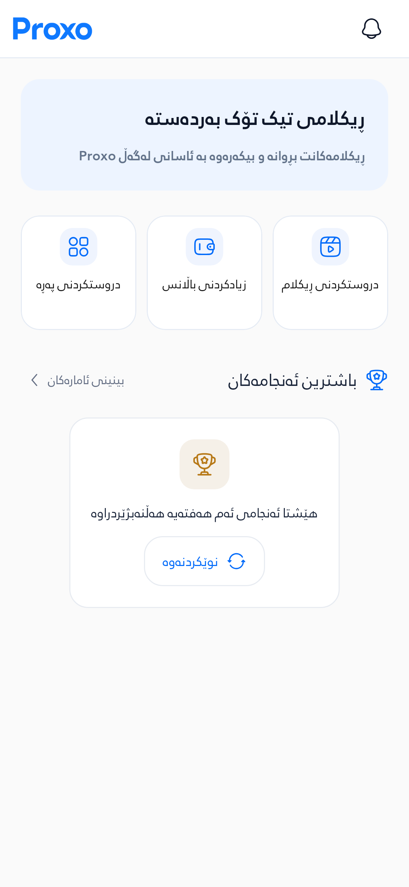
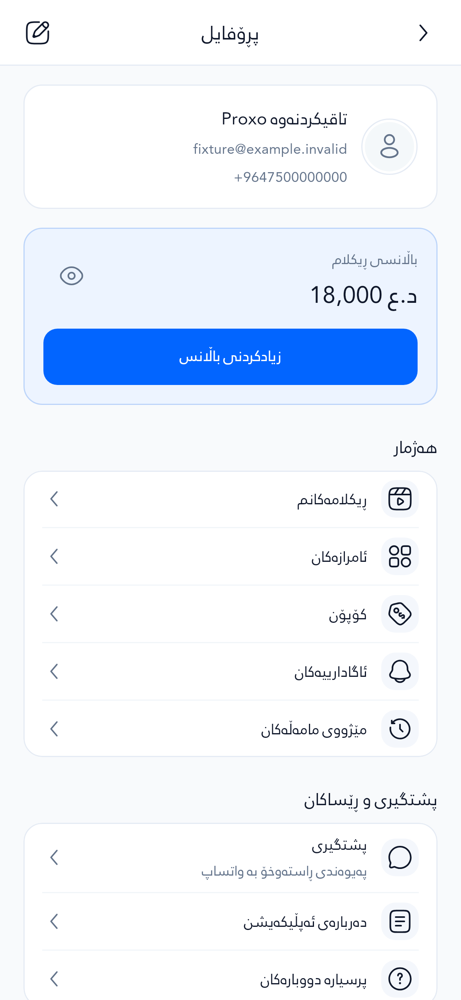
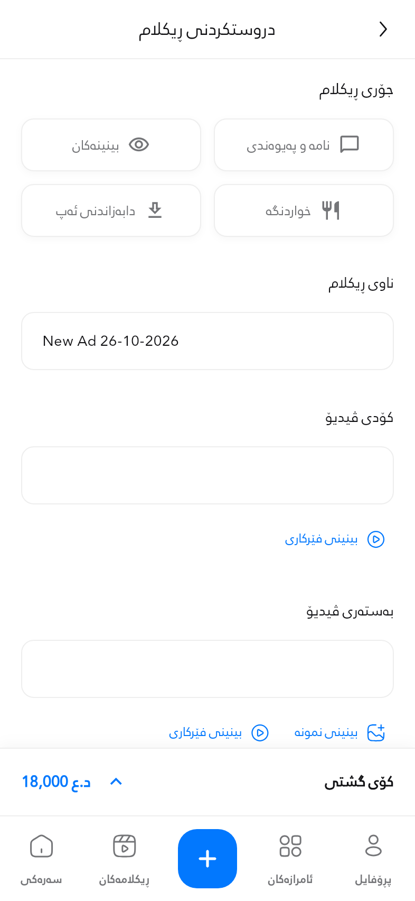
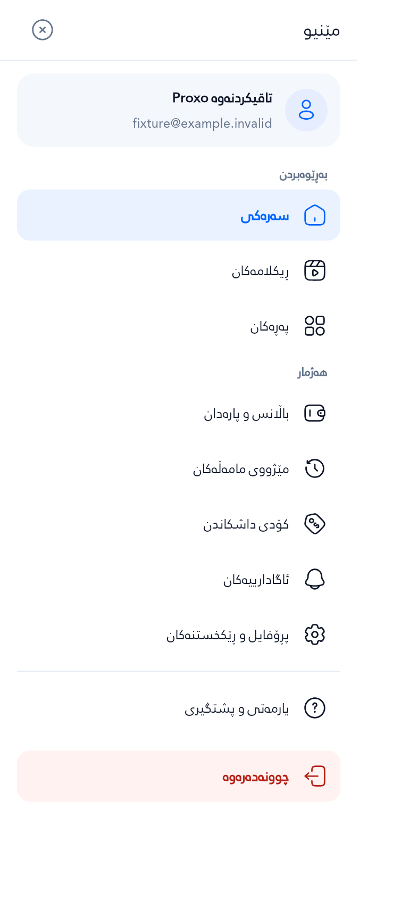
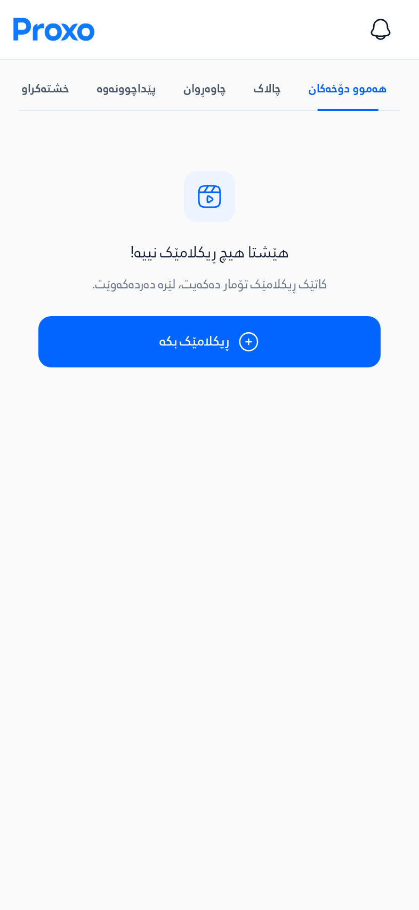

# Previous Proxo design restored

The visual baseline is `3e96d569`, immediately before the app-wide redesign in `092c56e`. PR #46 retains the new page, advertising, phone/OTP and update functionality.

## Complete visual audit

Nineteen of the 22 restored UI files match the baseline byte-for-byte: account setup, Home, Profile, Create Page, app theme, navigation/content/Create Ad tokens, form fields, auth widgets, best-results surfaces, quick actions, app bars, banner, empty states, sidebar and price bar. The remaining three retain only phone validation and accessible text/metric handling. See [the exact file list](audit.json).

Auth, notices and notification stacks also retain their previous presentation. Their remaining differences implement phone signup, manual dismissal and lifecycle fixes. Existing localization strings and bundled fonts are unchanged.

The last active redesign remnant was the optional/required update prompt. It now uses the previous ProxoSurface, ProxoChrome and AppColors styles with a 24dp SVG icon, regular typography, 16dp corners and 48dp buttons. Its policy verification, deferral, retry and mandatory-update protection remain intact. Unused PNG/hero helper definitions have no live UI consumers.

## Restored screens

These captures were generated from actual Flutter widgets on `196e207`, with isolated fictional data. The five pictured screens are unchanged by the update-prompt styling follow-up. They are not physical-device evidence. The source archive hash and individual PNG hashes are recorded in [audit.json](audit.json).

| Home | Profile |
| --- | --- |
|  |  |

| Create Ad | Menu |
| --- | --- |
|  |  |

## Validation and release status

At `196e207`, Verify ProxoLink, UI remediation, typed pages, Exchange Balance and page examples passed. The Android runtime job built and installed the APK but could not connect to the VM service; it timed out before UI assertions and produced no screenshots. This is not a passing native acceptance result. Final checks must be evaluated on the follow-up commit, including the update-prompt style assertions added to its existing behavior test.

The PR remains draft and unmerged. Production domains, routing, `autoAssignCustomDomains`, release flags, live providers, payments and migrations were not changed by this restoration. Earlier `0fd9857` screenshots/APK show the rejected redesign and must not be used to review the restored UI.
