# Original before/after captures

Immediate baseline `211abe49` versus application `8c0f3645`. These are original PNGs from actual production widgets, with bundled fonts and fictional read-only data. No images have been retouched.

## Auth, standard text

| Before | After |
|---|---|
|  |  |

## Auth, narrow screen / large text

| Before | After |
|---|---|
|  | 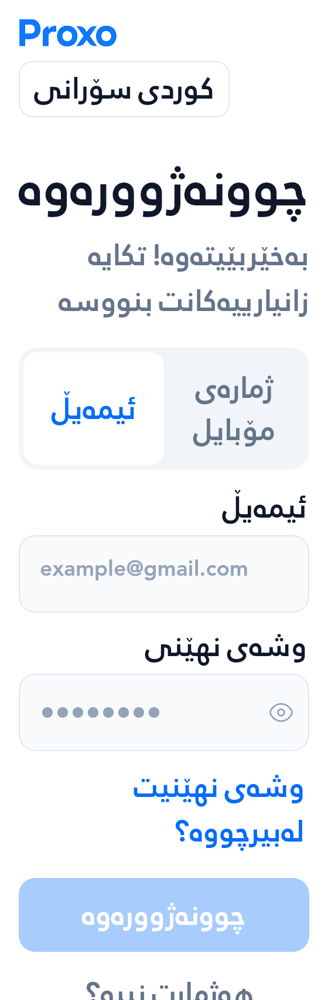 |

## Payment methods

| Before | After |
|---|---|
| 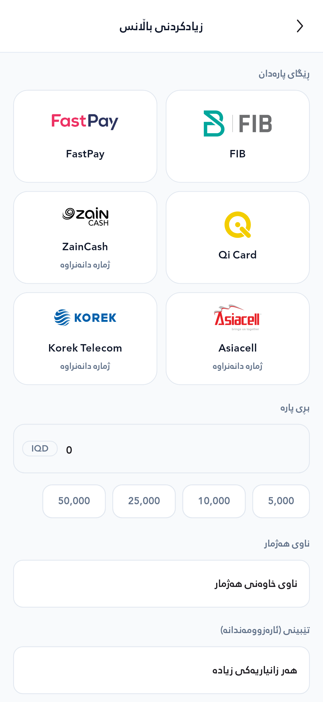 | 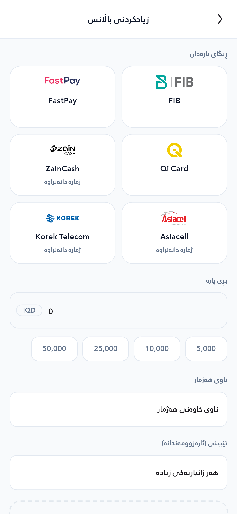 |

## Payment methods, narrow / large text

| Before | After |
|---|---|
|  | 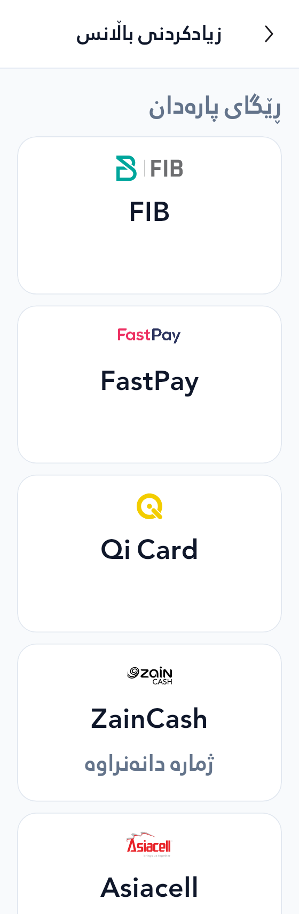 |

## Profile/logout

| Before | After |
|---|---|
| 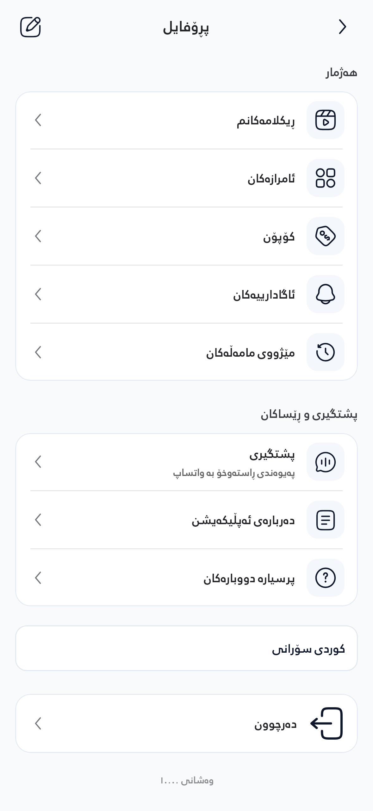 | 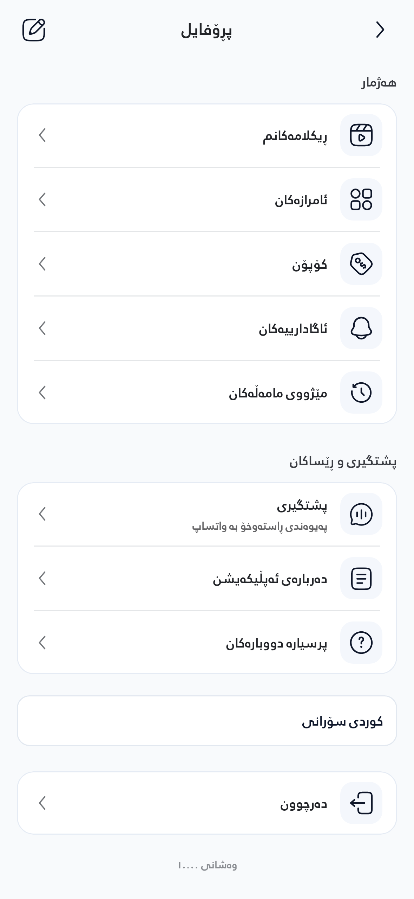 |

## Profile/logout, narrow / large text

| Before | After |
|---|---|
| 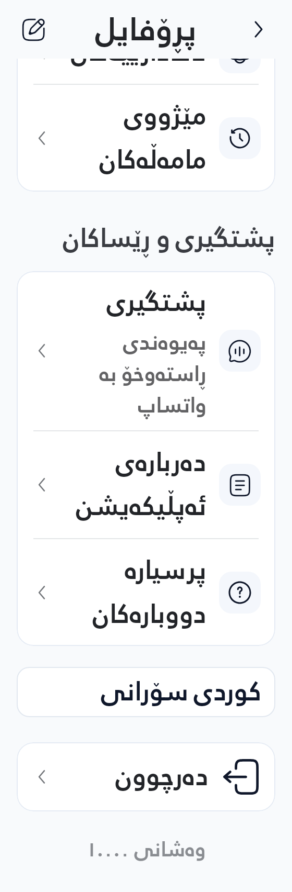 | 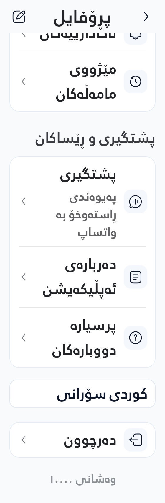 |

## Navigation

| Before | After |
|---|---|
|  |  |

## Home

| Before | After |
|---|---|
|  |  |

## Actual network-error recovery

The test first loads a failed network response, then refreshes successfully to an empty list. Both sizes retain readable controls and an attached refresh controller. Text scale is the requested system scale; Campaigns retains its existing 1× content cap.

| Width/text scale | Error | Recovered empty list |
|---|---|---|
| 393dp / 1× | 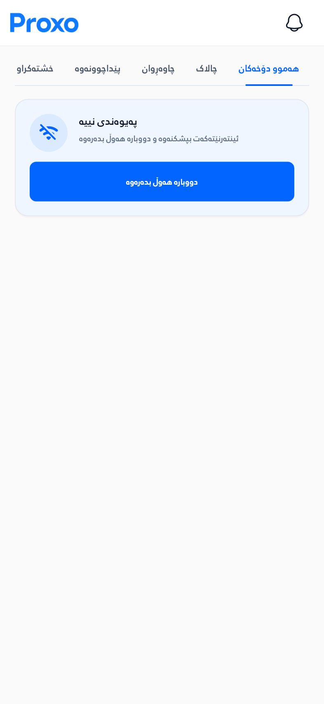 | 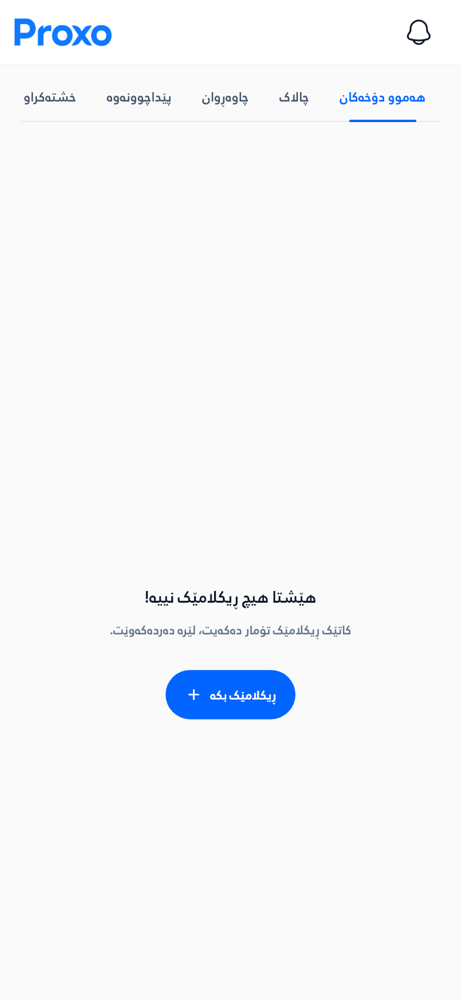 |
| 280dp / 2× | 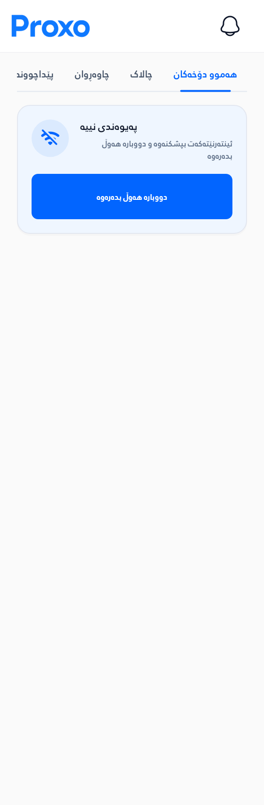 | 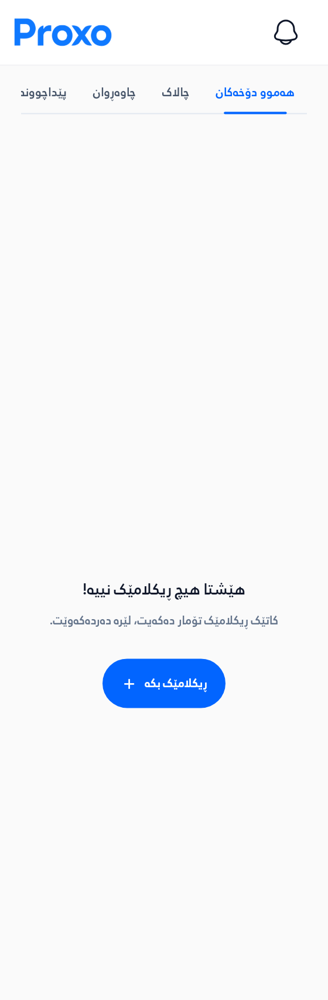 |

## Android API35 phone

Native frames use harness `8905c7f`, whose application source is identical to `8c0f3645`. All three configurations completed the real Android tap, keyboard and Back checks.

Original emulator debug frames at 393dp × 640dp, DPR3. The debug banner belongs to the verification build. Actual decoded Auth images measured 84 × 24dp and the provider bitmap measured 64 × 24dp at both requested text scales. Keyboard dismissal with real ADB Back preserved the form.

| Phone entry | Payment methods | Profile/logout |
|---|---|---|
| 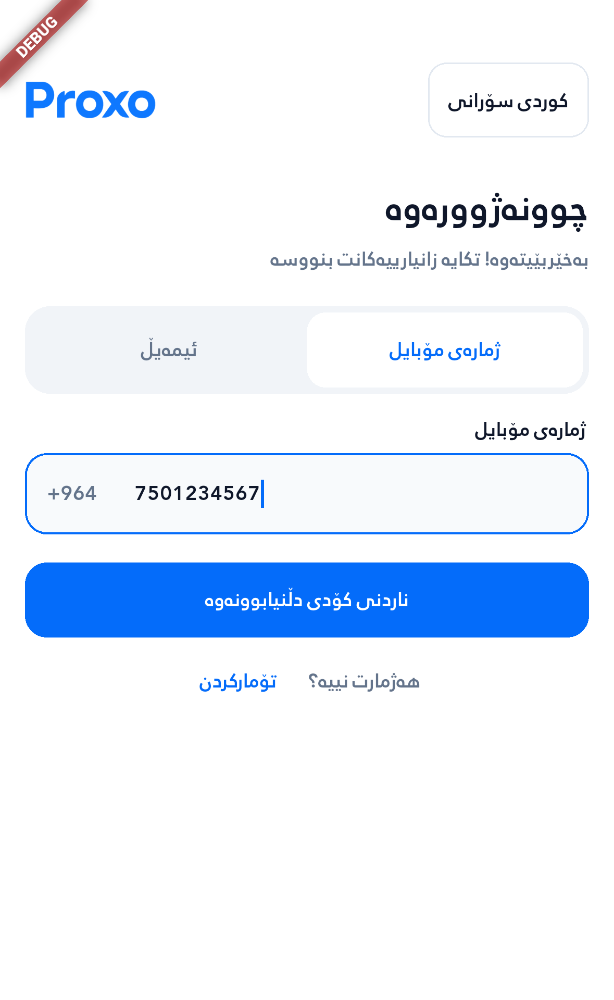 | 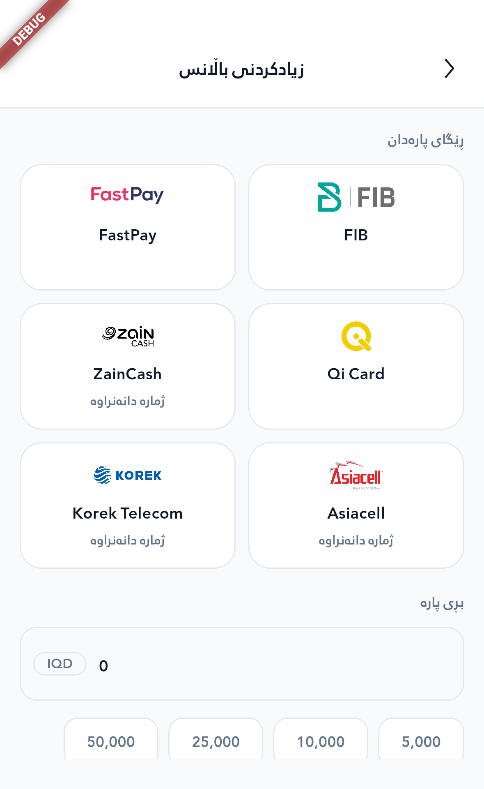 | 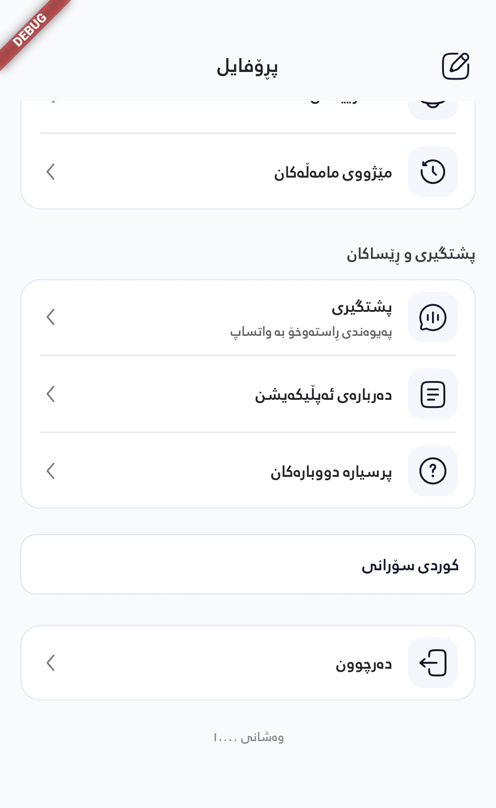 |

[Raw phone observations](native/phone.json) · [Device/input metadata](native/phone-device.json)

## Android narrow screen, 2× text

Actual 280dp × 640dp viewport, DPR3. The Profile frame is a scrolled section of the longer menu, not its end. Content remains scrollable; the standard-text phone frame above shows logout.

| Auth | Payment methods | Profile menu |
|---|---|---|
| 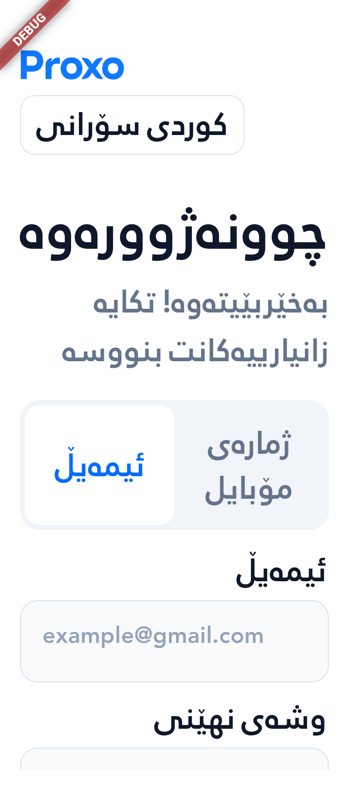 | 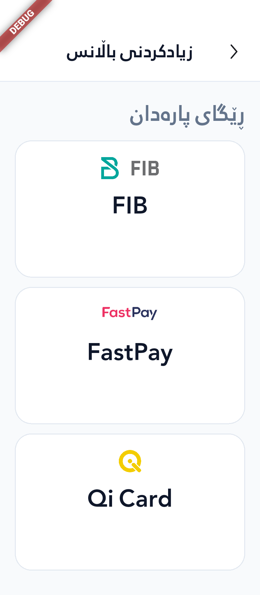 | 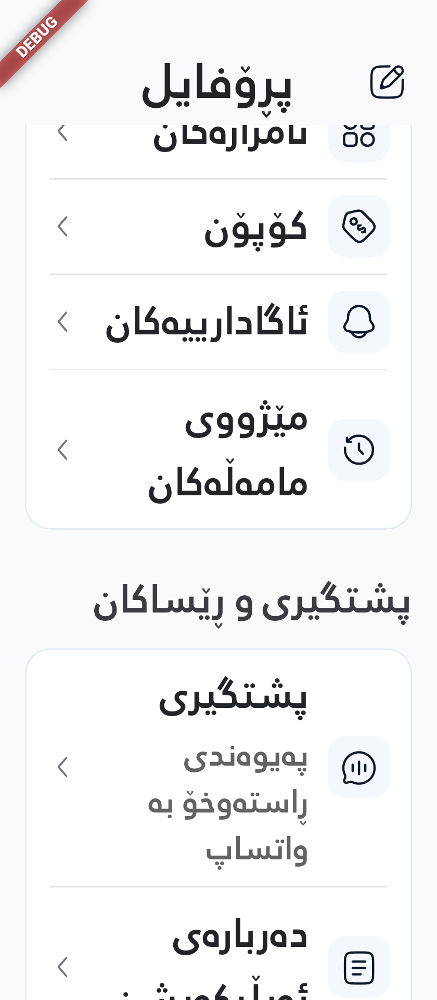 |

[Raw narrow observations](native/narrow.json) · [Device/input metadata](native/narrow-device.json)

## Android tablet

Actual 768dp × 852dp viewport, DPR2, with the same 64 × 24dp provider logo envelope and aligned status slots.

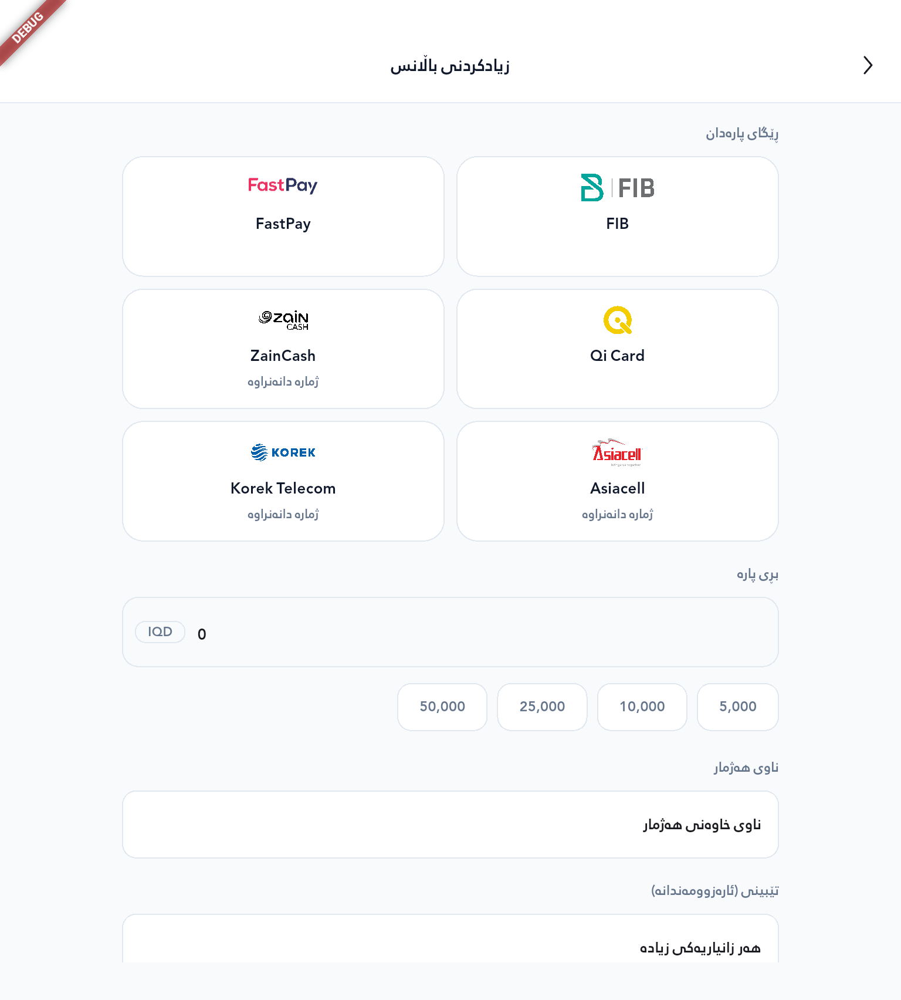

[Raw tablet observations](native/tablet.json) · [Device/input metadata](native/tablet-device.json)
