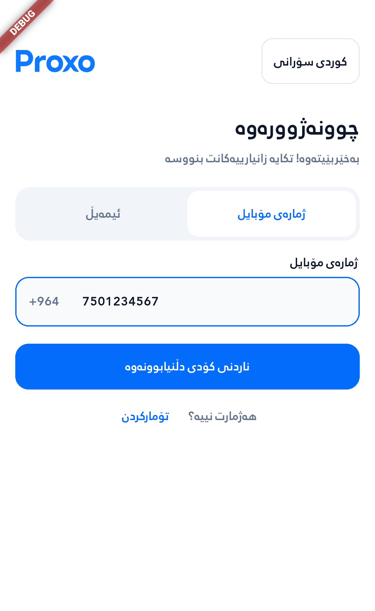
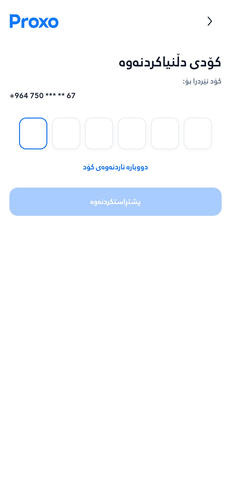
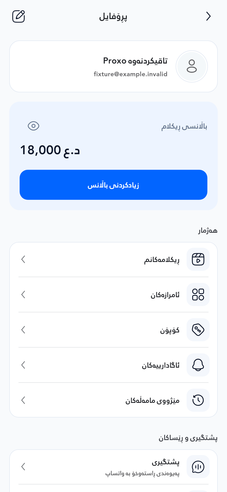
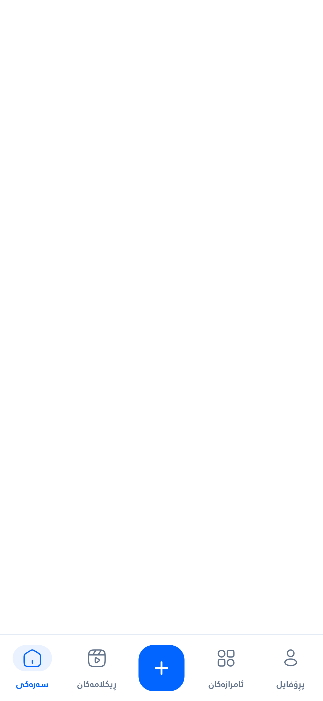

# وێنەکانی ئەبدەیتی نوێی Proxo

ئەم ١١ سکرینشۆتە لە ئەبدەیتی نوێ وەرگیراون، بە داتای تاقیکردنەوە. بۆ بینینی قەبارەی تەواو، کلیک لە وێنەکە بکە.

وێنەی ژمارەی مۆبایل لە ئەمیولەیتەری ئەندرۆید وەرگیراوە؛ نیشانەی DEBUG هی وەشانی تاقیکردنەوەیە. باری گەڕان و نامەکانی هەڵە بە جیا پیشان دراون.

## هۆم — بانەر و سێ کردار

## Auth — چوونەژوورەوە

## Auth — خانەی ژمارەی مۆبایل

## Auth — دروستکردنی هەژمار

## Auth — گۆڕینی وشەی نهێنی

## Auth — کۆدی دڵنیابوونەوە

## زیادکردنی باڵانس — بانک و جزدانەکان

## پڕۆفایل — بەشی سەرەوە

## پڕۆفایل — بەشی خوارەوە و دەرچوون

## باری گەڕان و دوگمەی + — بە جیا

## نامەکانی هەڵە — کارتەکانی سەر یەک بە شێوازی 3D

## Capture provenance

Original PNGs, copied byte-for-byte without resizing, cropping, retouching or recompression. This gallery was published on 2026-10-16 (Asia/Baghdad). Captures are from the final verification completed on 2026-10-15 UTC.

- Application: `82b4fe3c8311e5ee5343965df7e41753c4b01e9a`.
- Harness: `6248e6a24569cfd8ba259e8bc8ec66e20619b39a` (identical production code/assets/dependencies).
- [Widget capture run](https://github.com/Zana-Sponsor/proxobalance/actions/runs/38805771272).
- [Android capture run](https://github.com/Zana-Sponsor/proxobalance/actions/runs/38805771265), final successful phone attempt.
- [File hashes](screenshots.json) · [Final verification](../ui-balance-2026-10-15/completion-verification.json) · [Requirement audit](../ui-balance-2026-10-15/completion-audit.md).

Evidence publication only. PR #7 remains Draft/Open/Unmerged; no production deployment or migration.
