# وێنەکانی Auth و ڕەزامەندیی مارکێتینگی واتسئاپ

ڕەزامەندی ئارەزوومەندانەیە و لە کاتی تۆمارکردن پێشوەختە چالاک نییە. تۆمارکردنی هەژمار پێویستی بە ڕەزامەندیی مارکێتینگ نییە. لە پڕۆفایل دەتوانرێت هەڵوەشێنرێتەوە.

**[فایلی webhook بۆ n8n](../../integrations/wevlix/proxo-wevlix.json)** · **[وردەکارییەکان و خاڵەکانی Meta](../../integrations/wevlix/README.md)** · **[بەڵگەی تاقیکردنەوە](verification.json)**

ئەم وێنانە لە ویجێتە ڕاستەقینەکانی ئەپ و داتای تاقیکردنەوە وەرگیراون؛ موکاپ نین. کۆد لە Draft PR #7 دانراوە؛ چالاککردنی n8n و گۆڕانکاریی داتابەیسی production ئەنجام نەدراون.

پشکنینەکانی webhook، داتابەیس، ڕەزامەندی، Auth و دروستکردنی APK سەرکەوتوون. لە ئەندرۆید، قەبارەکانی مۆبایل و شاشەی تەسک سەرکەوتوون؛ پشکنینی تابلێت دوای یەک دووبارەکردنەوە بەهۆی دابڕانی emulator/driver تەواو نەبووە و بە سەرکەوتوو دانەنراوە. [ئەنجام و بەڵگەی هەموو هەوڵەکان](verification.json).

## ئەبدەیتی نوێ

| چوونەژوورەوە | تۆمارکردن و ڕەزامەندی | OTP |
|---|---|---|
| 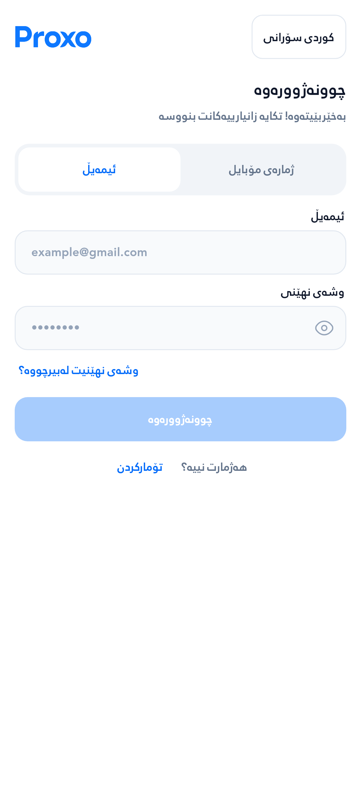 | 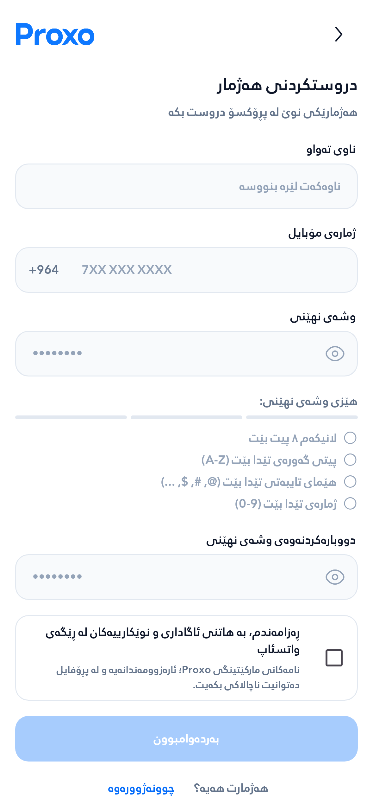 | 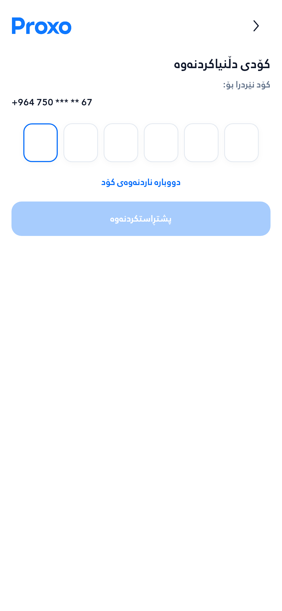 |

| پڕۆفایل | گۆڕینی ڕەزامەندی | گەڕاندنەوەی وشەی نهێنی |
|---|---|---|
| 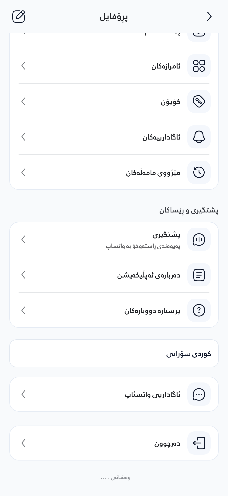 | 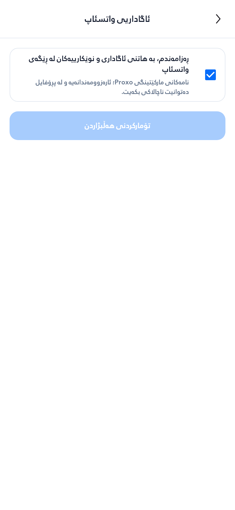 | 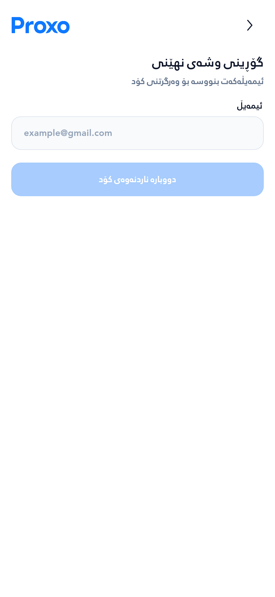 |

Checkbox لە وێنەی پڕۆفایلدا چالاکە چونکە داتای تاقیکردنەوە ڕەزامەندیی پێشووی هەیە؛ لە signup بەتاڵە. دووگمەی تۆمارکردن کاتێک چالاک دەبێت کە هەڵبژاردن بگۆڕدرێت.

## عەرەبی، بادینی و دەقی گەورە

| تۆمارکردن — عەرەبی | تۆمارکردن — بادینی | ڕەزامەندی — بادینی |
|---|---|---|
| 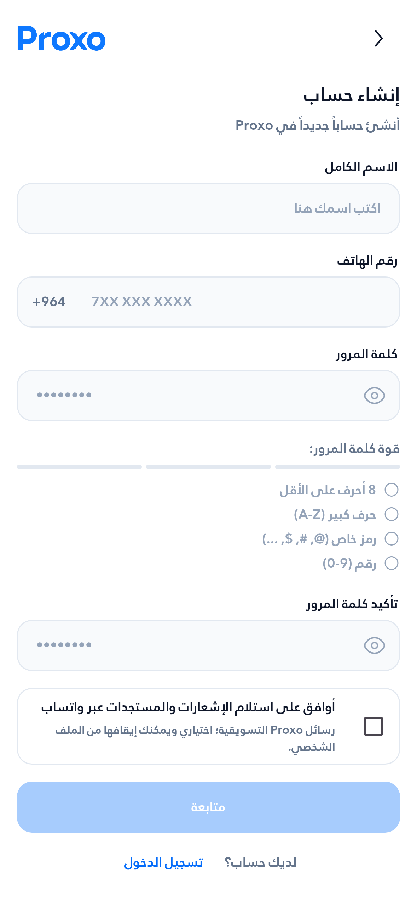 | 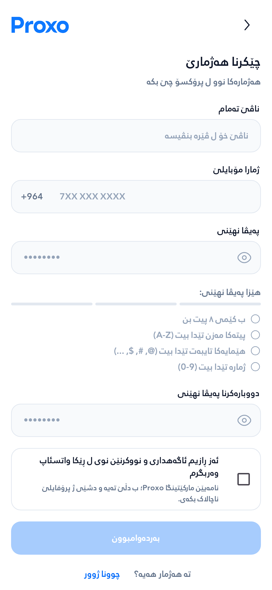 | 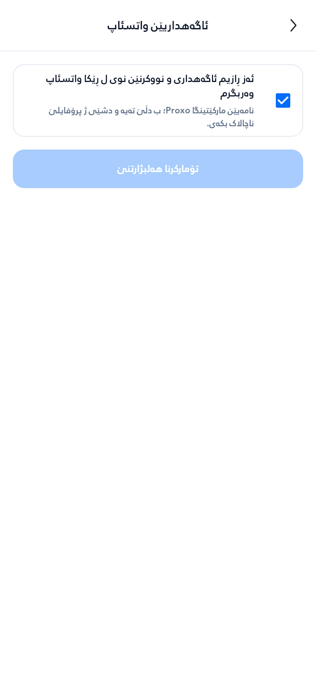 |

| تۆمارکردن، شاشەی 280dp و دەقی 2× — خوارەوەی فۆڕم | ڕەزامەندی، شاشەی 280dp و دەقی 2× |
|---|---|
| 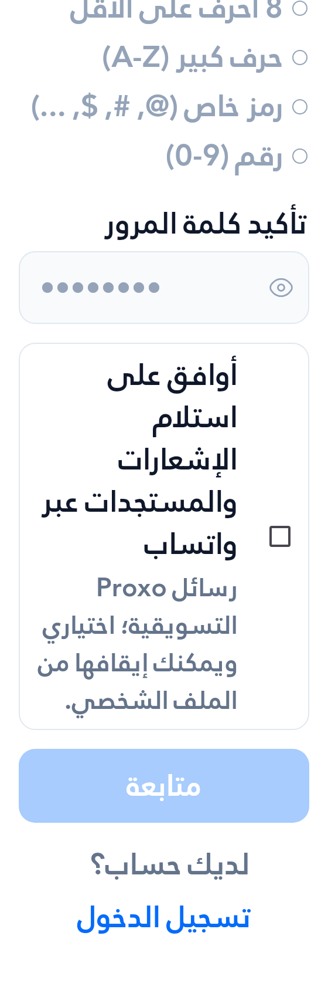 | 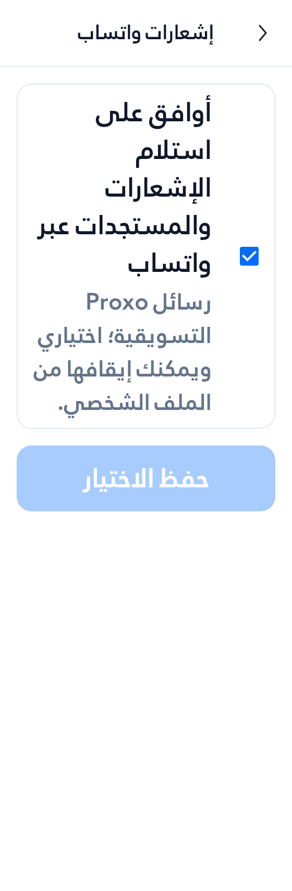 |

## پێش و پاش

| پێش — چوونەژوورەوە | پاش — چوونەژوورەوە |
|---|---|
| 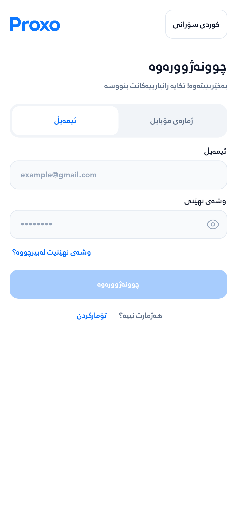 |  |

| پێش — تۆمارکردن | پاش — تۆمارکردن |
|---|---|
| 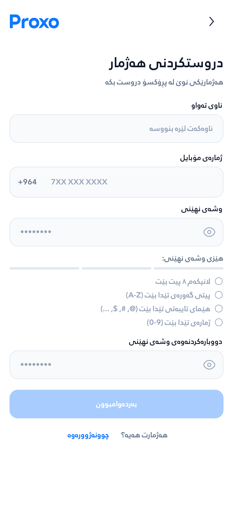 |  |

Measured at 393dp with bundled fonts and 1× text: the Auth title changes from 26dp to 20dp; its measured height changes from 34dp to 26dp. All four signup fields now measure 48dp tall; the phone field previously measured 52dp. Shared field gaps are 16dp and headings use a 20dp gap below the header. No accessibility scaling is disabled. Preference pages reuse the app's existing secondary-screen header.

The original PNG bytes are preserved. [screenshots.json](screenshots.json) records each source artifact, file and SHA-256. UI capture source `06285b0d01b7bdbc5179fcdc747e8cc46ac3db7c` has the same Flutter library, tests, assets and dependencies as final implementation `ee40915351df94bac965e80e2f13e2d6651d64c4`; the latter only tightens the database resend window and adds its SQL regression. Baseline is `196ded3397e460ccec8a73b3b98443166c268bce`.

[وێنەکانی هۆم، زیادکردنی باڵانس و بەشەکانی تری ئەبدەیتی پێشوو](../ui-update-2026-10-16/README.md)
